**DRAFT**: This article is a scaffold. As of November 28, 2026, its sections are outlined and its examples run; the
prose between them is to be written. The distributed sections start from a graph partitioned by rows and will grow
toward full shuffles. The matrix notation follows the path algebra of [[8]](#references) and the distribution notation
follows [[1]](./stream-ring-theory.md) and [[2]](./ring-theoretic-distributed-computing.md), so a reader can move between
them.

# Introduction

[To be written: property graphs (TinkerPop's modern graph [[5]](#references)), traversals on one machine and across
many, and the correspondence between a graph and its adjacency matrix that the rest of the article makes exact.]

A graph $G = (V, E)$, $E \subseteq (V \times V)$, with $n = |V|$, is its adjacency matrix
$\mathbf{A} \in \{0,1\}^{n \times n}$, where $\mathbf{A}_{i,j} = 1$ when $(i,j) \in E$ [[8]](#references). By the rules of
matrix multiplication,

$$
\mathbf{A}^{(t)}_{i,j} = \sum_{l \in V} \mathbf{A}^{(t-1)}_{i,l} \cdot \mathbf{A}_{l,j} \qquad t \geq 2,
$$

is the number of walks of length $t$ from $i$ to $j$: a traversal is a product, and a step of a traversal is a
multiplication by $\mathbf{A}$. Two algebras stand behind that sentence. One keeps the walks themselves, the other keeps
only how many there are. metatron has both, as types.

<!-- figure source: images/graph-traversal-rings/fig-01.tex (the PDF surface typesets it; the svg is its render) -->


Figure 1 draws one traversal both ways. On the left, a traverser walks the modern graph,
`g:V/1.out(knows).out(created)`: from marko along a `knows` edge to josh, and on along josh's `created` edges to ripple
and lop. The rec algebra keeps those walks, josh included. On the right, the label slices multiply, `*knows * *created`,
and the product sums over the join vertex, $\mathbf{Z}_{i,j} = \sum_{l} \mathcal{A}^{\texttt{knows}}_{i,l}\,
\mathcal{A}^{\texttt{created}}_{l,j}$, so it keeps how many walks join each pair and forgets which. $\varphi$, defined
below, maps the one onto the other.

## Rings and distributivity

A ring $\langle R, +, \cdot, 0, 1 \rangle$ is an abelian group under $+$ and a monoid under $\cdot$, tied by the two
distributive laws

$$
a\,(b + c) = a\,b + a\,c \qquad\qquad (a + b)\,c = a\,c + b\,c.
$$

Read right to left, the laws factor: a sum of terms that share a factor becomes one term. Read left to right, they
distribute: one term becomes a sum whose summands share nothing, and summands that share nothing can be computed
anywhere [[1]](./stream-ring-theory.md), [[2]](./ring-theoretic-distributed-computing.md).

A graph split by its rows is a sum. Let each place $p$ own the vertices $V_{p}$, $V = \bigcup_{p} V_{p}$, and write
$\mathbf{R}_{V_{p}} = \sum_{i \in V_{p}} \mathbf{R}_{i}$ for the row filter of their rows [[8]](#references). The row
filters sum to $\mathbf{1}$, and the Hadamard product $\circ$ distributes over $+$, so

$$
\mathbf{A} = \mathbf{A} \circ \mathbf{1} = \sum_{p} \mathbf{R}_{V_{p}} \circ \mathbf{A}
\qquad\text{and}\qquad
\mathbf{A}\,\mathbf{A} = \sum_{p} (\mathbf{R}_{V_{p}} \circ \mathbf{A})\,\mathbf{A}
$$

by right distributivity: one product becomes one per place. This is the shard identity of
[[2]](./ring-theoretic-distributed-computing.md), with the seed's parts named by rows.

The same partition splits the unity. The unity of relations is the diagonal $\Delta_{V} = \sum_{i \in V} (i \Rightarrow
i)$, the $\mathbf{I}$ of [[8]](#references), and a row filter is left multiplication by the part of the diagonal a place
owns, $\mathbf{R}_{V_{p}} \circ \mathbf{A} = \Delta_{V_{p}}\,\mathbf{A}$. So
$\mathbf{A} = \Delta_{V}\,\mathbf{A} = \sum_{p} \Delta_{V_{p}}\,\mathbf{A}$: one diagonal per place
[[9]](./parametric-identities-in-ring-theory.md).

[To be written: semirings (walk counting lives in $\mathbb{N}$, which has no additive inverses) against metatron's
rings (the uri and rec rings declare `neg`), and why traversal only needs the semiring.]

# Fundamental Types and their Algebras

Every type declares its algebra in its declarations, read at `?decq`: which instruction is its sum, which is its product,
and what its zero and one are.

**Zero is not noobj.** In Stream Ring Theory [[1]](./stream-ring-theory.md) the zero is a function, $0(x) = \emptyset$,
and in mtron it is `noobj`: it outputs nothing, so a chain that meets it stops before its next instruction runs. A type's
ring cannot name its zero as noobj itself, or $0 + a$ would never be computed. Each type names its zero by a value that
stands for nothing: uri's sentinel `<noobj>`, lst's `[noobj]` (the lst of a hole), and rec's empty `[=>]`. rel's
`noobj=>noobj` is still read as noobj, which is what its ring's declaration waits on.

**A ring has one inverse under each operation.** Under $+$ the inverse is the $-1$ point, the coefficient that cancels.
Under $\cdot$ a type may have a *converse*, the span $-1$: a path reversed, a walk reversed, an arrow flipped. The
converse is the transpose $\mathbf{A}^{\top}$ of [[8]](#references), an involution that reverses products,
$(r\,s)^{\smile} = s^{\smile}\,r^{\smile}$ [[3]](./span-and-point-coefficient-algebra.md).

| type     | zero           | one            | the inverse under $+$         | the converse                              |
|----------|----------------|----------------|-------------------------------|-------------------------------------------|
| `uri::T` | `<noobj>`      | `<>`           | `/a/b.neg()`, `</a/b{-1}>`    | `</a/b>{-1}`, `b/a/`                      |
| `rec::T` | `[=>]`         | `[id()=>id()]` | `[a=>b].neg()`, `[a=>{-1}b]`  | `[a=>{b,c}].converse()`, `[b=>a,c=>a]`    |
| `rel::T` | `noobj=>noobj` | `id()=>id()`   | `(a=>b).neg()`, `{-1}(a=>b)`  | `(a=>b).converse()`, `b=>a`               |

## uri::T: paths

```mtron
mtron> *uri?decq
==>decs::[obj=>uri::T,
          theory=>[
           ring=>ring_theory::[
            add=>!*/m/inst/plus?rng=/m/uri&dom=/m/uri,
            mul=>!*/m/inst/mult?rng=/m/uri&dom=/m/uri,
            zero=><noobj>,
            one=><>],
           add_group=>group_theory::[
            op=>!*/m/inst/plus?rng=/m/uri&dom=/m/uri,
            id=><noobj>,
            inv=>!*/m/inst/neg?rng=/m/uri&dom=/m/uri],
           add_monoid=>monoid_theory::[
            op=>!*/m/inst/plus?rng=/m/uri&dom=/m/uri,
            id=><noobj>],
           mul_monoid=>monoid_theory::[
            op=>!*/m/inst/mult?rng=/m/uri&dom=/m/uri,
            id=><>]]]
```
The product of two paths is their concatenation. The sum of two paths that share a prefix and a suffix factors into one
linear path that branches only where they differ:

```mtron
mtron> /a/b * /c/d
==>/a/b/c/d
mtron> /a/b/c + /a/d/c
==></a/{b,d}/c>
```
$$
/a/b/c \;+\; /a/d/c \;=\; /a\,(b + d)\,/c
$$

The factored form is both distributive laws read right to left at once: many paths layered into one.

The zero is `<noobj>` and the one is the empty path `<>`, the identity of concatenation. A span is a power, `{0}` is the
one, the inverse under $+$ is the $-1$ point on the path's last segment, and the span $-1$ is the converse, the path
reversed:

```mtron
mtron> </a/b>{2}
==>/a/b/a/b
mtron> </a/b>{0}
==><>
mtron> /a/b * <>
==>/a/b
mtron> /a/b.neg()
==></a/b{-1}>
mtron> </a/b>{-1}
==>b/a/
```
## rec::T: walks

```mtron
mtron> *rec?decq
==>decs::[obj=>rec::T,
          theory=>[
           ring=>ring_theory::[
            add=>!*/m/inst/plus?rng=/m/rec&dom=/m/rec,
            mul=>!*/m/inst/mult?rng=/m/rec&dom=/m/rec,
            zero=>[=>],
            one=>[id()=>id()]],
           add_group=>group_theory::[
            op=>!*/m/inst/plus?rng=/m/rec&dom=/m/rec,
            id=>[=>],
            inv=>!*/m/inst/neg?rng=/m/rec&dom=/m/rec],
           add_monoid=>monoid_theory::[
            op=>!*/m/inst/plus?rng=/m/rec&dom=/m/rec,
            id=>[=>]],
           add_commutative_monoid=>commutative_monoid_theory::[
            op=>!*/m/inst/plus?rng=/m/rec&dom=/m/rec,
            id=>[=>]],
           mul_monoid=>monoid_theory::[
            op=>!*/m/inst/mult?rng=/m/rec&dom=/m/rec,
            id=>[id()=>id()]]]]
mtron> [a=>b] + [b=>c]
==>[a=>b,b=>c]
mtron> [a=>b] * [b=>c]
==>[a=>b=>c]
```
The sum merges entries. The product is the **walk join**: an entry whose value is $b$ extends by the entry keyed $b$, and
the join vertex stays in the walk, $[a \Rightarrow b] \cdot [b \Rightarrow c] = [a \Rightarrow b \Rightarrow c]$. The
zero is the empty rec `[=>]` and the one is `[id()=>id()]`, the walk that goes nowhere, which the span `{0}` also
answers. The inverse under $+$ puts the $-1$ point on every value, and the converse reverses every walk: the span `{-1}`
on a rec literal, and `converse()` on any rec, a read's included.

```mtron
mtron> [a=>b]{0}
==>[id()=>id()]
mtron> [a=>b] + [=>]
==>[a=>b]
mtron> [a=>b].neg()
==>[a=>{-1}b]
mtron> [a=>{b,c}].converse()
==>[b=>a,c=>a]
```
## rel::T: relations

```mtron
mtron> *rel?decq
==>decs::[obj=>rel::T,
          theory=>[mul_monoid=>monoid_theory::[
           op=>!*/m/inst/mult?rng=/m/rel&dom=/m/rel,
           id=>id?A<=A()=>id?A<=A()]]]
mtron> (a=>b) + (b=>c)
==>a=>b
==>b=>c
mtron> (a=>b) * (b=>c)
==>a=>c
```
A rel is an arrow, and a relation is a finite sum of arrows with coefficients, a bag of rels. Under composition,
relations form the ring of finitely supported matrices whose rows and columns are objects
[[9]](./parametric-identities-in-ring-theory.md): the arrow $i \Rightarrow j$ is the matrix unit $\mathbf{E}_{i,j}$, a
rel's coefficient is its entry, and composition, which forgets the join vertex,
$(a \Rightarrow b) \cdot (b \Rightarrow c) = a \Rightarrow c$, distributes over the sum.

The unity is the diagonal $\Delta_{X} = \sum_{x \in X} (x \Rightarrow x)$, which no finite sum holds when $X$ is
infinite. The parametric unity `id()=>id()` is that diagonal as one arrow, with the identity instruction at both ends
[[9]](./parametric-identities-in-ring-theory.md). The zero is `noobj=>noobj`, the empty sum, which prints nothing and
counts as nothing. The $-1$ point cancels an arrow in a sum. The converse flips it, and composes back to the identity at
the arrow's ends, $(a \Rightarrow b) \cdot (a \Rightarrow b)^{\smile} = a \Rightarrow a$:

```mtron
mtron> (a=>b).one()
==>id?A<=A()=>id?A<=A()
mtron> (a=>b).zero().count()
==>0
mtron> (a=>b) * (id()=>id())
==>a=>b
mtron> (a=>b).neg()
==>{-1}(a=>b)
mtron> {(a=>b),{-1}(a=>b),(c=>d)}
==>c=>d
mtron> (a=>b).converse()
==>b=>a
mtron> (a=>b).mult((a=>b).converse())
==>a=>a
```
[To be written: the declaration of the relation ring. Today `*rel?decq` names the multiplicative monoid alone, and the
ring waits on its zero, which mtron reads as noobj, and on a sum that adds a whole relation at once.]

## From walks to matrices

Forgetting a walk's interior, keeping its first and last vertex, maps the walk algebra onto the matrix algebra:

$$
\varphi(i \Rightarrow l_{1} \Rightarrow \cdots \Rightarrow j) = \mathbf{E}_{i,j} \qquad
\varphi(R + S) = \varphi(R) + \varphi(S) \qquad
\varphi(R \cdot S) = \varphi(R)\,\varphi(S)
$$

where $\mathbf{E}_{i,j}$, the entry filter of [[8]](#references), is the matrix unit: $\mathbf{E}_{i,l}\,\mathbf{E}_{l,j}
= \mathbf{E}_{i,j}$ and $\mathbf{E}_{i,l}\,\mathbf{E}_{l',j} = \mathbf{0}$ for $l \neq l'$. A walk extends exactly when
its last vertex is the next entry's key.

| type                  | sum                | product       | zero             | one            | the join vertex    |
|-----------------------|--------------------|---------------|------------------|----------------|--------------------|
| `uri::T`              | branch, `/a/{b,d}` | concatenation | `<noobj>`        | `<>`           | is the path        |
| `rec::T`              | entry merge        | walk join     | `[=>]`           | `[id()=>id()]` | kept               |
| `rel::T`, in a stream | bag                | composition   | `noobj=>noobj`   | `id()=>id()`   | forgotten, counted |

[To be written: $\varphi$ as the homomorphism from rec::T's walks to the rel bags, and a figure of one graph seen three
ways (paths, walks, matrix).]

# Core Traversals

[To be written: a rundown of what the three algebras express on one machine, before any distribution.]

## An edge list is an adjacency list

A rec gathers the entries that share a key, so an edge list written as a rec is its adjacency list. The same edges as a
bag of rels are the matrix, and the barrier `?rel{*}<=rel{*}` writes the whole bag at one address:

```mtron
mtron> [a=>b,a=>c,a=>d,b=>c,b=>d,c=>a,c=>d]@g
==>[a=>{b,c,d},b=>{c,d},c=>{a,d}]@g
mtron> {a=>b,a=>c,a=>d,b=>c,b=>d,c=>a,c=>d}.to?rel{*}<=rel{*}(k)
==>a=>b
==>a=>c
==>a=>d
==>b=>c
==>b=>d
==>c=>a
==>c=>d
```
## Powers are walks of a length

```mtron
mtron> *g * *g
==>[a=>{b=>c,b=>d,c=>a,c=>d},
    b=>{c=>a,c=>d},
    c=>{a=>b,a=>c,a=>d}]
mtron> *g.{1}mult(*g)
==>[a=>{b=>c,b=>d,c=>a,c=>d},
    b=>{c=>a,c=>d},
    c=>{a=>b,a=>c,a=>d}]
mtron> *k * *k
==>a=>c
==>{2}(a=>d)
==>a=>a
==>b=>a
==>b=>d
==>c=>b
==>c=>c
==>c=>d
```
$\mathbf{A}^{(2)}$ three ways: the rec keeps every walk of length two, and the bag keeps only $\mathbf{A}^{(2)}_{i,j}$,
as a coefficient. A span after a read binds to the address, so a stored graph is powered by a span on the product's
instruction: `.{1}mult(*g)` multiplies by $\mathbf{A}$ once more, and $\mathbf{A}^{(t)}$ is `*g.{t-1}mult(*g)`.

## A traversal is a vector

A one-row matrix is a traversal's frontier, the energy vector $\pi$ of [[8]](#references), and a step is
$\pi^{(t)} = \pi^{(t-1)}\,\mathbf{A}$:

```mtron
mtron> [s=>a] * *g
==>[s=>{a=>b,a=>c,a=>d}]
mtron> (s=>a) * *k
==>s=>b
==>s=>c
==>s=>d
mtron> {{2}(s=>a),{3}(s=>b)} * *k
==>{2}(s=>b)
==>{5}(s=>c)
==>{5}(s=>d)
```
The coefficients are weights: $\pi_{a} = 2$ and $\pi_{b} = 3$ put $(\pi\mathbf{A})_{c} = 5$ at $c$.

[To be written: closure `{+}` and range sums `{0,n}`; this graph is cyclic ($a \to c \to a$), so its closure does not
terminate and a breadth-first search needs a bound or a visited set.]

## Transpose and degree

The converse is the transpose $\mathbf{A}^{\top}$, and `converse()` takes it from a read, of the rec and of the bag
alike:

```mtron
mtron> *g.converse()
==>[b=>a,c=>{a,b},d=>{a,b,c},a=>c]
mtron> *k.converse()
==>b=>a
==>c=>a
==>d=>a
==>c=>b
==>d=>b
==>a=>c
==>d=>c
mtron> *g==[_=>count()]
==>[a=>3,b=>2,c=>2]
mtron> *g.converse()==[_=>count()]
==>[b=>1,c=>2,d=>3,a=>1]
mtron> *k.count()
==>7
mtron> *g.plus(*g.converse())
==>[a=>{b,{2}c,d},
    b=>{c,d,a},
    c=>{{2}a,d,b},
    d=>{a,b,c}]
```
The out-degree of $i$ is the row sum $\sum_{j} \mathbf{A}_{i,j}$, the in-degree of $j$ the column sum
$\sum_{i} \mathbf{A}_{i,j}$, and $|E|$ is the bag's count. $\mathbf{A} + \mathbf{A}^{\top}$ is the graph without
direction, with $\{2\}$ where an edge runs both ways ($a \to c$ and $c \to a$).

[To be written: $|V|$ as the keys of $\mathbf{A} + \mathbf{A}^{\top}$ (an isolated vertex has none) and $v^{\pm}$ of
[[8]](#references); bfs.]

## Multi-relational graphs

A label is a slice of its own, and a path pattern is a word in the slices [[4]](#references), [[8]](#references). In the
modern graph, what marko's friends created:

```mtron
mtron> [marko=>{vadas,josh}]@knows
==>[marko=>{vadas,josh}]@knows
mtron> [marko=>lop,josh=>{ripple,lop},peter=>lop]@created
==>[marko=>lop,
    josh=>{ripple,lop},
    peter=>lop]@created
mtron> *knows * *created
==>[marko=>{josh=>ripple,josh=>lop}]
mtron> {marko=>vadas,marko=>josh} * {marko=>lop,josh=>ripple,josh=>lop,peter=>lop}
==>marko=>ripple
==>marko=>lop
```
$\mathcal{A}^{\texttt{knows}} \cdot \mathcal{A}^{\texttt{created}}$: the rec keeps josh, the friend each walk passed
through, and the bag keeps only the endpoints.

**A multi-relational graph is a three-way tensor, and an abstract path is a program.** In the path algebra of
[[8]](#references), a graph with $m$ labels is $\mathcal{A} \in \{0,1\}^{n \times n \times m}$, one adjacency slice
$\mathcal{A}^{k}$ per label, and an abstract path maps the tensor to a single-relational path matrix,
$\sigma : \{0,1\}^{n \times n \times m} \rightarrow \mathbb{R}_{+}^{n \times n}$. An inverse label is a transpose,
$\mathcal{A}^{\texttt{createdBy}} = {\mathcal{A}^{\texttt{created}}}^{\top}$, `*created.converse()`, and coauthorship,
$\mathbf{Z} = \mathcal{A}^{\texttt{authored}} \cdot {\mathcal{A}^{\texttt{authored}}}^{\top} \circ n(\mathbf{I})$, is
co-creation in the modern graph: who made what someone made, without themselves.

```mtron
mtron> *created.converse()
==>[lop=>{marko,josh,peter},ripple=>josh]
mtron> *created.mult(*created.converse())
==>[marko=>{lop=>marko,lop=>josh,lop=>peter},
    josh=>{ripple=>josh,lop=>marko,lop=>josh,lop=>peter},
    peter=>{lop=>marko,lop=>josh,lop=>peter}]
```
| path algebra [[8]](#references)                    | what it does                 | mtron                                            |
|----------------------------------------------------|------------------------------|--------------------------------------------------|
| $\mathcal{A}^{k}$                                  | one label's slice            | `*knows`, `*created`                             |
| $\mathbf{A} \cdot \mathbf{B}$                      | traverse: count the paths    | `*a * *b`, a bag; a rec keeps the walks          |
| $\mathbf{A}^{\top}$                                | traverse backward            | `*a.converse()`                                  |
| $\mathbf{A} + \mathbf{B}$                          | merge                        | `*a + *b`                                        |
| $\lambda \mathbf{A}$                               | weight                       | a coefficient, `{2}(a=>b)`                       |
| $\mathbf{A} \circ \mathbf{F}$, $n$, $c$, $v^{\pm}$ | filter, not, clip, vertex    | [To be written]                                  |
| $\pi^{(t)} = \pi^{(t-1)}\,\mathbf{A}$              | diffuse an energy vector     | a traversal vector, `{{2}(s=>a),{3}(s=>b)} * *k` |

[To be written: where metatron goes past [[8]](#references). $\sigma$ is a matrix of counts and forgets the walk, which
the rec keeps, so a path matrix $\mathbf{Z}$ is $\varphi$ of a rec program. The tensor's third index can be a path
segment, slices at `/g/knows` and `/g/created`, so a merge of labels is an address sum read once, `*/g/{knows,created}`.
And the weights of [[8]](#references) are real, $\mathbb{R}_{+}$, where a rel's coefficient is a natural number.]

## Walks or counts: Pascal's triangle

Two walks from $a$ reach $d$, one through $b$ and one through $c$, so $\mathbf{A}^{(2)}_{a,d} = 2$. The bag says $2$;
the rec says which:

```mtron
mtron> {a=>b,a=>c,b=>d,c=>d} * {a=>b,a=>c,b=>d,c=>d}
==>{2}(a=>d)
mtron> [a=>b,a=>c,b=>d,c=>d] * [a=>b,a=>c,b=>d,c=>d]
==>[a=>{b=>d,c=>d}]
```
A vertex that either stays or steps, $\mathbf{P} = \sum_{j} \mathbf{E}_{j,j} + \mathbf{E}_{j,j+1}$, counts binomially:

$$
\mathbf{E}_{0,0}\,\mathbf{P}^{(t)} = \sum_{j=0}^{t} \binom{t}{j}\,\mathbf{E}_{0,j}
$$

```mtron
mtron> {0=>0,0=>1,1=>1,1=>2,2=>2,2=>3}.to?rel{*}<=rel{*}(p)
==>0=>0
==>0=>1
==>1=>1
==>1=>2
==>2=>2
==>2=>3
mtron> (0=>0) * *p * *p * *p
==>0=>0
==>{3}(0=>1)
==>{3}(0=>2)
==>0=>3
mtron> [0=>{0,1},1=>{1,2},2=>{2,3}]@pr
==>[0=>{0,1},1=>{1,2},2=>{2,3}]@pr
mtron> [0=>0] * *pr * *pr * *pr
==>[0=>{0=>0=>0=>0,0=>0=>0=>1,0=>0=>1=>1,0=>0=>1=>2,0=>1=>1=>1,0=>1=>1=>2,0=>1=>2=>2,0=>1=>2=>3}]
```
The bag computes a row of Pascal's triangle. The rec enumerates the $2^{t}$ walks whose count, under $\varphi$, is that
row.

## A traversal and its plan

[To be written: one complex traversal over the labels, and its plan with `.explain()>>format`.]

# Distributed Traversals

[To be written: from a graph split by rows, to traversals that keep their frontier where it was made, to shuffles
between places.]

## Two places

`harvest`, an instruction from Dr. Stynx's boot file
[`drstynx.boot.mtron`](../skills/drstynx/assets/drstynx.boot.mtron), spawns a sibling JVM on this machine for each
integer it is given, boots it from the file it is handed, and dials each one as a `ws_client` peer.

```mtron
mtron> harvest?rec<=int{*}(uri{?}::T){
         spawn?uri<=int(<//localhost:${_ + 1111}/${_}>,<//${_}>,*0).
           -<[host=>_].as(ws_client::T).barrier()>>host.>-[,].as(rec::T)}@harvest
...
mtron> {0,1}.harvest(<boot/space/grph/peer.boot.mtron>)
==>[0=>ws://localhost:1111/mtron,
    1=>ws://localhost:1112/mtron]
```
## A graph partitioned by its rows

Each place holds the rows of the vertices it owns, here $V_{0} = \{a\}$ and $V_{1} = \{b, c\}$:
$\mathbf{A} = \mathbf{R}_{V_{0}} \circ \mathbf{A} + \mathbf{R}_{V_{1}} \circ \mathbf{A}$. An address whose terms name
places is a sum, and reading it is the sum of the reads, $\mathrm{from}(p_{0} + p_{1}) = \mathrm{from}(p_{0}) +
\mathrm{from}(p_{1})$ [[2]](./ring-theoretic-distributed-computing.md). The stream of row blocks folds back into the graph
under the rec's own sum:

```mtron
mtron> branch(<//0> => start([a=>{b,c,d}]).to(/n/g), <//1> => start([b=>{c,d},c=>{a,d}]).to(/n/g))
...
mtron> *//{0,1}/n/g
==>[a=>{b,c,d}]
==>[b=>{c,d},c=>{a,d}]
mtron> *//{0,1}/n/g.sum()
==>[a=>{b,c,d},b=>{c,d},c=>{a,d}]
```
## Powers where the rows live

A row filter passes into the left factor of a product, $\mathbf{R}_{V_{p}} \circ (\mathbf{X}\,\mathbf{Y}) =
(\mathbf{R}_{V_{p}} \circ \mathbf{X})\,\mathbf{Y}$, so a place's rows of the next power need only its own rows of this
one and the whole graph:

$$
\mathbf{R}_{V_{p}} \circ \mathbf{A}^{(t+1)} = (\mathbf{R}_{V_{p}} \circ \mathbf{A}^{(t)})\,\mathbf{A}
\qquad\qquad
\mathbf{A}^{(t+1)} = \sum_{p} (\mathbf{R}_{V_{p}} \circ \mathbf{A}^{(t)})\,\mathbf{A}.
$$

With $\mathbf{A}$ copied once to every place, each step is local: home sends a program and receives nothing but the
result it asks for at the end.

```mtron
mtron> *g.move(<//0>).to(/n/a)
...
mtron> *g.move(<//1>).to(/n/a)
...
mtron> branch(<//0> => start(*/n/g).mult(*/n/a).to(/n/g2), <//1> => start(*/n/g).mult(*/n/a).to(/n/g2))
...
mtron> *//{0,1}/n/g2.sum()
==>[a=>{b=>c,b=>d,c=>a,c=>d},
    b=>{c=>a,c=>d},
    c=>{a=>b,a=>c,a=>d}]
mtron> *g * *g
==>[a=>{b=>c,b=>d,c=>a,c=>d},
    b=>{c=>a,c=>d},
    c=>{a=>b,a=>c,a=>d}]
```
[To be written: the other split, $\mathbf{A}\,\mathbf{A} = \sum_{p} \mathbf{A}\,(\mathbf{R}_{V_{p}} \circ \mathbf{A})$ by
left distributivity, where each place computes the walks whose middle vertex it owns, and why its results must move
again at the next step.]

## Home as the shuffle

A partition routes each edge $i \Rightarrow l$ to the place $p$ with $l \in V_{p}$, which composes it with its rows. The
modern graph's edges, marko's rows at one place and josh's and peter's at the other:

```mtron
mtron> {marko=>lop,marko=>vadas,marko=>josh,josh=>ripple,josh=>lop,peter=>lop}.to?rel{*}<=rel{*}(m)
...
mtron> branch(<//0> => start({marko=>lop,marko=>josh,marko=>vadas}).to?rel{*}<=rel{*}(/n/m),
         <//1> => start({josh=>lop,josh=>ripple,peter=>lop}).to?rel{*}<=rel{*}(/n/m))
...
mtron> *m.partition(rshift() => {marko => //0 => mult(*/n/m), josh => //1 => mult(*/n/m), peter => //1 => mult(*/n/m), _ => is(false)})
==>marko=>lop
==>marko=>ripple
mtron> *m * *m
==>marko=>ripple
==>marko=>lop
```
Home keys every edge and receives every lane's answer, so home is the shuffle at every step.

[To be written: the shuffle between the places themselves, each place partitioning its own frontier; counting walks
across places, where an answer's coefficients cross the wire.]

[To be written: the operations of [[8]](#references) under a row partition,
$\mathbf{A} = \sum_{p} \mathbf{R}_{V_{p}} \circ \mathbf{A}$. Merge, weight and the Hadamard filters are elementwise and
stay where the rows are. A traverse $(\mathbf{R}_{V_{p}} \circ \mathbf{A})\,\mathbf{B}$ needs $\mathbf{B}$'s rows for
every column of $\mathbf{R}_{V_{p}} \circ \mathbf{A}$: a copy of $\mathbf{B}$ or a shuffle. The transpose turns a row
partition into a column partition, $(\mathbf{R}_{V_{p}} \circ \mathbf{A})^{\top} = \mathbf{C}_{V_{p}} \circ
\mathbf{A}^{\top}$, so it moves every edge. An energy vector, $(\pi\mathbf{A})_{j} = \sum_{i} \pi_{i}\,\mathbf{A}_{i,j}$,
sums its partials by column: PageRank's messages [[7]](#references).]

# Conclusion

**NOTES**:

- A graph is a sum of its edges and a traversal is a product. uri::T layers paths into one, rec::T keeps walks, and a bag
  of rel::T counts them; $\varphi$ maps the walks onto the counts, the path matrices of [[8]](#references).
- A row partition is a sum of row filters, $\mathbf{A} = \sum_{p} \mathbf{R}_{V_{p}} \circ \mathbf{A}$, and right
  distributivity is the license to traverse it in place:
  $\mathbf{A}^{(t+1)} = \sum_{p} (\mathbf{R}_{V_{p}} \circ \mathbf{A}^{(t)})\,\mathbf{A}$.
- [To be written: what each split costs (the copy of $\mathbf{A}$, the shuffle), and what is open.]

# References

1. Rodriguez, M.A., "[Stream Ring Theory](./stream-ring-theory.md)," S/V Red Herring's Ship's Log: Chronicles in the Sea
   of Cortez, pages 10–40, Mulegé, Baja California Sur, México, February 2019.
2. Rodriguez, M.A., Stynx, D.R., "[Ring Theoretic Distributed Computing](./ring-theoretic-distributed-computing.md)."
3. Rodriguez, M.A., Stynx, D.R.,
   "[A Span and Point Coefficient Algebra for Stream Rings](./span-and-point-coefficient-algebra.md)."
4. Rodriguez, M.A., Neubauer, P., "A Path Algebra for Multi-Relational Graphs," Proceedings of the 2nd International
   Workshop on Graph Data Management (GDM'11), IEEE ICDE Workshops, 2011.
5. Rodriguez, M.A., "The Gremlin Graph Traversal Machine and Language," Proceedings of the 15th Symposium on Database
   Programming Languages (DBPL), ACM, 2015.
6. Kepner, J., Gilbert, J. (editors), "Graph Algorithms in the Language of Linear Algebra," SIAM, 2011.
7. Malewicz, G., Austern, M.H., Bik, A.J.C., Dehnert, J.C., Horn, I., Leiser, N., Czajkowski, G., "Pregel: A System for
   Large-Scale Graph Processing," Proceedings of the ACM SIGMOD International Conference on Management of Data, 2010.
8. Rodriguez, M.A., Shinavier, J., "[Exposing Multi-Relational Networks to Single-Relational Network Analysis
   Algorithms](https://arxiv.org/abs/0806.2274)," arXiv:0806.2274.
9. Rodriguez, M.A., Stynx, D.R., "[Parametric Identities in Ring Theory](./parametric-identities-in-ring-theory.md)."