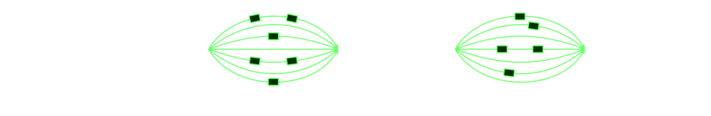

**DRAFT**: This article is currently being developed. As of November 18, 2026, the distribution rewrite it describes,
`law_shard`, is implemented in metatron for the patterns marked done in the distributed-computing
reference [[3]](../skills/mtron/references/distributed-computing-mtron.html);
the remaining sections are outlined.

# Introduction

In Stream Ring Theory [[1]](./stream-ring-theory.md), a program is a term of the ring
$\langle\mathcal{C}\mathcal{F}, +, \cdot \rangle$: the $+$ branches a stream into computations that share nothing, and
the $\cdot$ composes them in series. Read with a network in mind, the $+$ is already a distributed computation. The
summands of $a + b$ never meet until their streams merge, and by Theorem 5 streams are atemporal, so the summands may
run in any order and therefore on any machine. What a distributed system must decide is not *whether* a term may be
split, but *where the splitting must stop*: the places where a stream contracts back to a single value. Those places
are the reduce functions, and the stream ring states exactly when a reduce function may be pushed into the branches
before it.

The statement is Theorem 19 of [[1]](./stream-ring-theory.md). A reduce function $r$ over a commutative monoid is
*semi-right distributive*:

$$
(a + b)\,r = (a\,r + b\,r)\,r
$$

The left side folds the union of two streams in one place. The right side folds each stream where it lies, then folds
the two partials once more. Nothing on the right side requires the two folds to share a machine, so the right side is a
distributed program: two lanes, each computing its own partial, and a final fold that brings the computation home. The
fold's declared laws, *monoidic* and *commutative*, are the license; no other feature is needed.

<!-- figure source: images/ring-theoretic-distributed-computing/fig-01.tex (the PDF surface typesets it; the svg is its render) -->
{width=70%}

A program may contract more than once. Every fold that declares these laws is a *cut*, and each cut plans the run of
instructions before it. The program **expands** across the available machines, **contracts** at the fold, and starts
again from the one value the fold left at home.

<!-- figure source: images/ring-theoretic-distributed-computing/fig-02.tex (the PDF surface typesets it; the svg is its render) -->
{width=70%}

This article develops that reading. The first section recalls the distributive laws of the stream ring and its
function subrings. The second states the *shard identity*, the one rewrite every distribution pattern below lowers to,
and proves it from Theorems 18 and 19. The third extends it to programs with many cuts. The fourth shows that a
coefficient is itself an index set, so a single value can be distributed by splitting its unrolls instead of its
members. The fifth reads the menu of distribution patterns as a taxonomy of laws.

# The Distributive Laws of the Stream Ring

The stream ring's function set $\mathcal{F}$ has four logical subsets [[1]](./stream-ring-theory.md): the map, filter,
and flatmap functions, each of which forms a ring with unity, and the reduce functions $\mathcal{F}_r$, which form only
a *near-ring*. The difference is distributivity, and distributivity is exactly the question a distributed system asks.

| form                                           | right distributive         | left distributive   |
|------------------------------------------------|----------------------------|---------------------|
| `*inst?decq>>form`                             | $(a+b)c = ac + bc$         | $c(a+b) = ca + cb$  |
| ────────────────────────────────────────────── | ────────────────────────── | ─────────────────── |
| map, filter, flatmap rings                     | yes                        | yes                 |
| reduce near-ring $\mathcal{F}_r$ (Theorem 18)  | no                         | yes                 |
| monoidic reduce functions (Theorem 19)         | semi: $(a+b)c = (ac+bc)c$  | yes                 |

For a map, a filter, or a flatmap $f$, right distributivity says $(a + b)\,f = a\,f + b\,f$: an elementwise function
applied to a merged stream is the merge of its applications to the parts. Each part may be processed where it lies.
This is why a *floatable* run, any chain of such functions, can be replicated into every branch with no coordination
(Theorem 6: the coefficient floats through non-reduce chains).

<!-- figure source: images/ring-theoretic-distributed-computing/fig-03.tex -->


A reduce function is not right distributive: $(a+b)\,r$ produces one reduced object, while $a\,r + b\,r$ produces two.
Theorem 19 recovers the equality for a reduce function over a commutative monoid $\langle X, \oplus \rangle$, at the
cost
of one more fold: the two reduced objects are themselves reduced. Theorems 16 and 17 name the consequence for
distribution: reduce functions are temporal, and coefficients stop floating at them, so a reduce function is the one
synchronization point of a program, its *cut*.

<!-- figure source: images/ring-theoretic-distributed-computing/fig-04.tex -->


Theorem 19 drawn as streams: on the left one fold meets the merged stream; on the right each branch folds its own
stream, and the two partials are folded once more.

| theorem        | statement                                                   | for distribution                                          |
|----------------|-------------------------------------------------------------|-----------------------------------------------------------|
| **Theorem 5**  | streams are atemporal                                       | no order of apply or merge is required: placement is free |
| **Theorem 6**  | $ca \cdot 1b = 1a \cdot 1b \cdot c1$                        | elementwise work is independent: replicate it             |
| **Theorem 16** | reduce functions are temporal                               | the fold is the one synchronization point                 |
| **Theorem 17** | $c1 \cdot 1a \neq 1a \cdot c1$ for $a \in \mathcal{F}_r$    | floating stops at a reducer: the fold is the cut          |
| **Theorem 18** | $\langle\mathcal{F}_r, +, \cdot\rangle$ is a near-ring      | a reducer distributes over a fan-out after it             |
| **Theorem 19** | $(a+b)c = (ac+bc)c$ for a monoidic $c$                      | a commutative monoid fold splits and re-applies           |
| **Theorem 21** | $\langle\mathcal{F}_r, \cdot\rangle$ is functionally closed | a fold after a fold is a fold: combiners stay reducers    |

# The Shard Identity

**Definition (cut).** A *cut* is a reduce function $r$ whose partial results recombine through a reduce function
$C(r)$, its *combiner*, that is monoidic and commutative. A fold that declares those laws itself is its own combiner,
$C(r) = r$ (`sum`, `prod`); a fold defined by a derivation recombines through the fold that defines it ($
\texttt{count} = \texttt{map}(1) \cdot \texttt{sum}$, so $C(\texttt{count}) = \texttt{sum}$).

**Proposition (the shard identity).** Let the seed $s = s_1 + \cdots + s_k$ be partitioned across $k$ places, let $f$ be
a floatable run, and let $r$ be a cut. Then

$$
s\,f\,r = (s_1\,f\,r + \cdots + s_k\,f\,r)\;C(r).
$$

*Proof sketch.* Because $f$ is a product of map, filter, and flatmap functions, each of which is right distributive,
$(s_1 + \cdots + s_k)\,f = s_1 f + \cdots + s_k f$. Applying Theorem 19 to the cut, by induction on $k$,
$(s_1 f + \cdots + s_k f)\,r = (s_1 f r + \cdots + s_k f r)\,r$. When $r$ is defined through a derivation, the same
steps go through its definition, and the outer fold is $C(r)$. ◻

Read right to left, the identity is a program for $k$ machines: each place $p_i$ computes $s_i\,f\,r$, one partial per
place travels home, and the home machine computes $C(r)$ over the partials. In mtron the right side is a `branch` keyed
by place. The examples in this article run over two places. `harvest`, an instruction from Dr. Stynx's boot file
[`drstynx.boot.mtron`](../skills/drstynx/assets/drstynx.boot.mtron), spawns a sibling JVM on this machine for each
integer it is given and dials each one as a `ws_client` peer; the category instset, which holds `law_shard`, is
imported out of view.

```mtron
mtron> harvest?rec<=int{*}(uri{?}::T){
         spawn?uri<=int(<//localhost:${_ + 1111}/${_}>,<//${_}>,*0).
           -<[host=>_].as(ws_client::T).barrier()>>host.>-[,].as(rec::T)}@harvest
...
mtron> {0,1}.harvest()
==>[0=>ws://localhost:1111/mtron,
    1=>ws://localhost:1112/mtron]
```
The serial program

```mtron
mtron> {1,2,3,4}.plus(1).sum()
==>14
```
is rewritten by `law_shard`, and `explain()` prints the code the machine runs:

```mtron
mtron> {1,2,3,4}.plus(1).sum().explain()>>format
==>"""
    op      dom          rng      args                                                     f    desc      c_dom  c_rng 
    branch  noobj{0}::T  #{*}::T  [ws://localhost:1111=>start?hop=0({1,3}).plus(1).sum(),  <j>  standard  {0}    {*}   
                                   ws://localhost:1112=>start?hop=0({2,4}).plus(1).sum()]                              
    sum     #{*}::T      #::T                                                              <?>  reducer   {*}    {1}   
   """
```
The `branch` is keyed by the two places. Each lane starts from its share of the seed, `{1,3}` or `{2,4}` (the members
are dealt in turn), and runs the floatable run and the fold where it lands; `?hop=0` tells the peer not to plan the lane
again. The `sum` after the `branch` is $C(r)$. A fold defined by a derivation recombines through the fold that defines
it: each place counts its share, and home sums the counts.

```mtron
mtron> {1,2,3,4}.count().explain()>>format
==>"""
    op      dom          rng      args                                               f    desc      c_dom  c_rng 
    branch  noobj{0}::T  #{*}::T  [ws://localhost:1111=>start?hop=0({1,3}).count(),  <j>  standard  {0}    {*}   
                                   ws://localhost:1112=>start?hop=0({2,4}).count()]                              
    sum     #{*}::T      #::T                                                        <?>  reducer   {*}    {1}   
   """
```
The rewrite never names a combiner: it reads the fold's declared laws and computes one.

[To be written: the computed combiner in full (self-combining, by derivation, pointwise for a keyed fold), and what a
fold that declares neither law does (it stays home).]

# Chains of Cuts

A program with several cuts is planned cut by cut. Each cut plans the floatable run before it, never reaching back past
the cut before that, and the instructions between a cut and the next run stay home. Written as a pattern over a chain,

```mtron
[initial,{+}[{*}home,{*}floatable,cut],{*}tail]
         └─────── distributed ───────┘
```

each bracketed group is one expansion and one contraction (figure 2). After a cut the program holds one object, the
value the fold answered, so the run after it has nothing to deal; what it has instead is the multiplicity in its own
coefficients, which the next section treats. The instructions that stay home between two cuts keep that one object as
long as each hands on at most one object for the one it takes: an effect like `print` stays home, and the run after it
still ships.

```mtron
mtron> {1,2,3,4,5}.plus(1).sum().{0,3}plus(1).sum()
==>86
mtron> {1,2,3,4,5}.plus(1).sum().{0,3}plus(1).sum().explain()>>format
==>"""
    op      dom          rng      args                                                       f    desc      c_dom  c_rng 
    branch  noobj{0}::T  #{*}::T  [ws://localhost:1111=>start?hop=0({1,3,5}).plus(1).sum(),  <j>  standard  {0}    {*}   
                                   ws://localhost:1112=>start?hop=0({2,4}).plus(1).sum()]                                
    sum     #{*}::T      #::T                                                                <?>  reducer   {*}    {1}   
    branch  int{*}::T    #{*}::T  [ws://localhost:1111=>{0,2}plus?hop=0(1).sum(),            <j>  standard  {*}    {*}   
                                   ws://localhost:1112=>{3}plus?hop=0(1).sum()]                                          
    sum     #{*}::T      #::T                                                                <?>  reducer   {*}    {1}   
   """
```
The plan has a `branch` and a `sum` for each cut. The first deals the seed. The second has one object, the `20` the
first
fold answered, so it copies that object to both places and splits the run's own span, $[0,2]$ to one and $[3,3]$ to the
other (the next section reads a coefficient as an index set). The profile counts what the home machine ran, the
expansion and contraction of each cut in figure 2, and lists `law_shard` among the rewrite rules:

```mtron
mtron> {1,2,3,4,5}.plus(1).sum().{0,3}plus(1).sum().profile()>>format
==>"""
     master booger//4097763   apply 372.830 ms, 2 places
       places      2, gathered in 372.830 ms (the master's apply, its gather wait included)
       place                objs  apply (ms)   share
       booger//4097879         3      12.796   48.3%
       booger//4097961         1      13.685   51.7%  straggler
       apply       min 12.796   max 13.685   mean 13.241 (ms)
       imbalance   1.03 (max ÷ mean apply)
       efficiency  0.036 (Σ lane apply ÷ (k × gather wait))
       tree        depth 1   leaves 2   objs 4   lane time 26.481 ms
       level 1     2 places, imbalance 1.03
       critical    booger//4097961 13.685 ms
       stage     min (ms)   max (ms)
       rewrite     11.514     23.249
       resolve     15.206     31.495
       apply      372.830    466.760
       insts     3
       resolve sub-stages (avg ms):
         inst-resolve         5.068   57.8%
         generic-binding      3.347   38.2%
         inst-composition     0.347    4.0%
       rewrite rules:
                     branch_factor       law_poset           law_shard           law_monoidic        theory_unit_removal derivation_contraction
           insts.in  60                  60                  60                  60                  60                  60                  
           insts.out 60                  60                  60                  60                  60                  60                  
           time(ms)  60.227              11.689              5.016               4.499               2.609               2.458               
           TOTAL     inst.in 3   inst.out 3   time(ms) 105.165
       apply sub-stages (avg ms):
         split        0.009    0.0%
         apply       35.354  100.0%
         next         0.006    0.0%
       per-instruction (per iteration):
                     branch    sum       branch    
           in.monad  0         1         0         
           in.coeff  0         2         0         
           out.monad 1         1         1         
           out.coeff 2         1         2         
           time(ms)  35.354    0.000     0.000     
       flow       monads=25 coeff-sum=25 compression=1.00 processors=10
       cache     hits=382403 misses=6 hit=100.0%
       booger//4097879   apply 12.796 ms, a leaf, objs 3
         stage     min (ms)   max (ms)
         rewrite      9.148     10.698
         resolve      9.315     10.871
         apply       12.796     14.813
         insts     3
         resolve sub-stages (avg ms):
           inst-resolve         2.045   33.4%
           generic-binding      3.594   58.7%
           inst-composition     0.486    7.9%
         rewrite rules:
                       derivation_contractionlaw_poset           branch_factor       law_monoidic        theory_unit_removal law_idempotent      
             insts.in  60                  60                  60                  60                  60                  60                  
             insts.out 60                  60                  60                  60                  60                  60                  
             time(ms)  56.463              9.419               8.153               4.274               3.987               3.263               
             TOTAL     inst.in 3   inst.out 3   time(ms) 93.629
         apply sub-stages (avg ms):
           split        0.012    4.6%
           apply        0.236   91.5%
           next         0.010    3.9%
         per-instruction (per iteration):
                       start     plus      sum       
             in.monad  0         1         1         
             in.coeff  0         1         3         
             out.monad 1         1         1         
             out.coeff 1         3         1         
             time(ms)  0.030     0.206     0.000     
         flow       monads=20 coeff-sum=25 compression=1.25 processors=10
         cache     hits=95821 misses=9 hit=100.0%
       booger//4097961   apply 13.685 ms, a leaf, objs 1, straggler
         stage     min (ms)   max (ms)
         rewrite      9.740     11.487
         resolve      9.926     11.693
         apply       13.685     16.525
         insts     3
         resolve sub-stages (avg ms):
           inst-resolve         2.223   33.0%
           generic-binding      3.886   57.6%
           inst-composition     0.636    9.4%
         rewrite rules:
                       derivation_contractionbranch_factor       law_poset           law_monoidic        theory_unit_removal law_idempotent      
             insts.in  60                  60                  60                  60                  60                  60                  
             insts.out 60                  60                  60                  60                  60                  60                  
             time(ms)  59.339              10.327              9.576               4.371               4.002               3.457               
             TOTAL     inst.in 3   inst.out 3   time(ms) 99.405
         apply sub-stages (avg ms):
           split        0.011    3.6%
           apply        0.286   92.3%
           next         0.013    4.0%
         per-instruction (per iteration):
                       start     plus      sum       
             in.monad  0         1         1         
             in.coeff  0         1         1         
             out.monad 1         1         1         
             out.coeff 1         1         1         
             time(ms)  0.036     0.250     0.000     
         flow       monads=20 coeff-sum=15 compression=0.75 processors=10
         cache     hits=96336 misses=9 hit=100.0%
   """
```
[To be written: the home instructions in general (what a contract must state for one object to survive them), and the
leading flatmapper: with one object and no index set, `merge()` unrolls the lst a fold answered at home, and the rest of
the run deals its members.]

```mtron
mtron> {1,2,3,4,5}.plus(10).order(neg()).merge().plus(1).sum()
==>70
mtron> {1,2,3,4,5}.plus(10).order(neg()).merge().plus(1).sum().explain()>>format
==>"""
    op      dom          rng      args                                                               f    desc        c_dom  c_rng 
    branch  noobj{0}::T  #{*}::T  [ws://localhost:1111=>start?hop=0({1,3,5}).plus(10).order(neg()),  <j>  standard    {0}    {*}   
                                   ws://localhost:1112=>start?hop=0({2,4}).plus(10).order(neg())]                                  
    kmerge  #{*}::T      #{*}::T  [neg()]                                                            <j>  reducer     {*}    {*}   
    merge   #{*}::T      #{*}::T  [noobj]                                                            <j>  flatmapper  {*}    {*}   
    branch  int{*}::T    #{*}::T  [ws://localhost:1111=>plus?hop=0(1).sum(),                         <j>  standard    {*}    {*}   
                                   ws://localhost:1112=>plus?hop=0(1).sum()]                                                       
    sum     #{*}::T      #::T                                                                        <?>  reducer     {*}    {1}   
   """
```
`order` is a cut too, and its computed combiner is `kmerge`, a k-way merge: each place sorts its share, and home merges
the sorted partials. The `merge` that unrolls the sorted lst stays home, and the run after it deals the members to the
places again.

# Coefficients as Index Sets

A coefficient is a second place to find parallelism [[2]](./span-and-point-coefficient-algebra.md). A span range is a
sum of independent terms, $a^{[m,n]} = \sum_{k=m}^{n} a^k$, so a run over one object can be split by its exponent: each
place takes the whole object and a contiguous share of the unrolls.

```mtron
mtron> start(0).{0,3}plus(1).sum()
==>6
mtron> start(0).{0,3}plus(1).sum().explain()>>format
==>"""
    op      dom          rng      args                                                      f    desc      c_dom  c_rng 
    branch  noobj{0}::T  #{*}::T  [ws://localhost:1111=>start?hop=0(0).{0,2}plus(1).sum(),  <j>  standard  {0}    {*}   
                                   ws://localhost:1112=>start?hop=0(0).{3}plus(1).sum()]                                
    sum     #{*}::T      #::T                                                               <?>  reducer   {*}    {1}   
   """
```
Both lanes start from the same `0`. The first takes the unrolls $0$ to $2$ and the second the unroll $3$, written `{3}`:
the shares are cut by the work each costs, not by how many unrolls each holds. At home the profile shows the program
that ran, a `branch` and a `sum`, and the time spent at the `branch` waiting on the two partials:

```mtron
mtron> start(0).{0,3}plus(1).sum().profile()>>format
==>"""
     master booger//4097763   apply 294.161 ms, 2 places
       places      2, gathered in 294.161 ms (the master's apply, its gather wait included)
       place                objs  apply (ms)   share
       booger//4097879         3      10.763   49.1%
       booger//4097961         1      11.178   50.9%  straggler
       apply       min 10.763   max 11.178   mean 10.970 (ms)
       imbalance   1.02 (max ÷ mean apply)
       efficiency  0.037 (Σ lane apply ÷ (k × gather wait))
       tree        depth 1   leaves 2   objs 4   lane time 21.941 ms
       level 1     2 places, imbalance 1.02
       critical    booger//4097961 11.178 ms
       stage     min (ms)   max (ms)
       rewrite      4.611      5.776
       resolve      5.597      6.846
       apply      294.161    322.422
       insts     1
       resolve sub-stages (avg ms):
         inst-resolve         1.038   34.3%
         generic-binding      1.858   61.4%
         inst-composition     0.129    4.3%
       rewrite rules:
                     branch_factor       law_poset           law_monoidic        law_shard           theory_unit_removal derivation_contraction
           insts.in  10                  10                  10                  10                  10                  10                  
           insts.out 10                  10                  10                  10                  10                  10                  
           time(ms)  5.769               4.398               1.578               1.422               1.214               0.962               
           TOTAL     inst.in 1   inst.out 1   time(ms) 21.781
       apply sub-stages (avg ms):
         split        0.000    0.0%
         apply        0.000    0.0%
         next         0.000    0.0%
       per-instruction (per iteration):
                     branch    
           in.monad  0         
           in.coeff  0         
           out.monad 0         
           out.coeff 0         
           time(ms)  0.000     
       flow       monads=0 coeff-sum=0 compression=0.00 processors=0
       cache     hits=212595 misses=6 hit=100.0%
       booger//4097879   apply 10.763 ms, a leaf, objs 3
         stage     min (ms)   max (ms)
         rewrite      7.742     10.721
         resolve      7.901     10.886
         apply       10.763     12.124
         insts     3
         resolve sub-stages (avg ms):
           inst-resolve         1.762   33.2%
           generic-binding      3.129   59.0%
           inst-composition     0.413    7.8%
         rewrite rules:
                       derivation_contractionlaw_poset           branch_factor       law_idempotent      law_monoidic        theory_unit_removal 
             insts.in  60                  60                  60                  60                  60                  60                  
             insts.out 60                  60                  60                  60                  60                  60                  
             time(ms)  45.850              8.920               7.247               4.286               3.759               3.339               
             TOTAL     inst.in 3   inst.out 3   time(ms) 79.953
         apply sub-stages (avg ms):
           split        0.007    3.9%
           apply        0.161   94.0%
           next         0.004    2.1%
         per-instruction (per iteration):
                       start     plus      sum       
             in.monad  0         1         1         
             in.coeff  0         1         3         
             out.monad 1         1         1         
             out.coeff 1         3         1         
             time(ms)  0.015     0.146     0.000     
         flow       monads=20 coeff-sum=25 compression=1.25 processors=10
         cache     hits=96049 misses=9 hit=100.0%
       booger//4097961   apply 11.178 ms, a leaf, objs 1, straggler
         stage     min (ms)   max (ms)
         rewrite      8.153      9.587
         resolve      8.284      9.748
         apply       11.178     12.998
         insts     3
         resolve sub-stages (avg ms):
           inst-resolve         1.882   33.0%
           generic-binding      3.330   58.4%
           inst-composition     0.488    8.6%
         rewrite rules:
                       derivation_contractionlaw_poset           branch_factor       law_monoidic        theory_unit_removal law_idempotent      
             insts.in  60                  60                  60                  60                  60                  60                  
             insts.out 60                  60                  60                  60                  60                  60                  
             time(ms)  47.170              9.065               8.154               3.765               3.318               2.643               
             TOTAL     inst.in 3   inst.out 3   time(ms) 80.785
         apply sub-stages (avg ms):
           split        0.008    4.5%
           apply        0.161   93.6%
           next         0.003    1.9%
         per-instruction (per iteration):
                       start     plus      sum       
             in.monad  0         1         1         
             in.coeff  0         1         1         
             out.monad 1         1         1         
             out.coeff 1         1         1         
             time(ms)  0.015     0.145     0.000     
         flow       monads=20 coeff-sum=15 compression=0.75 processors=10
         cache     hits=96444 misses=9 hit=100.0%
   """
```
A point is an index set too. The point $a\{p\}$ is $p$ copies of one term, and points add across a branch,
$a\{p\} = a\{p_1\} + a\{p_2\}$ with $p = p_1 + p_2$, so the places take even shares of the copies.

<!-- figure source: images/ring-theoretic-distributed-computing/fig-05.tex -->


[To be written: the point's live example. Over places today a shipped lane loses its point, so the example waits on
that fix.]

The same holds after a cut, where the object to copy is the fold's answer: the second `branch` in the chain of cuts
above copies the `20` to both places and splits the span $[0,3]$ as $[0,2]$ and $[3,3]$.

[To be written: shares chosen by work for a span (a lane walks its runs from the seed, so a share $[a,b]$ costs the $b$
steps it walks and the $b - a + 1$ runs it emits) and evenly for a point; why the copy needs no idempotence (the shares
are disjoint); one axis per run, the seed's first.]

# The Shape of a Law

The law a fold obeys fixes how it distributes, and there are only a few
shapes [[3]](../skills/mtron/references/distributed-computing-mtron.html):

| law                             | pattern              | shape                                     | coordination         |
|---------------------------------|----------------------|-------------------------------------------|----------------------|
| floatable (Theorem 6)           | map, filter, flatmap | free: replicate the run                   | none                 |
| commutative monoid (Theorem 19) | reduce, fold         | star: scatter, partial reduce, gather     | one barrier          |
| associative, not commutative    | scan, prefix         | pipeline: carry the running total         | neighbor to neighbor |
| keyed product                   | join, group by       | shuffle: partition by key, reduce, gather | key co-location      |

`sum`, `count`, `max`, and `order` are one pattern, the commutative monoid fold, with different instances: the operation
is the instance, and the law is the pattern.

The free shape needs no fold at all. With no cut there is nothing to recombine, so right distributivity alone,
$(a + b)\,f = a\,f + b\,f$, ships the run: each place runs it on its share of the seed, and the branch's own merge, its
$+$, brings every member home.

```mtron
mtron> {1,2,3,4,5,6,7,8}.plus(1).mult(2)
==>4
==>8
==>12
==>16
==>6
==>10
==>14
==>18
mtron> {1,2,3,4,5,6,7,8}.plus(1).mult(2).explain()>>format
==>"""
    op      dom          rng      args                                                           f    desc      c_dom  c_rng 
    branch  noobj{0}::T  #{*}::T  [ws://localhost:1111=>start?hop=0({1,3,5,7}).plus(1).mult(2),  <j>  standard  {0}    {*}   
                                   ws://localhost:1112=>start?hop=0({2,4,6,8}).plus(1).mult(2)]                              
   """
```
This is the embarrassingly parallel pattern: the program is the `branch` and nothing after it. A run floats only when
every instruction in it is pure, and so is every code it is handed, so a filter handed a `print` stays home. An effect
between two runs brings the members home, where it runs once over the merged bag, and the run after it goes out
again on a branch of its own.

## The Menu

Every distribution pattern metatron names is an instance of one of these laws, and the menu lists them all
[[3]](../skills/mtron/references/distributed-computing-mtron.html). A $\checkmark$ marks a pattern `law_shard`
implements today; an empty status means the law holds and the lowering is not yet written. Two are free, the
floatable law alone: O carries a constant along, and W, embarrassingly parallel, has no cut at all. Most entries are
stars, refinements of the shard identity (A, E, G, J, K, L, H). D, S and V are orthogonal: they multiply any fan-out,
through the transport, the master's own share, and the run's own coefficients. The rest place the work (B, C, Q, P, T)
or compose the others (N, R, M, I).

|       |              | pattern                   | law                                                                                                                                | description                                                                                                                            |
|-------|--------------|---------------------------|------------------------------------------------------------------------------------------------------------------------------------|----------------------------------------------------------------------------------------------------------------------------------------|
| **A** | $\checkmark$ | homomorphism shard        | $h(a \uplus b) = h(a) \oplus h(b)$                                                                                                 | each place folds its part; the master recombines the partials through the computed combiner                                            |
| **B** |              | data-local shard          | $\mathrm{from}(p) = \sum_a \mathrm{from}_a(p)$                                                                                     | the code moves to the data: each authority folds what it holds                                                                         |
| **C** |              | authority push-down       | $\mathrm{from} \cdot \mathrm{count} \mapsto \mathrm{native\_count}$                                                                | B with one owner: the fold runs where the data lives, natively (Theorem 5 and a pure chain)                                            |
| **D** | $\checkmark$ | parallel fan-out          | $\langle x\rangle(a+b) = \langle x\rangle a + \langle x\rangle b$                                                                  | the transport, not a new fold: every lane is submitted before any is awaited, so the master pays the longest round trip, not their sum |
| **E** | $\checkmark$ | tree reduction            | $(a+b+c+d)\cdot r = ((a\cdot r + b\cdot r)\cdot C + (c\cdot r + d\cdot r)\cdot C)\cdot C$                                          | each interior node re-plans its part and recombines a level                                                                            |
| **F** |              | ordered fold              | $a \cdot (b \cdot c) = (a \cdot b) \cdot c$                                                                                        | associativity alone: a list-partitioned fold carries the running total (streams never shard)                                           |
| **G** | $\checkmark$ | keyed reduce              | $\mathrm{combiner}(\mathrm{group}([k \Rightarrow h])) = \mathrm{sum} \cdot \mathrm{select}([\_ \Rightarrow \mathrm{combiner}(h)])$ | partials merge by key; the combiner is pointwise, computed from the inner fold's                                                       |
| **H** |              | redundant / hedged shards | $x \oplus x = x$                                                                                                                   | an idempotent fold lets a part ship to several peers and every reply fold; otherwise hedge, first wins                                 |
| **I** |              | span/route interpreter    | $\mathrm{plan} \mapsto \mathrm{layout}$                                                                                            | the infrastructure: a plan's axes lowered to a layout                                                                                  |
| **J** |              | algebraic aggregates      | $\mathrm{mean} \equiv (\mathrm{sum}, \mathrm{count}) \cdot \mathrm{div}$                                                           | pointwise tuple partials; the finalizer runs once at the master                                                                        |
| **K** |              | limit / top-k push-down   | $\mathrm{take}(k) \cdot \oplus = \mathrm{take}(k) \cdot \oplus \cdot \mathrm{take}(k)$                                             | each lane keeps its own top k, and the master merges and keeps k                                                                       |
| **L** |              | mergeable sketches        | $\hat h(a \uplus b) = \hat h(a) \oplus \hat h(b)$                                                                                  | a sketch fold that declares its monoid theory plugs into A, E and H                                                                    |
| **M** |              | matrix multiplication     | $A \cdot (B + C) = A \cdot B + A \cdot C$                                                                                          | O plus an addressed union (rows), A with the matrix sum (inner k), G over block keys (2-D)                                             |
| **N** |              | iterative / BSP           | $x^{*} = x \vee f(x) \vee f^{2}(x) \vee \cdots$                                                                                    | a sharded superstep, repeated: the combiner is the superstep boundary                                                                  |
| **O** | $\checkmark$ | broadcast constants       | $ca \cdot 1b = 1a \cdot 1b \cdot c1$                                                                                               | a constant rides as an argument of the floatable run: no fan-out change (Theorem 6)                                                    |
| **P** |              | computed seeds            | $[0, n) = \uplus_i \mathrm{index}_i$                                                                                               | the index space is split, not the data: one constant-size message per peer                                                             |
| **Q** |              | monad migration           | $\mathrm{authority}(m)$                                                                                                            | ship the monad, not the value: the continuation travels, one shard per step                                                            |
| **R** |              | durable results           | $\mathrm{id} : \mathrm{partial} \mapsto \mathrm{address}$                                                                          | each partial is written to an address                                                                                                  |
| **S** | $\checkmark$ | master-participates       | $\bigoplus_{i=0}^{k} a_i \cdot r$ over $\{\mathrm{master}\} \cup \mathrm{peers}$                                                   | the master folds its own slice, a lane at distance zero, and ships the rest                                                            |
| **T** | $\checkmark$ | reference frame migration | $\mathrm{move}(a) \ldots \mathrm{move}(b) \ldots$                                                                                  | the frame moves, not the data: the tail ships as a program and the value snakes back                                                   |
| **U** | $\checkmark$ | profile collation         | $\hat{p}(a \uplus b) = \hat{p}(a) \oplus \hat{p}(b)$                                                                               | each shard's profile ships home, and the master collates one report                                                                    |
| **V** | $\checkmark$ | generative run            | $a^{[m,n]} = \sum_{k=m}^{n} a^k$                                                                                                   | a span range or a point is an index set: the lanes split the unrolls by work, or the copies evenly                                     |
| **W** | $\checkmark$ | embarrassingly parallel   | $(a + b) \cdot f = a \cdot f + b \cdot f$                                                                                          | no cut: each place runs the floatable run on its share, and the branch's merge brings it all home                                      |

[To be written: the menu as a tree of these laws, a figure.]

# Conclusion

**NOTES**:

- Distribution is a reading of the ring, not a feature: $+$ is placement-free by Theorem 5, and the only question is
  where a stream must contract.
- The shard identity, $s\,f\,r = (s_1 f r + \cdots + s_k f r)\,C(r)$, is the one rewrite: floatable runs distribute
  because their subrings are right distributive, and a fold distributes when Theorem 19 holds for it.
- A program expands and contracts once per cut; one object survives the home instructions between cuts.
- A coefficient is an index set: a span splits by its exponent, a point by its copies.
- [To be written: what is open — the shuffle and pipeline shapes, and the laws a fold would declare to reach them.]

# References

1. Rodriguez, M.A., "[Stream Ring Theory](./stream-ring-theory.md)," S/V Red Herring's Ship's Log: Chronicles in the Sea
   of Cortez, pages 10–40, Mulegé, Baja California Sur, México, February 2019.
2. Rodriguez, M.A., Stynx, D.R.,
   "[A Span and Point Coefficient Algebra for Stream Rings](./span-and-point-coefficient-algebra.md)."
3. "[distributed computing — the pattern menu](../skills/mtron/references/distributed-computing-mtron.html)," the mtron
   skill reference.