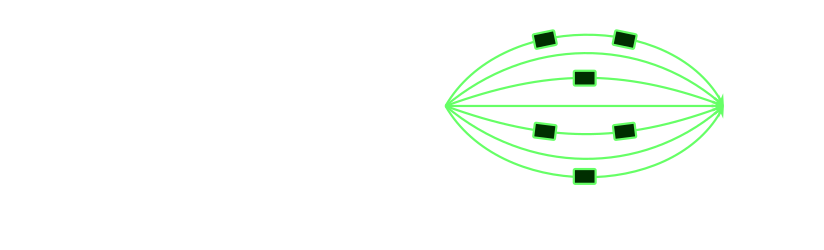
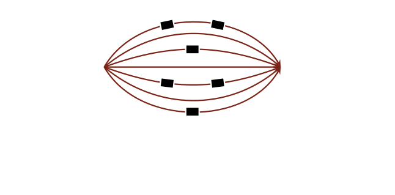
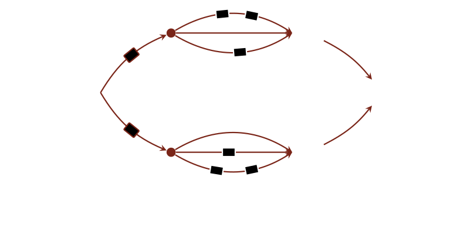

**DRAFT**: This article is currently being developed. As of November 22, 2026, the distribution rewrites it describes,
`law_shard` and `law_bsp`, are implemented in metatron for the patterns marked done in the distributed-computing
reference [[3]](../skills/mtron/references/distributed-computing-mtron.html);
the remaining sections are outlined.

# Introduction

In Stream Ring Theory [[1]](./stream-ring-theory.md), a program is a term of the ring
$\langle\mathcal{C}\mathcal{F}, +, \cdot \rangle$: the $+$ branches a stream into computations that share nothing, and
the $\cdot$ composes them in series. Read with a network in mind, the $+$ is already a distributed computation. The
summands of $a + b$ never meet until their streams merge, and by Theorem 5 streams are atemporal, so the summands may
run in any order and therefore on any machine. What a distributed system must decide is not *whether* a term may be
split, but *where the splitting must stop*: the places where a stream contracts back to a single value. Those places
are the reduce functions, and the stream ring states exactly when a reduce function may be pushed into the branches
before it.

The statement is Theorem 19 of [[1]](./stream-ring-theory.md). A reduce function $r$ over a commutative monoid is
*semi-right distributive*:

$$
(a + b)\,r = (a\,r + b\,r)\,r
$$

The left side folds the union of two streams in one place. The right side folds each stream where it lies, then folds
the two partials once more. Nothing on the right side requires the two folds to share a machine, so the right side is a
distributed program: two lanes, each computing its own partial, and a final fold that brings the computation home. The
fold's declared laws, *monoidic* and *commutative*, are the license; no other feature is needed.

<!-- figure source: images/ring-theoretic-distributed-computing/fig-01.tex (the PDF surface typesets it; the svg is its render) -->


This article develops the relationship between the distributivity laws of `+` and physical, real-world
distributed computing.
The first section recalls the distributive laws of the stream ring and its function subrings. The second states the
*shard identity*, the one rewrite every distribution pattern below lowers to,
proves it from Theorems 18 and 19, and plans it at every level of a tree. The third extends it to programs with many
cuts. The fourth closes a program into a loop, the superstep of bulk synchronous computation, run again and again,
and couples the loop with the tree. The fifth shows that a coefficient is
itself an index set, so a single value can be distributed by splitting its unrolls instead of its members. The sixth
reads the menu of distribution patterns as a taxonomy of laws.

# The Distributive Laws of the Stream Ring

The stream ring's function set $\mathcal{F}$ has four logical subsets [[1]](./stream-ring-theory.md): the map, filter,
and flatmap functions, each of which forms a ring with unity, and the reduce functions $\mathcal{F}_r$, which form only
a *near-ring*. The difference is distributivity, and distributivity is exactly the question a distributed system asks.

| form                                           | right distributive         | left distributive   |
|------------------------------------------------|----------------------------|---------------------|
| `*inst?decq>>form`                             | $(a+b)c = ac + bc$         | $c(a+b) = ca + cb$  |
| ────────────────────────────────────────────── | ────────────────────────── | ─────────────────── |
| map, filter, flatmap rings                     | yes                        | yes                 |
| reduce near-ring $\mathcal{F}_r$ (Theorem 18)  | no                         | yes                 |
| monoidic reduce functions (Theorem 19)         | semi: $(a+b)c = (ac+bc)c$  | yes                 |

For a map, a filter, or a flatmap $f$, right distributivity says $(a + b)\,f = a\,f + b\,f$: an elementwise function
applied to a merged stream is the merge of its applications to the parts. Each part may be processed where it lies.
This is why a *floatable* run, any chain of such functions, can be replicated into every branch with no coordination
(Theorem 6: the coefficient floats through non-reduce chains).

<!-- figure source: images/ring-theoretic-distributed-computing/fig-03.tex -->


A reduce function is not right distributive: $(a+b)\,r$ produces one reduced object, while $a\,r + b\,r$ produces two.
Theorem 19 recovers the equality for a reduce function over a commutative monoid $\langle X, \oplus \rangle$, at the
cost
of one more fold: the two reduced objects are themselves reduced. Theorems 16 and 17 name the consequence for
distribution: reduce functions are temporal, and coefficients stop floating at them, so a reduce function is the one
synchronization point of a program, its *cut*.

<!-- figure source: images/ring-theoretic-distributed-computing/fig-04.tex -->


Theorem 19 drawn as streams: on the left one fold meets the merged stream; on the right each branch folds its own
stream, and the two partials are folded once more.

| theorem        | statement                                                   | for distribution                                          |
|----------------|-------------------------------------------------------------|-----------------------------------------------------------|
| **Theorem 5**  | streams are atemporal                                       | no order of apply or merge is required: placement is free |
| **Theorem 6**  | $ca \cdot 1b = 1a \cdot 1b \cdot c1$                        | elementwise work is independent: replicate it             |
| **Theorem 16** | reduce functions are temporal                               | the fold is the one synchronization point                 |
| **Theorem 17** | $c1 \cdot 1a \neq 1a \cdot c1$ for $a \in \mathcal{F}_r$    | floating stops at a reducer: the fold is the cut          |
| **Theorem 18** | $\langle\mathcal{F}_r, +, \cdot\rangle$ is a near-ring      | a reducer distributes over a fan-out after it             |
| **Theorem 19** | $(a+b)c = (ac+bc)c$ for a monoidic $c$                      | a commutative monoid fold splits and re-applies           |
| **Theorem 21** | $\langle\mathcal{F}_r, \cdot\rangle$ is functionally closed | a fold after a fold is a fold: combiners stay reducers    |

# The Shard Identity

**Definition (cut).** A *cut* is a reduce function $r$ whose partial results recombine through a reduce function
$C(r)$, its *combiner*, that is monoidic and commutative. A fold that declares those laws itself is its own combiner,
$C(r) = r$ (`sum`, `prod`); a fold defined by a derivation recombines through the fold that defines it (
$\texttt{count} = \texttt{map}(1) \cdot \texttt{sum}$, so $C(\texttt{count}) = \texttt{sum}$).

**Proposition (the shard identity).** Let the seed $s = s_1 + \cdots + s_k$ be partitioned across $k$ places, let $f$ be
a floatable run, and let $r$ be a cut. Then

$$
s\,f\,r = (s_1\,f\,r + \cdots + s_k\,f\,r)\;C(r).
$$

*Proof sketch.* Because $f$ is a product of map, filter, and flatmap functions, each of which is right distributive,
$(s_1 + \cdots + s_k)\,f = s_1 f + \cdots + s_k f$. Applying Theorem 19 to the cut, by induction on $k$,
$(s_1 f + \cdots + s_k f)\,r = (s_1 f r + \cdots + s_k f r)\,r$. When $r$ is defined through a derivation, the same
steps go through its definition, and the outer fold is $C(r)$. ◻

Read right to left, the identity is a program for $k$ machines: each place $p_i$ computes $s_i\,f\,r$, one partial per
place travels home, and the home machine computes $C(r)$ over the partials. In mtron the right side is a `branch` keyed
by place. The examples in this article run over two places. `harvest`, an instruction from Dr. Stynx's boot file
[`drstynx.boot.mtron`](../skills/drstynx/assets/drstynx.boot.mtron), spawns a sibling JVM on this machine for each
integer it is given, boots it from the file it is handed, and dials each one as a `ws_client` peer. Here every peer
boots `boot/space/grph/peer.boot.mtron`, which mounts the modern graph at `g:`, so the graph walk of *Loops of Cuts*
has the same graph on every machine. The category instset, which holds `law_shard` and `law_bsp`, and this machine's
own copy of the graph are imported out of view.

```mtron
mtron> harvest?rec<=int{*}(uri{?}::T){
         spawn?uri<=int(<//localhost:${_ + 1111}/${_}>,<//${_}>,*0).
           -<[host=>_].as(ws_client::T).barrier()>>host.>-[,].as(rec::T)}@harvest
...
mtron> {0,1}.harvest(<boot/space/grph/peer.boot.mtron>)
==>[0=>ws://localhost:1111/mtron,
    1=>ws://localhost:1112/mtron]
```
The serial program

```mtron
mtron> {1,2,3,4}.plus(1).sum()
==>14
```
is rewritten by `law_shard`, and `explain()` prints the code the machine runs:

```mtron
mtron> {1,2,3,4}.plus(1).sum().explain()>>format
==>"""
    op      dom          rng        args                                                     f    desc      c_dom  c_rng  c_out 
    branch  noobj{0}::T  int{*}::T  [ws://localhost:1111=>start?hop=0({1,3}).plus(1).sum(),  <j>  standard  {0}    {*}    {*}   
                                     ws://localhost:1112=>start?hop=0({2,4}).plus(1).sum()]                                     
    sum     int{*}::T    int::T                                                              <j>  reducer   {*}    {1}    {1}   
   
        ┌─►//0─{2}─{2}─{1}─┐
   {4}──┤                  ├─►//local─{2}─{1}
        └─►//1─{2}─{2}─{1}─┘
   """
```
The `branch` is keyed by the two places. Each lane starts from its share of the seed, `{1,3}` or `{2,4}` (the members
are dealt in turn), and runs the floatable run and the fold where it lands; `?hop=0` tells the peer not to plan the lane
again. The `sum` after the `branch` is $C(r)$. A fold defined by a derivation recombines through the fold that defines
it: each place counts its share, and home sums the counts.

```mtron
mtron> {1,2,3,4}.count().explain()>>format
==>"""
    op      dom          rng        args                                               f    desc      c_dom  c_rng  c_out 
    branch  noobj{0}::T  int{*}::T  [ws://localhost:1111=>start?hop=0({1,3}).count(),  <j>  standard  {0}    {*}    {*}   
                                     ws://localhost:1112=>start?hop=0({2,4}).count()]                                     
    sum     int{*}::T    int::T                                                        <j>  reducer   {*}    {1}    {1}   
   
        ┌─►//0─{2}─{1}─┐
   {4}──┤              ├─►//local─{2}─{1}
        └─►//1─{2}─{1}─┘
   """
```
The rewrite never names a combiner: it reads the fold's declared laws and computes one.

[To be written: the computed combiner in full (self-combining, by derivation, pointwise for a keyed fold), and what a
fold that declares neither law does (it stays home).]

**A cut absorbs the prefix its combiner respects.** A fold may be followed by a projection that its combiner commutes
with. Write $t_k$ for the select that keeps the first $k$ positions of a lst, `==[{k}_]` in mtron: a positional select
keeps only the positions its pattern covers, and the span lays $k$ identity slots along its bracket. A combiner is
*causal* when the first $n$ of its output depend only on the first $n$ of each input, and then

$$
(x \oplus y)\,t_k = (x\,t_k \oplus y\,t_k)\,t_k,
$$

so $r\,t_k$ is itself a cut whose combiner is $C(r)\,t_k$: the shard identity holds for the longer cut, with nothing
declared beyond the combiner's law. `kmerge` is causal, as the first $k$ of a sorted merge draw only on the first $k$
of each run, so top-k ships as each place's own top $k$.

```mtron
mtron> {5,3,9,1,7}.order()==[{2}_]
==>[1,3]
```
```mtron
mtron> {5,3,9,1,7}.order().select([{2}_]).explain()>>format
==>"""
    op      dom                 rng                   args                                                                     f    desc      c_dom  c_rng  c_out 
    branch  noobj{0}::T         lst[{*}int{*}]{*}::T  [ws://localhost:1111=>start?hop=0({5,9,7}).order().select([id(),id()]),  <j>  standard  {0}    {*}    {*}   
                                                       ws://localhost:1112=>start?hop=0({3,1}).order().select([id(),id()])]                                       
    kmerge  lst[{*}A{*}]{*}::T  lst[{*}int{*}]::T     [noobj]                                                                  <j>  reducer   {*}    {1}    {1}   
    select  lst::T              lst{?}::T             [[id(),id()]]                                                            <j>  mapper    {1}    {?}    {?}   
   
        ┌─►//0─{3}─{1}─{?}─┐
   {5}──┤                  ├─►//local─{0,2}─{1}─{?}
        └─►//1─{2}─{1}─{?}─┘
   """
```
Each place sorts its share and keeps two, and home merges the runs and keeps two, so no place sends more than two
members. The law is causality, not monotonicity in the prefix order, which a sorted merge lacks: `[1]` is a prefix of
`[1,2]`, yet merging each with `[3]` gives `[1,3]` and `[1,2,3]`.

**A cut is planned at every level of a tree.** A place handed a lane may plan it again, over places of its own. The
budget `?hop` states how many levels a plan may take (the menu's entry E): `law_shard` reads it off the fold, and every
lane carries it one level down, on its head, so a leaf states `?hop=0` and plans nothing further. To grow a tree, each
peer harvests two peers of its own, with the `harvest` its boot file defines:

```mtron
mtron> branch(<//0> => start({2,3}).harvest(<boot/space/grph/peer.boot.mtron>),
              <//1> => start({4,5}).harvest(<boot/space/grph/peer.boot.mtron>))
==>fail{2}::[inst apply failure: future get timed out after 5000 ms [FutureObj<245>] (at λawait) [FutureObj<245>]]
```
Now `//0` holds `//2` and `//3`, and `//1` holds `//4` and `//5`. Each level is the shard identity again: a place deals
what it is handed over its children and recombines their partials through the same combiner, so with
$s_j = s_{j,1} + \cdots + s_{j,k}$ the part the $j$-th place is handed,

$$
s\,f\,r = \Big(\sum_{j=1}^{k}\Big(\sum_{l=1}^{k} s_{j,l}\,f\,r\Big)\,C(r)\Big)\,C(r).
$$

```mtron
mtron> {1,2,3,4,5,6,7,8}.plus(1).sum?hop=2()
==>fail::[lhs range does not match inst domain: fail::T => int{*}::T [/m/inst/sum?/m/int<=/m/int{*}&hop=2()@<1>]]
mtron> {1,2,3,4,5,6,7,8}.plus(1).sum?hop=2().explain()>>format
==>"""
    op      dom          rng        args                                                         f    desc      c_dom  c_rng  c_out 
    branch  noobj{0}::T  int{*}::T  [ws://localhost:1111=>start?hop=1({1,3,5,7}).plus(1).sum(),  <j>  standard  {0}    {*}    {*}   
                                     ws://localhost:1112=>start?hop=1({2,4,6,8}).plus(1).sum()]                                     
    sum     int{*}::T    int::T                                                                  <j>  reducer   {*}    {1}    {1}   
   
                    ┌─►//192.168.1.37:8777──{1}─{1}─{1}─┐
                    ├─►//192.168.1.37:8555──{1}─{1}─{1}─┤
        ┌─►//0─{4}──┤                                   ├─►//0─{4}─{1}─┐
        │           ├─►//192.168.1.250:8777─{1}─{1}─{1}─┤              │
        │           └─►//192.168.1.72:8777──{1}─{1}─{1}─┘              │
   {8}──┤                                                              ├─►//local─{2}─{1}
        │           ┌─►//192.168.1.37:8777──{1}─{1}─{1}─┐              │
        │           ├─►//192.168.1.37:8555──{1}─{1}─{1}─┤              │
        └─►//1─{4}──┤                                   ├─►//1─{4}─{1}─┘
                    ├─►//192.168.1.250:8777─{1}─{1}─{1}─┤
                    └─►//192.168.1.72:8777──{1}─{1}─{1}─┘
   """
mtron> {1,2,3,4,5,6,7,8}.plus(1).sum?hop=2().explain()>>ext/topology/format
==>"""
                    ┌─►//192.168.1.37:8777──{1}─{1}─{1}─┐
                    ├─►//192.168.1.37:8555──{1}─{1}─{1}─┤
        ┌─►//0─{4}──┤                                   ├─►//0─{4}─{1}─┐
        │           ├─►//192.168.1.250:8777─{1}─{1}─{1}─┤              │
        │           └─►//192.168.1.72:8777──{1}─{1}─{1}─┘              │
   {8}──┤                                                              ├─►//local─{2}─{1}
        │           ┌─►//192.168.1.37:8777──{1}─{1}─{1}─┐              │
        │           ├─►//192.168.1.37:8555──{1}─{1}─{1}─┤              │
        └─►//1─{4}──┤                                   ├─►//1─{4}─{1}─┘
                    ├─►//192.168.1.250:8777─{1}─{1}─{1}─┤
                    └─►//192.168.1.72:8777──{1}─{1}─{1}─┘
   """
```
The root's two lanes state `?hop=1`, a level left, so each peer plans its share over its own two peers. The topology is
drawn by the nodes that planned it: each peer explains its own lane, and its fan is drawn inside the lane, a tree within
the tree.

# Chains of Cuts

A program with several cuts is planned cut by cut. Each cut plans the floatable run before it, never reaching back past
the cut before that, and the instructions between a cut and the next run stay home. Written as a pattern over a chain,

```mtron
[initial,{+}[{*}home,{*}floatable,cut],{*}tail]
         └─────── distributed ───────┘
```

each bracketed group is one expansion and one contraction (figure 2). After a cut the program holds one object, the
value the fold answered, so the run after it has nothing to deal; what it has instead is the multiplicity in its own
coefficients, which the next section treats. The instructions that stay home between two cuts keep that one object as
long as each hands on at most one object for the one it takes: an effect like `print` stays home, and the run after it
still ships.

<!-- figure source: images/ring-theoretic-distributed-computing/fig-02.tex (the PDF surface typesets it; the svg is its render) -->


```mtron
mtron> {1,2,3,4,5}.plus(1).sum().{0,3}plus(1).sum()
==>86
mtron> {1,2,3,4,5}.plus(1).sum().{0,3}plus(1).sum().explain()>>format
==>"""
    op      dom          rng        args                                                       f    desc      c_dom  c_rng  c_out 
    branch  noobj{0}::T  int{*}::T  [ws://localhost:1111=>start?hop=0({1,3,5}).plus(1).sum(),  <j>  standard  {0}    {*}    {*}   
                                     ws://localhost:1112=>start?hop=0({2,4}).plus(1).sum()]                                       
    sum     int{*}::T    int::T                                                                <j>  reducer   {*}    {1}    {1}   
    branch  int{*}::T    int{*}::T  [ws://localhost:1111=>{0,2}plus?hop=0(1).sum(),            <j>  standard  {*}    {*}    {*}   
                                     ws://localhost:1112=>{3}plus?hop=0(1).sum()]                                                 
    sum     int{*}::T    int::T                                                                <j>  reducer   {*}    {1}    {1}   
   
        ┌─►//0─{3}─{3}─{1}─┐                   ┌─►//0─{1}─{3}─{1}─┐
   {5}──┤                  ├─►//local─{2}─{1}──┤                  ├─►//local─{2}─{1}
        └─►//1─{2}─{2}─{1}─┘                   └─►//1─{1}─{1}─{1}─┘
   """
```
The plan has a `branch` and a `sum` for each cut. The first deals the seed. The second has one object, the `20` the
first
fold answered, so it copies that object to both places and splits the run's own span, $[0,2]$ to one and $[3,3]$ to the
other (the next section reads a coefficient as an index set). The profile counts what the home machine ran, the
expansion and contraction of each cut in figure 2, and lists `law_shard` among the rewrite rules:

```mtron
mtron> {1,2,3,4,5}.plus(1).sum().{0,3}plus(1).sum().profile()>>format
==>"""
     master booger//633589   apply 664.090 ms, 2 places
       places      2, gathered in 664.090 ms (the master's apply, its gather wait included)
       place               objs  apply (ms)   share
       booger//633710         3      27.806   51.0%  straggler
       booger//634006         1      26.671   49.0%
       apply       min 26.671   max 27.806   mean 27.238 (ms)
       imbalance   1.02 (max ÷ mean apply)
       efficiency  0.041 (Σ lane apply ÷ (k × gather wait))
       tree        depth 1   leaves 2   objs 4   lane time 54.477 ms
       level 1     2 places, imbalance 1.02
       critical    booger//633710 27.806 ms
       stage     min (ms)   max (ms)
       rewrite      6.439     16.768
       resolve      9.244     24.615
       apply      664.090   1085.178
       insts     3
       resolve sub-stages (avg ms):
         inst-resolve         5.748   55.3%
         generic-binding      4.104   39.5%
         inst-composition     0.539    5.2%
       rewrite rules:
                     branch_factor       law_poset           law_monoidic        theory_unit_removal derivation_contractionlaw_bsp             
           insts.in  60                  60                  60                  60                  60                  60                  
           insts.out 60                  60                  60                  60                  60                  60                  
           time(ms)  23.915              13.781              5.166               3.033               3.017               2.926               
           TOTAL     inst.in 3   inst.out 3   time(ms) 76.001
       apply sub-stages (avg ms):
         split        0.010    0.0%
         apply       67.719  100.0%
         next         0.006    0.0%
       per-instruction (per iteration):
                     branch    sum       branch    
           in.monad  0         1         0         
           in.coeff  0         2         0         
           out.monad 1         1         1         
           out.coeff 2         1         2         
           time(ms)  67.719    0.000     0.000     
       flow       monads=25 coeff-sum=25 compression=1.00 processors=10
       cache     hits=388224 misses=9 hit=100.0%
       booger//633710   apply 27.806 ms, a leaf, objs 3, straggler
         stage     min (ms)   max (ms)
         rewrite     24.692     33.687
         resolve     24.839     33.838
         apply       27.806     29.494
         insts     3
         resolve sub-stages (avg ms):
           inst-resolve         2.906   30.6%
           generic-binding      5.967   62.8%
           inst-composition     0.624    6.6%
         rewrite rules:
                       law_shard           derivation_contractionlaw_poset           branch_factor       law_monoidic        theory_unit_removal 
             insts.in  60                  60                  60                  60                  60                  60                  
             insts.out 60                  60                  60                  60                  60                  60                  
             time(ms)  141.679             74.863              10.767              8.240               4.136               3.749               
             TOTAL     inst.in 3   inst.out 3   time(ms) 258.981
         apply sub-stages (avg ms):
           split        0.009    4.8%
           apply        0.182   91.5%
           next         0.007    3.7%
         per-instruction (per iteration):
                       start     plus      sum       
             in.monad  0         1         1         
             in.coeff  0         1         3         
             out.monad 1         1         1         
             out.coeff 1         3         1         
             time(ms)  0.017     0.165     0.000     
         flow       monads=20 coeff-sum=25 compression=1.25 processors=10
         cache     hits=156458 misses=8 hit=100.0%
       booger//634006   apply 26.671 ms, a leaf, objs 1
         stage     min (ms)   max (ms)
         rewrite     23.766     27.388
         resolve     23.910     27.579
         apply       26.671     28.453
         insts     3
         resolve sub-stages (avg ms):
           inst-resolve         2.954   30.6%
           generic-binding      6.034   62.5%
           inst-composition     0.669    6.9%
         rewrite rules:
                       law_shard           derivation_contractionlaw_poset           branch_factor       law_monoidic        theory_unit_removal 
             insts.in  60                  60                  60                  60                  60                  60                  
             insts.out 60                  60                  60                  60                  60                  60                  
             time(ms)  126.935             76.083              9.272               9.083               4.087               3.625               
             TOTAL     inst.in 3   inst.out 3   time(ms) 244.466
         apply sub-stages (avg ms):
           split        0.009    4.5%
           apply        0.179   91.9%
           next         0.007    3.7%
         per-instruction (per iteration):
                       start     plus      sum       
             in.monad  0         1         1         
             in.coeff  0         1         1         
             out.monad 1         1         1         
             out.coeff 1         1         1         
             time(ms)  0.015     0.164     0.000     
         flow       monads=20 coeff-sum=15 compression=0.75 processors=10
         cache     hits=157418 misses=8 hit=100.0%
   """
```
[To be written: the home instructions in general (what a contract must state for one object to survive them), and the
flatmapper: with one object and no index set, `merge()` unrolls the lst a fold answered at home, along with whatever
hands on one object for one before it, and the rest of the run deals its members.]

```mtron
mtron> {1,2,3,4,5}.plus(10).order(neg()).merge().plus(1).sum()
==>70
mtron> {1,2,3,4,5}.plus(10).order(neg()).merge().plus(1).sum().explain()>>format
==>"""
    op      dom                 rng                   args                                                               f    desc        c_dom  c_rng  c_out 
    branch  noobj{0}::T         lst[{*}int{*}]{*}::T  [ws://localhost:1111=>start?hop=0({1,3,5}).plus(10).order(neg()),  <j>  standard    {0}    {*}    {*}   
                                                       ws://localhost:1112=>start?hop=0({2,4}).plus(10).order(neg())]                                         
    kmerge  lst[{*}A{*}]{*}::T  lst[{*}int{*}]::T     [neg()]                                                            <j>  reducer     {*}    {1}    {1}   
    merge   lst[{*}A{*}]::T     int{*}::T                                                                                <j>  flatmapper  {1}    {*}    {*}   
    branch  int{*}::T           int{*}::T             [ws://localhost:1111=>plus?hop=0(1).sum(),                         <j>  standard    {*}    {*}    {*}   
                                                       ws://localhost:1112=>plus?hop=0(1).sum()]                                                              
    sum     int{*}::T           int::T                                                                                   <j>  reducer     {*}    {1}    {1}   
   
        ┌─►//0─{3}─{3}─{1}─┐                       ┌─►//0─{*}─{*}─{1}─┐
   {5}──┤                  ├─►//local─{2}─{1}─{*}──┤                  ├─►//local─{2}─{1}
        └─►//1─{2}─{2}─{1}─┘                       └─►//1─{*}─{*}─{1}─┘
   """
```
`order` is a cut too, and its computed combiner is `kmerge`, a k-way merge: each place sorts its share, and home merges
the sorted partials. The `merge` that unrolls the sorted lst stays home, and the run after it deals the members to the
places again.

# Loops of Cuts

A cut contracts a stream once. A loop contracts it again and again: the frontier one pass leaves is the next pass's
input (figure 5). The menu's entry N names the pattern, iterative computation,
$x^{*} = x \vee f(x) \vee f^{2}(x) \vee \cdots$, and in mtron the loop is `repeat`. Bounded at $n$ passes, the loop is
the
$n$-fold product $x\,f^{n}$.

<!-- figure source: images/ring-theoretic-distributed-computing/fig-06.tex (the PDF surface typesets it; the svg is its render) -->


`repeat` has two readings, and its domain coefficient chooses between them. With the default domain of one object,
`repeat` takes one monad at a time and loops it on its own, the way a traverser walks: each monad runs $f^{n}$ in
isolation, and the passes of different monads interleave as the processor schedules them. With a domain of every
object, `repeat?<=A{*}`, the processor's barrier hands it the whole frontier at once, and each pass applies $f$ to all
of it before the next pass begins. That is a *superstep*, the lock step of bulk synchronous parallel (BSP) computation.
For a floatable $f$ the two readings agree, by right distributivity,

$$
\sum_{m} m\,f^{n} = \Big(\sum_{m} m\Big)\,f^{n},
$$

so the barrier changes nothing in the answer. They part when a pass holds a cut: one monad at a time, a fold meets each
member alone; over the whole frontier, it meets them all.

```mtron
mtron> {1,2,3}.repeat(code=>sum(),until=>loop()?>0)
==>1
==>2
==>3
mtron> {1,2,3}.repeat?<=int{*}(code=>sum(),until=>loop()?>0)
==>6
```
**Proposition (the superstep).** Let $f$ be a floatable run, and let each pass deal its frontier
$x_i = x_{i,1} + \cdots + x_{i,k}$ across $k$ places. Then every pass is the cutless shard identity, and the loop is its
repetition:

$$
x_{i+1} = x_i\,f = x_{i,1}\,f + \cdots + x_{i,k}\,f, \qquad x\,f^{n} = x_{n}.
$$

*Proof sketch.* $f$ is a product of map, filter, and flatmap functions, each right distributive, so each pass
distributes over its own partition. The next pass deals the merged frontier afresh, so no partition need survive a pass,
and induction on $n$ gives $x\,f^{n}$. ◻

The merge, the ring's $+$, is the superstep boundary: no pass begins before every lane of the last has answered,
because a `repeat?<=A{*}` waits for its whole frontier and the `branch` inside it gathers before it deals. The rewrite
`law_bsp` writes that `branch`. A whole-frontier `repeat` whose code is pure and floatable has its code dealt over the
dialed peers on every pass:

```mtron
x.repeat?<=A{*}(code=>f, until=>p)
  ⇝  x.repeat?<=A{*}(code=>branch?<=A{*}&split=part(<p_1> => f?hop=0, …, <p_k> => f?hop=0), until=>p)
```

The loop and its predicates stay home, and only $f$ travels. `?hop=0` keeps a peer from planning its lane again, and
the frontier is dealt by the branch's own rule, member $j$ to lane $j \bmod k$, a bulked member whole. A code that holds
a fold stays home, as the shard identity requires: dealt, the `sum()` above would answer a partial per place, not $6$.

```mtron
mtron> {1,2,3}.repeat?<=int{*}(code=>plus(1),until=>loop()?>3)
==>5
==>6
==>7
mtron> {1,2,3}.repeat?<=int{*}(code=>plus(1),until=>loop()?>3).explain()>>format
==>"""
    op      dom          rng        args                                                                         f    desc     c_dom  c_rng  c_out 
    start   noobj{0}::T  int{3}::T  [{1,2,3}]                                                                    <j>  initial  {0}    {3}    {3}   
    repeat  int{*}::T    #{*}::T    [code=>branch?<=A{*}&split=part(ws://localhost:1111=>/m/inst/plus?hop=0(1),  <j>  scatter  {*}    {*}    {*}   
                                                             ws://localhost:1112=>/m/inst/plus?hop=0(1)),                                          
                                     until=>loop().is(gt(3)),                                                                                      
                                     {?}until=>loop().is(gt(3))]                                                                                   
   
          ┌─►//0─{0,3}─{0,3}─┐
   {3}─┬──┤                  ├─►//local─{0,6}─┬─{*}
       ▲  └─►//1─{0,3}─{0,3}─┘                │
       └──────────────────────────────────────┘
   """
```
The topology draws the loop as it runs: the pass's fan once, and a back edge from the merge to where the frontier
enters.

```mtron
mtron> {1,2,3}.repeat?<=int{*}(code=>plus(1),until=>loop()?>3).explain()>>ext/topology/format
==>"""
          ┌─►//0─{0,3}─{0,3}─┐
   {3}─┬──┤                  ├─►//local─{0,6}─┬─{*}
       ▲  └─►//1─{0,3}─{0,3}─┘                │
       └──────────────────────────────────────┘
   """
```
**A walk over a graph.** The peers were booted with the modern graph, the same six vertices with the same ids on every
machine, so a vertex dealt to any peer binds to that peer's copy of itself. Walking `both()` five times from every
vertex counts, at each vertex, the walks of length five that end there. With $A$ the graph's adjacency matrix, edges
read in both directions, the coefficient a vertex carries is $(A^{5}\mathbf{1})_v$:

$$
A^{5}\,\mathbf{1} = (99,\; 99,\; 99,\; 41,\; 41,\; 41)
$$

for marko, lop and josh, then vadas, ripple and peter. The walks number $3 \cdot 99 + 3 \cdot 41 = 420$, yet the
frontier never holds more than six members: the traversers that reach one vertex merge between passes, their count
riding as that vertex's coefficient, so a pass ships six objects, not hundreds of paths. Each traversal step declares
itself pure, so `law_bsp` deals `both()` like any floatable run:

```mtron
mtron> *g:V/+.repeat?<=A{*}(code=>both(),until=>loop()?>4)>>name
==>{99}'lop'
==>{41}'vadas'
==>{99}'josh'
==>{99}'marko'
==>{41}'peter'
==>{41}'ripple'
mtron> *g:V/+.repeat?<=A{*}(code=>both(),until=>loop()?>4).explain()>>ext/topology/format
==>"""
          ┌─►//0─{*}─{*}─┐
   {*}─┬──┤              ├─►//local─{*}─┬─{*}
       ▲  └─►//1─{*}─{*}─┘              │
       └────────────────────────────────┘
   """
```
**A tree of supersteps.** The superstep's budget is read as `law_shard` reads a fold's: a `?hop` on the `repeat`, or on
its code, states how many levels each pass may take, and the lanes `law_bsp` writes carry it one level down. A peer
handed its share as `start(part).f?hop=1` plans it as it plans any cutless run, over its own peers, so every pass deals
the frontier down the tree and merges it back up (figure 6). The root's merge is still the one barrier per pass.

<!-- figure source: images/ring-theoretic-distributed-computing/fig-07.tex (the PDF surface typesets it; the svg is its render) -->


Write $\pi_j$ for the deal's $j$-th share, the function that hands a place its part of what it receives. A deal
partitions what it receives, every member to exactly one child, so its shares sum to the identity,
$\pi_1 + \cdots + \pi_k = 1$. A pass over a tree of height $h$, repeated $n$ times, is then one term, and its two
recursions are orthogonal: the nesting is the tree, a recursion in space whose parentheses are the merges, and the power
is the loop, a recursion in time whose factors meet at the barrier.

$$
x\,f^{n} \;=\; x\,\overbrace{\Bigg(\underbrace{\sum_{j_1=1}^{k}\pi_{j_1}\bigg(\sum_{j_2=1}^{k}\pi_{j_2}\cdots\Big(\sum_{j_h=1}^{k}\pi_{j_h}\,f\Big)\cdots\bigg)}_{\text{space: a tree of height } h}\Bigg)^{n}}^{\text{time: } n \text{ supersteps}}
$$

**Proposition (the tree of supersteps).** Let $f$ be a floatable run, and let every deal partition what it receives.
Then the term above is $x\,f^{n}$, for every height $h$ and every number of passes $n$.

*Proof sketch.* The innermost sum is $\pi_{1}f + \cdots + \pi_{k}f = (\pi_1 + \cdots + \pi_k)\,f = f$, by right
distributivity, since $f$ is a product of map, filter, and flatmap functions. Each enclosing level then has the same
form, so a pass collapses to $f$ by induction on $h$, and its $n$-th power is $f^{n}$. ◻

At $h = 0$ the term is the serial loop, at $h = 1$ the flat superstep above, and at $n = 1$ one pass dealt over a tree.
Tree reduction (E) and the superstep (N), two entries of the menu, are one program at two settings of one query
parameter, and the answer does not change between them.

```mtron
mtron> {1,2,3,4,5,6,7,8}.repeat?<=int{*}&hop=2(code=>plus(1),until=>loop()?>3)
==>5
==>6
==>7
==>8
==>9
==>10
==>11
==>12
mtron> {1,2,3,4,5,6,7,8}.repeat?<=int{*}&hop=2(code=>plus(1),until=>loop()?>3).explain()>>format
==>"""
    op      dom          rng        args                                                                         f    desc     c_dom  c_rng  c_out 
    start   noobj{0}::T  int{8}::T  [{1,2,3,4,5,6,7,8}]                                                          <j>  initial  {0}    {8}    {8}   
    repeat  int{*}::T    #{*}::T    [code=>branch?<=A{*}&split=part(ws://localhost:1111=>/m/inst/plus?hop=1(1),  <j>  scatter  {*}    {*}    {*}   
                                                             ws://localhost:1112=>/m/inst/plus?hop=1(1)),                                          
                                     until=>loop().is(gt(3)),                                                                                      
                                     {?}until=>loop().is(gt(3))]                                                                                   
   
          ┌─►//0─{0,8}─{0,8}─┐
   {8}─┬──┤                  ├─►//local─{0,16}─┬─{*}
       ▲  └─►//1─{0,8}─{0,8}─┘                 │
       └───────────────────────────────────────┘
   """
mtron> *g:V/+.repeat?<=A{*}&hop=2(code=>both(),until=>loop()?>4)>>name
==>{99}'lop'
==>{41}'vadas'
==>{99}'josh'
==>{99}'marko'
==>{41}'ripple'
==>{41}'peter'
```
Each lane of the root's `branch` states `?hop=1`, a level left, and the walk answers what the flat walk answers. The
topology draws only the root's level: a peer plans its part of a frontier only when the part arrives, and `explain()`
runs nothing.

**The domain coefficient is the schedule.** How much of the frontier a pass waits for is `repeat`'s domain
coefficient, not a flag: $\{1\}$ walks each monad on its own and $\{*\}$ waits for the whole frontier. One knob
moves a program between the asynchronous and the bulk synchronous models, and for a floatable pass the answer is the
same at either setting. The budget is the shape: `?hop` moves a pass from home to a star to a tree, and again the
answer is the same.

**Patterns are points, and metatron interpolates between them.** The menu lists its patterns as if each were a design
of its own, but here they are settings of a few parameters on one term, and every setting between two named patterns is
a program too. The budget's height runs from home ($h = 0$) through a star ($h = 1$) to a tree; its arity from a chain
(`?hop=[h,1]`) through a $k$-ary tree (`?hop={k}h`) to whatever each place holds; the domain coefficient from one monad
at a time ($\{1\}$) to the whole frontier ($\{*\}$), with pages of $n$ between them still to be written. A program
moves along these axes by its query parameters alone, never by being rewritten, and for a floatable pass the
propositions above keep its answer where it is: only the cost moves. Distribution becomes a gradient rather than a
catalog, and a planner could descend it by cost.

[To be written: a bounded $\{n\}$ as a page, supersteps over pages of $n$ objects that the processor runs and dumps as
a lazy barrier; the frontier kept on the peers between passes, fusing one pass's branch with the next so that only the
merge's coefficients travel; a deal weighted by coefficient rather than by member; and a pass that holds a cut, whose
combiner then runs at the boundary of every superstep.]

# Coefficients as Index Sets

A coefficient is a second place to find parallelism [[2]](./span-and-point-coefficient-algebra.md). A span range is a
sum of independent terms, $a^{[m,n]} = \sum_{k=m}^{n} a^k$, so a run over one object can be split by its exponent: each
place takes the whole object and a contiguous share of the unrolls.

```mtron
mtron> 0.{0,3}plus(1).sum()
==>6
mtron> 0.{0,3}plus(1).sum().explain()>>format
==>"""
    op      dom          rng        args                                                      f    desc      c_dom  c_rng  c_out 
    branch  noobj{0}::T  int{*}::T  [ws://localhost:1111=>start?hop=0(0).{0,2}plus(1).sum(),  <j>  standard  {0}    {*}    {*}   
                                     ws://localhost:1112=>start?hop=0(0).{3}plus(1).sum()]                                       
    sum     int{*}::T    int::T                                                               <j>  reducer   {*}    {1}    {1}   
   
        ┌─►//0─{1}─{3}─{1}─┐
   {1}──┤                  ├─►//local─{2}─{1}
        └─►//1─{1}─{1}─{1}─┘
   """
```
Both lanes start from the same `0`. The first takes the unrolls $0$ to $2$ and the second the unroll $3$, written `{3}`:
the shares are cut by the work each costs, not by how many unrolls each holds. At home the profile shows the program
that ran, a `branch` and a `sum`, and the time spent at the `branch` waiting on the two partials:

```mtron
mtron> 0.{0,3}plus(1).sum().profile()>>format
==>"""
     master booger//633589   apply 565.894 ms, 2 places
       places      2, gathered in 565.894 ms (the master's apply, its gather wait included)
       place               objs  apply (ms)   share
       booger//633710         3      26.748   49.9%
       booger//634006         1      26.873   50.1%  straggler
       apply       min 26.748   max 26.873   mean 26.810 (ms)
       imbalance   1.00 (max ÷ mean apply)
       efficiency  0.047 (Σ lane apply ÷ (k × gather wait))
       tree        depth 1   leaves 2   objs 4   lane time 53.621 ms
       level 1     2 places, imbalance 1.00
       critical    booger//634006 26.873 ms
       stage     min (ms)   max (ms)
       rewrite      4.519      5.512
       resolve      5.548      6.559
       apply      565.894    649.365
       insts     1
       resolve sub-stages (avg ms):
         inst-resolve         1.095   35.3%
         generic-binding      1.881   60.6%
         inst-composition     0.130    4.2%
       rewrite rules:
                     branch_factor       law_poset           law_monoidic        theory_unit_removal law_involution      derivation_contraction
           insts.in  10                  10                  10                  10                  10                  10                  
           insts.out 10                  10                  10                  10                  10                  10                  
           time(ms)  5.849               4.456               1.440               1.434               0.967               0.966               
           TOTAL     inst.in 1   inst.out 1   time(ms) 22.082
       apply sub-stages (avg ms):
         split        0.000    0.0%
         apply        0.000    0.0%
         next         0.000    0.0%
       per-instruction (per iteration):
                     branch    
           in.monad  0         
           in.coeff  0         
           out.monad 0         
           out.coeff 0         
           time(ms)  0.000     
       flow       monads=0 coeff-sum=0 compression=0.00 processors=0
       cache     hits=236254 misses=6 hit=100.0%
       booger//633710   apply 26.748 ms, a leaf, objs 3
         stage     min (ms)   max (ms)
         rewrite     23.310     25.094
         resolve     23.452     25.311
         apply       26.748     28.864
         insts     3
         resolve sub-stages (avg ms):
           inst-resolve         2.838   30.1%
           generic-binding      6.027   64.0%
           inst-composition     0.552    5.9%
         rewrite rules:
                       law_shard           derivation_contractionlaw_poset           branch_factor       law_monoidic        theory_unit_removal 
             insts.in  60                  60                  60                  60                  60                  60                  
             insts.out 60                  60                  60                  60                  60                  60                  
             time(ms)  124.110             73.370              9.066               8.449               5.028               3.758               
             TOTAL     inst.in 3   inst.out 3   time(ms) 238.669
         apply sub-stages (avg ms):
           split        0.007    3.7%
           apply        0.168   93.5%
           next         0.005    2.8%
         per-instruction (per iteration):
                       start     plus      sum       
             in.monad  0         1         1         
             in.coeff  0         1         3         
             out.monad 1         1         1         
             out.coeff 1         3         1         
             time(ms)  0.016     0.152     0.000     
         flow       monads=20 coeff-sum=25 compression=1.25 processors=10
         cache     hits=157002 misses=8 hit=100.0%
       booger//634006   apply 26.873 ms, a leaf, objs 1, straggler
         stage     min (ms)   max (ms)
         rewrite     23.979     26.411
         resolve     24.125     26.602
         apply       26.873     29.887
         insts     3
         resolve sub-stages (avg ms):
           inst-resolve         3.042   30.5%
           generic-binding      6.300   63.1%
           inst-composition     0.639    6.4%
         rewrite rules:
                       law_shard           derivation_contractionbranch_factor       law_poset           law_monoidic        theory_unit_removal 
             insts.in  60                  60                  60                  60                  60                  60                  
             insts.out 60                  60                  60                  60                  60                  60                  
             time(ms)  125.889             76.902              9.791               9.091               4.252               3.597               
             TOTAL     inst.in 3   inst.out 3   time(ms) 244.851
         apply sub-stages (avg ms):
           split        0.007    4.0%
           apply        0.174   93.8%
           next         0.004    2.3%
         per-instruction (per iteration):
                       start     plus      sum       
             in.monad  0         1         1         
             in.coeff  0         1         1         
             out.monad 1         1         1         
             out.coeff 1         1         1         
             time(ms)  0.016     0.158     0.000     
         flow       monads=20 coeff-sum=15 compression=0.75 processors=10
         cache     hits=157808 misses=8 hit=100.0%
   """
```
A point is an index set too. The point $a\{p\}$ is $p$ copies of one term, and points add across a branch,
$a\{p\} = a\{p_1\} + a\{p_2\}$ with $p = p_1 + p_2$, so the places take even shares of the copies.

<!-- figure source: images/ring-theoretic-distributed-computing/fig-05.tex -->


[To be written: the point's live example. Over places today a shipped lane loses its point, so the example waits on
that fix.]

The same holds after a cut, where the object to copy is the fold's answer: the second `branch` in the chain of cuts
above copies the `20` to both places and splits the span $[0,3]$ as $[0,2]$ and $[3,3]$.

[To be written: shares chosen by work for a span (a lane walks its runs from the seed, so a share $[a,b]$ costs the $b$
steps it walks and the $b - a + 1$ runs it emits) and evenly for a point; why the copy needs no idempotence (the shares
are disjoint); one axis per run, the seed's first.]

# The Shape of a Law

The law a fold obeys fixes how it distributes, and there are only a few
shapes [[3]](../skills/mtron/references/distributed-computing-mtron.html):

| law                             | pattern              | shape                                     | coordination         |
|---------------------------------|----------------------|-------------------------------------------|----------------------|
| floatable (Theorem 6)           | map, filter, flatmap | free: replicate the run                   | none                 |
| commutative monoid (Theorem 19) | reduce, fold         | star: scatter, partial reduce, gather     | one barrier          |
| associative, not commutative    | scan, prefix         | pipeline: carry the running total         | neighbor to neighbor |
| keyed product                   | join, group by       | shuffle: partition by key, reduce, gather | key co-location      |

`sum`, `count`, `max`, and `order` are one pattern, the commutative monoid fold, with different instances: the operation
is the instance, and the law is the pattern.

The free shape needs no fold at all. With no cut there is nothing to recombine, so right distributivity alone,
$(a + b)\,f = a\,f + b\,f$, ships the run: each place runs it on its share of the seed, and the branch's own merge, its
$+$, brings every member home.

```mtron
mtron> {1,2,3,4,5,6,7,8}.plus(1).mult(2)
==>4
==>8
==>12
==>16
==>6
==>10
==>14
==>18
mtron> {1,2,3,4,5,6,7,8}.plus(1).mult(2).explain()>>format
==>"""
    op      dom          rng        args                                                           f    desc      c_dom  c_rng  c_out 
    branch  noobj{0}::T  int{*}::T  [ws://localhost:1111=>start?hop=0({1,3,5,7}).plus(1).mult(2),  <j>  standard  {0}    {*}    {*}   
                                     ws://localhost:1112=>start?hop=0({2,4,6,8}).plus(1).mult(2)]                                     
   
        ┌─►//0─{4}─{4}─{4}─┐
   {8}──┤                  ├─►//local─{8}
        └─►//1─{4}─{4}─{4}─┘
   """
```
This is the embarrassingly parallel pattern: the program is the `branch` and nothing after it. A run floats only when
every instruction in it is pure, and so is every code it is handed, so a filter handed a `print` stays home. An effect
between two runs brings the members home, where it runs once over the merged bag, and the run after it goes out
again on a branch of its own.

## The Menu

Every distribution pattern metatron names is an instance of one of these laws, and the menu lists them all
[[3]](../skills/mtron/references/distributed-computing-mtron.html). A $\checkmark$ marks a pattern `law_shard` or
`law_bsp` implements today; an empty status means the law holds and the lowering is not yet written. Two are free, the
floatable law alone: O carries a constant along, and W, embarrassingly parallel, has no cut at all. Most entries are
stars, refinements of the shard identity (A, E, G, J, K, L, H). D, S and V are orthogonal: they multiply any fan-out,
through the transport, the master's own share, and the run's own coefficients. The rest place the work (B, C, Q, P, T)
or compose the others (N, R, M, I).

|       |              | pattern                   | law                                                                                                                                | description                                                                                                                            |
|-------|--------------|---------------------------|------------------------------------------------------------------------------------------------------------------------------------|----------------------------------------------------------------------------------------------------------------------------------------|
| **A** | $\checkmark$ | homomorphism shard        | $h(a \uplus b) = h(a) \oplus h(b)$                                                                                                 | each place folds its part; the master recombines the partials through the computed combiner                                            |
| **B** |              | data-local shard          | $\mathrm{from}(p) = \sum_a \mathrm{from}_a(p)$                                                                                     | the code moves to the data: each authority folds what it holds                                                                         |
| **C** |              | authority push-down       | $\mathrm{from} \cdot \mathrm{count} \mapsto \mathrm{native\_count}$                                                                | B with one owner: the fold runs where the data lives, natively (Theorem 5 and a pure chain)                                            |
| **D** | $\checkmark$ | parallel fan-out          | $\langle x\rangle(a+b) = \langle x\rangle a + \langle x\rangle b$                                                                  | the transport, not a new fold: every lane is submitted before any is awaited, so the master pays the longest round trip, not their sum |
| **E** | $\checkmark$ | tree reduction            | $(a+b+c+d)\cdot r = ((a\cdot r + b\cdot r)\cdot C + (c\cdot r + d\cdot r)\cdot C)\cdot C$                                          | each interior node re-plans its part and recombines a level; under a whole-frontier `repeat`, every pass does (N)                      |
| **F** |              | ordered fold              | $a \cdot (b \cdot c) = (a \cdot b) \cdot c$                                                                                        | associativity alone: a list-partitioned fold carries the running total (streams never shard)                                           |
| **G** | $\checkmark$ | keyed reduce              | $\mathrm{combiner}(\mathrm{group}([k \Rightarrow h])) = \mathrm{sum} \cdot \mathrm{select}([\_ \Rightarrow \mathrm{combiner}(h)])$ | partials merge by key; the combiner is pointwise, computed from the inner fold's                                                       |
| **H** |              | redundant / hedged shards | $x \oplus x = x$                                                                                                                   | an idempotent fold lets a part ship to several peers and every reply fold; otherwise hedge, first wins                                 |
| **I** |              | span/route interpreter    | $\mathrm{plan} \mapsto \mathrm{layout}$                                                                                            | the infrastructure: a plan's axes lowered to a layout                                                                                  |
| **J** |              | algebraic aggregates      | $\mathrm{mean} \equiv (\mathrm{sum}, \mathrm{count}) \cdot \mathrm{div}$                                                           | pointwise tuple partials; the finalizer runs once at the master                                                                        |
| **K** | $\checkmark$ | limit / top-k push-down   | $\mathrm{take}(k) \cdot \oplus = \mathrm{take}(k) \cdot \oplus \cdot \mathrm{take}(k)$                                             | each lane keeps its own top k, and the master merges and keeps k                                                                       |
| **L** |              | mergeable sketches        | $\hat h(a \uplus b) = \hat h(a) \oplus \hat h(b)$                                                                                  | a sketch fold that declares its monoid theory plugs into A, E and H                                                                    |
| **M** |              | matrix multiplication     | $A \cdot (B + C) = A \cdot B + A \cdot C$                                                                                          | O plus an addressed union (rows), A with the matrix sum (inner k), G over block keys (2-D)                                             |
| **N** | $\checkmark$ | iterative / BSP           | $x^{*} = x \vee f(x) \vee f^{2}(x) \vee \cdots$                                                                                    | a superstep, repeated: `law_bsp` deals each pass of a whole-frontier `repeat`, down a tree under `?hop` (E); the merge is the barrier  |
| **O** | $\checkmark$ | broadcast constants       | $ca \cdot 1b = 1a \cdot 1b \cdot c1$                                                                                               | a constant rides as an argument of the floatable run: no fan-out change (Theorem 6)                                                    |
| **P** |              | computed seeds            | $[0, n) = \uplus_i \mathrm{index}_i$                                                                                               | the index space is split, not the data: one constant-size message per peer                                                             |
| **Q** |              | monad migration           | $\mathrm{authority}(m)$                                                                                                            | ship the monad, not the value: the continuation travels, one shard per step                                                            |
| **R** |              | durable results           | $\mathrm{id} : \mathrm{partial} \mapsto \mathrm{address}$                                                                          | each partial is written to an address                                                                                                  |
| **S** | $\checkmark$ | master-participates       | $\bigoplus_{i=0}^{k} a_i \cdot r$ over $\{\mathrm{master}\} \cup \mathrm{peers}$                                                   | the master folds its own slice, a lane at distance zero, and ships the rest                                                            |
| **T** | $\checkmark$ | reference frame migration | $\mathrm{move}(a) \ldots \mathrm{move}(b) \ldots$                                                                                  | the frame moves, not the data: the tail ships as a program and the value snakes back                                                   |
| **U** | $\checkmark$ | profile collation         | $\hat{p}(a \uplus b) = \hat{p}(a) \oplus \hat{p}(b)$                                                                               | each shard's profile ships home, and the master collates one report                                                                    |
| **V** | $\checkmark$ | generative run            | $a^{[m,n]} = \sum_{k=m}^{n} a^k$                                                                                                   | a span range or a point is an index set: the lanes split the unrolls by work, or the copies evenly                                     |
| **W** | $\checkmark$ | embarrassingly parallel   | $(a + b) \cdot f = a \cdot f + b \cdot f$                                                                                          | no cut: each place runs the floatable run on its share, and the branch's merge brings it all home                                      |

[To be written: the menu as a tree of these laws, a figure.]

# Conclusion

**NOTES**:

- Distribution is a reading of the ring, not a feature: $+$ is placement-free by Theorem 5, and the only question is
  where a stream must contract.
- The shard identity, $s\,f\,r = (s_1 f r + \cdots + s_k f r)\,C(r)$, is the one rewrite: floatable runs distribute
  because their subrings are right distributive, and a fold distributes when Theorem 19 holds for it. Applied again
  at every place a lane lands, it is tree reduction.
- A cut absorbs the prefix its combiner respects: when the combiner is causal, the select keeping the first $k$ ships
  with the fold, $C(r\,t_k) = C(r)\,t_k$, which is top-k.
- A program expands and contracts once per cut; one object survives the home instructions between cuts.
- A loop of cuts is a superstep, repeated: `repeat?<=A{*}` waits for its whole frontier each pass, `law_bsp` deals a
  floatable pass over the peers, and the merge is the barrier. The domain coefficient is the schedule: one object at
  a time or the whole frontier, and a bounded one is to page it. The hop budget is the shape, and the tree and the loop
  couple into one term, $x\,\big(\sum_{j_1}\pi_{j_1}(\cdots(\sum_{j_h}\pi_{j_h}\,f)\cdots)\big)^{n} = x\,f^{n}$.
- The menu's patterns are points on a few axes, the hop budget's height and arity and the domain coefficient, and
  metatron interpolates between them: a program moves along the axes by its query parameters, and for a floatable pass
  its answer does not move with it.
- A coefficient is an index set: a span splits by its exponent, a point by its copies.
- [To be written: what is open — the shuffle and pipeline shapes, and the laws a fold would declare to reach them.]

# References

1. Rodriguez, M.A., "[Stream Ring Theory](./stream-ring-theory.md)," S/V Red Herring's Ship's Log: Chronicles in the Sea
   of Cortez, pages 10–40, Mulegé, Baja California Sur, México, February 2019.
2. Rodriguez, M.A., Stynx, D.R.,
   "[A Span and Point Coefficient Algebra for Stream Rings](./span-and-point-coefficient-algebra.md)."
3. "[distributed computing — the pattern menu](../skills/mtron/references/distributed-computing-mtron.html)," the mtron
   skill reference.