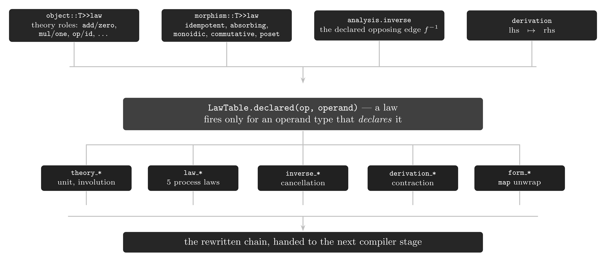

# the category graph (`/m/math/cat`)

`/m/math/cat` realizes types and insts as a **category**: types are the objects (the vertices), insts are the
morphisms (the edges), and an inst's dom/rng are its source and target endpoints.

```mtron
mtron> import(/m/math/cat,cat)
...
```
The category is not part of the default boot profile: the import above is what mounts `/m/math/cat` and binds the
`cat:` alias, and none of the lifts below resolves on a machine that has not imported it.

The lift is a type constructor. An _object_ is constructed from a type and a _morphism_ from an inst. This structure is
called the **cat-graph**.

<!-- figure source: assets/tikz/cat-lift.tex — white ink on transparent (the site theme is dark); edit there, re-render with the tikz MCP server, drop the PNG in assets/ -->


A **vertex** is a type lifted to `object::T`; an **edge** is an inst lifted to `morphism::T`. Every morphism is
classified on four axes — `form` (its n-tid coefficient shape), `class` (its set-theoretic class), `position` (its
place in the graph), and `law` (the algebraic laws it obeys) — and every object carries the structural theories it
models. Those same declarations are what the rewriter stage consumes (see *the declared rewrites*).

A law is either **structural**, declared at an object, or **process**, declared at a morphism. Both kinds of
declaration are consumed by the later lifts: when `code::T` is modeled as a vertex on a graph of rewrite edges, the
rules a vertex may take are read from exactly these declarations (see *the declared rewrites* and *the third lift*).

## the first lift — types as objects (`object::T`)

```mtron
mtron> int::T.as(object::T)
==>object[int]::[obj=>int::T,
                 law=>[ring=>ring_theory::[add=>!*/m/inst/plus?rng=/m/int&dom=/m/int,
                                           mul=>!*/m/inst/mult?rng=/m/int&dom=/m/int,
                                           zero=>0,
                                           one=>1],
                       add_group=>group_theory::[
                        op=>!*/m/inst/plus?rng=/m/int&dom=/m/int,
                        id=>0,
                        inv=>!*/m/inst/neg?rng=/m/int&dom=/m/int],
                       add_monoid=>monoid_theory::[
                        op=>!*/m/inst/plus?rng=/m/int&dom=/m/int,
                        id=>0],
                       mult_monoid=>monoid_theory::[
                        op=>!*/m/inst/mult?rng=/m/int&dom=/m/int,
                        id=>1]],
                 morphed_to=>!inst(){<j>},
                 morphed_from=>!inst(){<j>}]
```
### the object fields

| field          | what it is                                                                |
|----------------|---------------------------------------------------------------------------|
| `obj`          | the type this object wraps (the vertex itself)                            |
| `morphed_to`   | the morphisms **sourced from** this object (the outgoing edges)           |
| `morphed_from` | the morphisms **targeted at** this object (the incoming edges)            |
| `law`          | the structural theories this object models (see *the algebraic theories*) |

```mtron
mtron> int::T.as(object::T).morphed_to()
==>morphism::[name=>as,
              form=>mapper,
              src=>!inst(#{*}::T){<j>},
              trgt=>!inst(#{*}::T){<j>},
              analysis=>!inst?#<=#(#{*}::T){<j>},
              obj=>as?bool<=int(bool::T){<j>}]
==>morphism::[name=>as,
              form=>mapper,
              src=>!inst(#{*}::T){<j>},
              trgt=>!inst(#{*}::T){<j>},
              analysis=>!inst?#<=#(#{*}::T){<j>},
              obj=>as?bytes<=int(bytes::T){<j>}]
==>morphism::[name=>as,
              form=>mapper,
              src=>!inst(#{*}::T){<j>},
              trgt=>!inst(#{*}::T){<j>},
              analysis=>!inst?#<=#(#{*}::T){<j>},
              obj=>as?real<=int(real::T){<j>}]
==>morphism::[name=>as,
              form=>mapper,
   ...
```
### the algebraic theories

An object can model several algebraic structures. `object::T>>law` is a rec keyed by the name given to each
instance at declaration, and each role holds a `!*` (`auto_from`) pointer to the *live* operation rather than a copy:
the graph holds the references, and a role dereferences transparently on `>>` (`...>>law>>ring>>add` yields the
inst). The first example above is the `int` case in full: its law rec declares a `ring` and the three constituent
group/monoid instances. `theory::T` is the nominal super-type grouping them:

| type                 | roles (fields)                     | what it asserts                                                                                                                                 |
|----------------------|------------------------------------|-------------------------------------------------------------------------------------------------------------------------------------------------|
| `ring_theory`        | `add`, `mul`, `zero`, `one`        | $\langle R, +, \cdot, 0, 1 \rangle$: $+$ an abelian group, $\cdot$ a monoid, $a \cdot (b + c) = a \cdot b + a \cdot c$                          |
| `field_theory`       | `add`, `mul`, `zero`, `one`, `inv` | $\langle F, +, \cdot, 0, 1, {}^{-1} \rangle$: a commutative ring where every non-$0$ element has a multiplicative inverse, $x \cdot x^{-1} = 1$ |
| `rig_theory`         | `add`, `mul`, `zero`, `one`        | $\langle S, +, \cdot, 0, 1 \rangle$: additive and multiplicative monoids, $\cdot$ distributive over $+$, no additive inverses                   |
| `group_theory`       | `op`, `id`, `inv`                  | $\langle G, \cdot, 1, {}^{-1} \rangle$: $g \cdot g^{-1} = g^{-1} \cdot g = 1$                                                                   |
| `monoid_theory`      | `op`, `id`                         | $\langle M, \cdot, 1 \rangle$: $m \cdot 1 = 1 \cdot m = m$ and $(m \cdot n) \cdot p = m \cdot (n \cdot p)$                                      |
| `boolean_theory`     | `or`, `and`, `not`, `zero`, `one`  | $\langle B, \lor, \land, \lnot, 0, 1 \rangle$: a complemented distributive lattice, $b \lor \lnot b = 1$ and $b \land \lnot b = 0$              |
| `lattice_theory`     | `meet`, `join`, `bottom`, `top`    | $\langle L, \sqcap, \sqcup, \bot, \top \rangle$: every pair of elements has a meet and a join, bounded by $\bot$ and $\top$                     |
| `semilattice_theory` | `op`, `id`                         | $\langle S, \sqcup, 0 \rangle$: an idempotent commutative monoid (one side of a lattice)                                                        |
| `near_ring_theory`   | `add`, `mul`, `zero`               | $\langle N, +, \cdot, 0 \rangle$: $+$ a group, $\cdot$ a monoid, one-sided distributivity, no multiplicative $1$                                |

## the second lift — insts as morphisms (`morphism::T`)

```mtron
mtron> |plus?int<=int(int::T).as(morphism::T)
==>morphism[plus?rng=int&dom=int]::[
    name=>plus,
    form=>mapper,
    class=>[endo],
    src=>!inst(#{*}::T){<j>},
    trgt=>!inst(#{*}::T){<j>},
    analysis=>!inst?#<=#(#{*}::T){<j>},
    obj=>plus?int<=int(int::T),
    ...(1 more)]
```
The `|` in that expression is a `block` inst; it keeps the instruction from being evaluated, so that the raw inst is
lifted rather than its result.

### the morphism fields

| field        | what it is                                                                                               |
|--------------|----------------------------------------------------------------------------------------------------------|
| `name`       | the operation's name                                                                                     |
| `obj`        | the inst this morphism wraps (the edge itself)                                                           |
| `form`       | the n-tid coefficient shape — see *the form axis*                                                        |
| `class`      | the set-theoretic class (`endo`, `iso`, `auto`, `mono`, `epi`, `section`, `retraction`)                  |
| `src`        | the source object (the morphism's dom)                                                                   |
| `trgt`       | the target object (the morphism's rng)                                                                   |
| `derivation` | the declared defining equation, `lhs ↦ rhs`, when the operation is derived (see *the declared rewrites*) |
| `law`        | the declared **process** laws the morphism obeys (see *the process laws*)                                |
| `analysis`   | a lazy sub-block of whole-graph stats — see *the analysis sub-block*                                     |

### the form axis

`form` is the morphism's n-tid coefficient shape — the `(dom_c, rng_c)` pair in regex notation:

| form         | what it is                                                        |
|--------------|-------------------------------------------------------------------|
| `initial`    | maps nothing to objs (`dom_c = 0`)                                |
| `terminal`   | maps objs to nothing (`rng_c = 0`)                                |
| `mapper`     | one-to-one obj transformation (`dom_c = rng_c = 1`)               |
| `filter`     | conditionally passes or drops an obj (`dom_c = 1, rng_c = {0,1}`) |
| `flatmapper` | one-to-many obj transformation (`dom_c = 1, rng_c > 1`)           |
| `scatter`    | maps an obj to objs (`rng_c = {0,}`)                              |
| `gather`     | maps objs to objs (`dom_c = {0,}`)                                |
| `reducer`    | gathers objs into a single output (`rng_c = 1`)                   |
| `fork`       | splits objs across parallel streams                               |
| `join`       | merges parallel streams into a single stream                      |
| `catcher`    | intercepts a `fail` obj for recovery                              |
| `standard`   | an instruction with no well-defined classification                |

Two forms collapse onto the stream-ring's function subrings for the rewrite algebra: `scatter` is the linearized
one-to-many (`flatmapper`) and `join` is the many-to-many merge (`gather`). On that projection, a coefficient floats
through `mapper` / `filter` / `flatmapper` — the `floatable` run — and is anchored by `reducer` / `gather` — the
`blocked` cut (see *the process laws*).

### the dual incidence

`src`/`trgt` and `morphed_to`/`morphed_from` are the same relation seen from opposite sides:

| from       | dom side (out) | rng side (in)  |
|------------|----------------|----------------|
| an object  | `morphed_to`   | `morphed_from` |
| a morphism | `src`          | `trgt`         |

`morphed_to(A)` is $\{ f \mid \mathrm{src} (f) = A \}$; `morphed_from(A)` is $\{ f \mid \mathrm{trgt} (f) = A \}$.
Composing them round-trips — from an object to its edges and back, or from an edge to its endpoints and back.

### the analysis sub-block

`analysis` is one lazy `auto()` — evaluated with `>>analysis`. Inside it, each stat is itself lazy:

| field       | what it is                                                                                                                                                                                                                                                                                                                                                                                                                                                               |
|-------------|--------------------------------------------------------------------------------------------------------------------------------------------------------------------------------------------------------------------------------------------------------------------------------------------------------------------------------------------------------------------------------------------------------------------------------------------------------------------------|
| `family`    | the same-name siblings: $\{ g \mid \mathrm{op}(g) = \mathrm{op}(f) \}$ — every registration of the same operator                                                                                                                                                                                                                                                                                                                                                         |
| `contested` | the witness edges behind the `ambiguous` / `incomparable` labels — the competing siblings                                                                                                                                                                                                                                                                                                                                                                                |
| `orbit`     | the connected component of the source object in the reversible core — all objects reached by edges that exist in both directions                                                                                                                                                                                                                                                                                                                                         |
| `position`  | the edge's place among its siblings (a subset of the six kinds below)                                                                                                                                                                                                                                                                                                                                                                                                    |
| `inverse`   | the opposing edge $f^{-1}$ with $f \cdot f^{-1} = 1$ (only when a declared inverse exists)                                                                                                                                                                                                                                                                                                                                                                               |
| `combiner`  | the edge a reducer's partials recombine through, $(a \uplus b) \cdot r = (a \cdot r \uplus b \cdot r) \cdot \mathrm{combiner}(r)$ — computed, never declared: a fold declaring `monoidic` + `commutative` is its own, a fold defined by its `derivation` names the fold that defines it (`count` ↦ `sum`, `order` ↦ `kmerge`); a keyed fold (`group`) recombines pointwise through a chain — `sum`, then a per-key fold — that no single edge names, so it has none here |

### the six edge kinds

`position` classifies an edge against the rest of the graph into up to six labels:

<!-- figure source: assets/tikz/cat-positions.tex (same recipe) -->


| kind           | the relation to the graph                                                               |
|----------------|-----------------------------------------------------------------------------------------|
| `duplicate`    | another morphism of the same family maps the same dom to the same rng                   |
| `ambiguous`    | contested by an incomparable sibling that *overlaps* it — dispatch has no winner        |
| `incomparable` | contested by an incomparable, *disjoint* sibling — dispatch stays total                 |
| `coupling`     | an edge in the opposite direction links the same two objects — a candidate inverse pair |
| `isochain`     | endpoints linked by a chain of couplings — one orbit of the reversible core             |
| `retract`      | mutually reachable and round-trip idempotent — a subobject retraction                   |

`orbit` is the transitive closure of `coupling` — the connected component of the *reversible core* (the subgraph of
edges that exist in both directions). It is a reachability class, coarser than isomorphism (which needs the round trip
to be idempotent → `retract`) and finer than raw incidence.

### the class axis

`class` classifies a morphism set-theoretically — as self-mapping, invertible, or split. Only the sound implications
are computed; proper (non-split) mono/epi classification requires composition, which is not yet registered:

| class        | what it asserts                                                                           |
|--------------|-------------------------------------------------------------------------------------------|
| `endo`       | self-mapping — $\mathrm{dom}(f) = \mathrm{rng}(f)$                                        |
| `auto`       | an invertible endomorphism — `endo` and `iso`                                             |
| `iso`        | invertible — currently a self-inverse (involution)                                        |
| `mono`       | left-cancellable — $f \cdot g = f \cdot h \Rightarrow g = h$ (here: a split monomorphism) |
| `epi`        | right-cancellable — $g \cdot f = h \cdot f \Rightarrow g = h$ (here: a split epimorphism) |
| `section`    | split mono — $f$ has a left inverse                                                       |
| `retraction` | split epi — $f$ has a right inverse                                                       |

### the process laws

The morphism's `law` field is a set of **process** law labels served from `mInstSetLawTable` (the declared process
laws):

```mtron
mtron> |plus?int<=int(int::T).as(morphism::T)>>law
==>[commutative,
    right_distributive,
    action,
    pure]
```
| law                  | what it asserts                                                              |
|----------------------|------------------------------------------------------------------------------|
| `commutative`        | $a \cdot b = b \cdot a$                                                      |
| `left_distributive`  | $a \cdot (b + c) = a \cdot b + a \cdot c$                                    |
| `right_distributive` | $(a + b) \cdot c = a \cdot c + b \cdot c$                                    |
| `monoidic`           | an associative binary op with an identity                                    |
| `magmadic`           | a bare binary op — a magma, as `monoidic` is a monoid — no identity demanded |
| `unit`               | an identity element — $e \cdot x = x \cdot e = x$                            |
| `absorbing`          | an annihilator — $a \cdot x = a$ for every $x$                               |
| `action`             | a monoid/group acting on a carrier — $f(gh)x = f(g)f(h)x$                    |
| `involution`         | self-inverse — $f(f(x)) = x$ (period two)                                    |
| `idempotent`         | $f(f(x)) = f(x)$                                                             |
| `nilpotent`          | some power is zero — $f^n = 0$                                               |
| `floatable`          | the coefficient commutes through the stream ring's parallel/serial structure |
| `blocked`            | cannot float past a barrier — a reduce anchors the coefficient               |
| `pure`               | no effect: the result depends on the lhs and args alone (never inferred)     |
| `partial`            | pass-through-or-drop $\{0,1\}$ — the optional (maybe) lift of a value        |
| `kleene`             | the reflexive-transitive iterate $a^{*}$ — a Kleene closure                  |
| `prime`              | atomic — no nontrivial factorization                                         |
| `zero_divisor`       | a nonzero $a$ with $a \cdot b = 0$ for some nonzero $b$                      |
| `cyclic`             | generated by one element — every value is a power of a single generator      |
| `poset`              | the carrier is partially ordered — these insts are its comparisons           |

## the declared rewrites — laws as rules

Everything above is also the rewriter's input. A rule fires only when the operand's type **declares** the law that
the rule consumes, and the category is the rewrite table: an algebra registered on a type licenses the rules of that
type, and a type that models no such structure is left unchanged.

<!-- figure source: assets/tikz/cat-rewrites.tex (same recipe) -->


| rewrite                  | reads                                                                                       | rule                                                                                                                                                                                                                                                |
|--------------------------|---------------------------------------------------------------------------------------------|-----------------------------------------------------------------------------------------------------------------------------------------------------------------------------------------------------------------------------------------------------|
| `theory_unit_removal`    | every theory instance of the operand's type                                                 | $\mathrm{op}(\mathrm{id}) \leadsto \varepsilon$                                                                                                                                                                                                     |
| `theory_involution`      | $\mathrm{law} \ni \mathrm{involution}$, or the declared `inv` role                          | $f \cdot f \leadsto \varepsilon$                                                                                                                                                                                                                    |
| `law_idempotent`         | $\mathrm{law} \ni \mathrm{idempotent}$                                                      | $f \cdot f \leadsto f$                                                                                                                                                                                                                              |
| `law_absorbing`          | $\mathrm{law} \ni \mathrm{absorbing}$                                                       | $g \cdot f \leadsto f$ for a pure $g$ handing $f$ one obj per obj: a mapper of the carrier, a filter too when $f$'s dom is non-strict, any $g$ when $f$ answers noobj                                                                               |
| `law_monoidic`           | $\mathrm{law} \ni \mathrm{monoidic}$ + the `reducer`/`join` form                            | $f \cdot f \leadsto f$                                                                                                                                                                                                                              |
| `law_poset`              | $\mathrm{law} \ni \mathrm{poset}$                                                           | $\mathrm{is}(\mathrm{gt}(a)) \cdot \mathrm{is}(\mathrm{gt}(b)) \leadsto \mathrm{is}(\mathrm{gt}(\max(a, b)))$, $\min$ for `lt` — filters only: a bare `gt` answers a bool                                                                           |
| `inverse_cancellation`   | `analysis.inverse`                                                                          | $f(a) \cdot f^{-1}(a) \leadsto \varepsilon$                                                                                                                                                                                                         |
| `form_map_unwrap`        | the stream lift `map`                                                                       | $\mathrm{map}(f) \leadsto f$                                                                                                                                                                                                                        |
| `derivation_contraction` | `derivation`                                                                                | $\mathrm{plus} \cdot \mathrm{neg} \leadsto \mathrm{minus}$, $\mathrm{mult} \cdot \mathrm{inv} \leadsto \mathrm{div}$                                                                                                                                |
| `branch_collapse`        | the additive role of the operand's algebra — `cut => [role => add]`                         | $\mathrm{S}(x, \ldots, x) \leadsto \mathrm{S}(x\{n\})$ — equal terms collapse, summing the coefficients                                                                                                                                             |
| `branch_inline`          | the additive role — `cut => [role => zero]`                                                 | $a \cdot \mathrm{S}(b) \cdot c \leadsto a \cdot b \cdot c$, $\mathrm{S}_{\{c\}}(b) \leadsto b\{c\}$, $\mathrm{S}(x) \leadsto \mathrm{map}(x)$                                                                                                       |
| `law_shard`              | `form = reducer` with a `combiner` declaring `monoidic`, `commutative` + a live peer roster | the seed partitions, each peer folds its shard, and the master recombines the partials through the `combiner` (Thm 19) — `sum`, `prod`, `count`, `order`, rec `sum` (distributed rec merging), and a keyed `group` pointwise (see *the deep merge*) |

**Most declared laws carry no rule.** Five of them back a rule directly — `involution`, `idempotent`, `absorbing`,
`monoidic`, `poset` — and `floatable` and `blocked` do not drive a rule of their own but constrain where a
distribution plan may anchor (its spans). `pure` constrains every rule that moves, drops or replicates code: only a
declared-pure instruction is swallowed by `law_absorbing` or replicated into `law_shard`'s floatable run, and an
instruction that does not declare it is effectful (`to`, `print`, `side` stay where they are). The remaining labels
are classification predicates, recorded for the
rewriter's guards and for reasoning, with no rewrite of their own: `commutative`, `unit`, `magmadic`, `nilpotent`,
`kleene`, `partial`, `prime`, `cyclic`, `zero_divisor`, `left_distributive`, `right_distributive`, `action`.
`commutative` is the cleanest case: a canonical form for a commutative operand would be a no-op where it is legal — a
stream (`{3,1,2}` already equals `{1,2,3}`) — while for an `lst` it would be unsound, its order being
semantic. The law stays declared (it is what licenses the inverse-pair search) without a rewrite.

The first two generalize a *ring's* unit and a *group's* inverse to every declared structure: the unit law is read
for each `(op, id)` role pair a theory names (`add`/`zero`, `mul`/`one`, `op`/`id`, `or`/`zero`, `and`/`one`,
`join`/`bottom`, `meet`/`top`), so $x + 0$, $x \cdot 1$, $x \cdot \langle\rangle$ (uri), $x \cdot .$ (machine) and
$x \cdot \mathrm{id}$ (code) all drop, and a bare identity *operation* (`code`'s $\mathrm{id}$) is the identity
morphism. The involution law holds for every operation declared `involution` — `neg`, `inv`, `not`, `reverse`,
`conjugate` — not only the additive group's.

```mtron
mtron> 5.plus(0)
==>5
mtron> 5.id()
==>5
mtron> 5.neg().neg()
==>5
mtron> "ab".reverse().reverse()
==>'ab'
```
The process laws act on the chain, each gated by the operand type's declaration:

```mtron
mtron> "ab".ucase().ucase()
==>'AB'
mtron> 2.zero().zero()
==>0
mtron> {1,2,3}.sum().sum()
==>6
mtron> 5.plus(3).zero()
==>0
mtron> {1,2,3,4,5}.is(gt(1)).is(gt(3))
==>4
==>5
```
The two *relational* declarations — the opposing edge and the defining equation — underlie the final two rules:

```mtron
mtron> 5.plus(3).minus(3)
==>5
mtron> 6.plus(3.neg())
==>3
mtron> 6.0.mult(2.0.inv())
==>3.0
mtron> {1,2,3,4}.inst(_,+1,+2){ map(*0).plus(*1).plus(*2) }
==>6
==>9
==>12
==>15
```
**A worked compression.** One expression, four of the rules above firing, and the whole chain collapses from eight
operations to two. `explain()>>format` prints the *compiled* code — the op, its dom/rng, its arg and its coefficient
shape per line — so that every rewrite applied is visible:

```mtron
mtron> 6.plus(0).mult(1).neg().neg().plus(3.neg()).mult(2).div(2)
==>3
mtron> 6.plus(0).mult(1).neg().neg().plus(3.neg()).mult(2).div(2).explain()>>format
==>"""
    op     dom          rng     args  f    desc     c_dom  c_rng 
    start  noobj{0}::T  int::T  6     <j>  initial  {0}    {1}   
    minus  int::T       int::T  3     <j>  mapper   {1}    {1}   
   """
```
Only two instructions remain in the explain table: the seed and the one operation that survives. The other
instructions were rewritten away:

* `plus(0)` and `mult(1)` are the int ring's units (`theory_unit_removal`),
* `neg().neg()` is the additive group's involution (`theory_involution`),
* `plus(3.neg())` folds to `minus(3)` (`derivation_contraction`), and
* `mult(2).div(2)` is a declared inverse pair (`inverse_cancellation`).

**Direction.** Every rule above either removes or preserves chain length, so a rule set that is only ever applied in
that direction settles under any `rewriter::T` that iterates the rewrite stage to a fixpoint — the bundled
`fixpoint_rewriter` (`fixpoint_rewriter::[max=>N]`, bounded iterations) is one such stage, not the only one. The dual of
`derivation_contraction`, `derivation_expansion`
($\mathrm{minus} \leadsto \mathrm{plus} \cdot \mathrm{neg}$), is deliberately **not** registered: it trades the
length back, so the pair would alternate forever and no stage could settle. Lowering to a target that lacks the
derived operation is a policy, not a law.

### the deep merge — the rec monoid a keyed fold recombines through

`+` on recs is a **deep merge**, and `sum` is its fold: $\mathrm{sum} (\{r_1, \ldots, r_n\}) = r_1 + \cdots + r_n$.
The keys union, and a key on both sides merges its two values by their kind:

| the two values            | their merge                           | so                                                            |
|---------------------------|---------------------------------------|---------------------------------------------------------------|
| recs                      | $r(k) + s(k)$ — recurse, key by key   | a nested rec merges at every depth                            |
| anything else, `lst`s too | $x \uplus y$ — appended into a stream | equal values bulk, $5 \uplus 5 = \{2\}5$; a `lst` stays whole |

A `lst` is an **atom** of the merge: two colliding `lst`s make a stream of `lst`s, $[1,2,3] \uplus [2,3]$, never their
concatenation — the union is commutative, so its fold is defined over a stream. Rec `sum` declares `monoidic` and
`commutative`, so `law_shard` distributes a rec merge as it distributes a sum of ints: each peer merges its share of
the recs and the master merges the partial recs. Concatenating `lst` values is said by
the expression, with a select's `+`: $[1,2,3] \mathbin{+\!\!+} [2,3]$ is `[a=>[1,2,3]]==[a=>+[2,3]]`.

A coefficient is a **multiplicity**, read the way every access reads it — the outer $c$ multiplied into what it holds,
$\{c\}[k \Rightarrow v] = [k \Rightarrow \{c\}v]$, all the way down to the merge's atoms, where $\{c\}v$ is $v$'s
multiplicity in the stream (a `lst`'s too). A bulked rec therefore merges as the copies it stands for,
$\{c\}r = r + \cdots + r$ ($c$ times), and a fold over a stream answers what it answers over the copies.

A weekend of dog walks makes the rules concrete. Each day files one report: dog ⇒ kilometres per trail, plus the
places visited.

```mtron
mtron> /usr/walk/sat -> [mama=>[km=>[ridge=>12,lake=>5],visited=>[arroyo]],puppy=>[km=>[ridge=>12]],chelsea=>[km=>[lake=>5]]]
==>[mama=>[km=>[ridge=>12,lake=>5],
           visited=>[arroyo]],
    puppy=>[km=>[ridge=>12]],
    chelsea=>[km=>[lake=>5]]]
mtron> /usr/walk/sun -> [mama=>[km=>[ridge=>9],visited=>[acequia,mesa]],puppy=>[km=>[lake=>5]],chelsea=>[km=>[lake=>5]]]
==>[mama=>[km=>[ridge=>9],visited=>[acequia,mesa]],
    puppy=>[km=>[lake=>5]],
    chelsea=>[km=>[lake=>5]]]
mtron> */usr/walk/sat + */usr/walk/sun
==>[mama=>[km=>[ridge=>{12,9},lake=>5],
           visited=>{[arroyo],[acequia,mesa]}],
    puppy=>[km=>[ridge=>12,lake=>5]],
    chelsea=>[km=>[lake=>{2}5]]]
```
<!-- figure source: assets/tikz/cat-deep-merge.tex (same recipe) -->


Every rule fires in that one merge:

* every dog is in both reports, so each dog's rec merges — and so does each `km` rec, one level down;
* `mama`'s `ridge` is in both: `12` and `9` append into the stream `{12,9}`, while `mama`'s `lake` is Saturday's alone
  and
  is kept;
* `puppy`'s two days share no trail, so the two `km` recs simply union;
* `chelsea` walked the same loop on both days — two equal values, which bulk to `{2}5`;
* `mama`'s `visited` values are `lst`s — atoms of the merge — so the two days' lists stream whole,
  `{[arroyo],[acequia,mesa]}`.

The merge keeps every partial; a **per-key fold** reduces them. `==` (`select`) applies a pattern rec key by key — `_`
matches every key and a nested pattern descends — so the weekend's totals are one select away: `sum` reads `{12,9}` as
$12 + 9$ and `{2}5` as $5 + 5$, while `visited=>_` keeps the stream of lists as it is.

```mtron
mtron> */usr/walk/sat.plus(*/usr/walk/sun)==[_=>[km=>[_=>sum()],visited=>_]]
==>[mama=>[km=>[ridge=>21,lake=>5],
           visited=>{[arroyo],[acequia,mesa]}],
    puppy=>[km=>[ridge=>12,lake=>5]],
    chelsea=>[km=>[lake=>10]]]
```
To join the lists rather than stream them, the expression says so — a select's `+` concatenates the slots:

```mtron
mtron> */usr/walk/sat==[mama=>[visited=>+[acequia,mesa]]]
==>[mama=>[visited=>[arroyo,acequia,mesa]]]
```
A stream of equal recs is one rec with a coefficient, and the merge reads it as the copies it stands for — the bulked
`sum` is the explicit `+`:

```mtron
mtron> {[puppy=>[km=>[ridge=>12]]],[puppy=>[km=>[ridge=>12]]]}
==>{2}[puppy=>[km=>[ridge=>12]]]
mtron> {[puppy=>[km=>[ridge=>12]]],[puppy=>[km=>[ridge=>12]]]}.sum()
==>[puppy=>[km=>[ridge=>{2}12]]]
mtron> [puppy=>[km=>[ridge=>12]]] + [puppy=>[km=>[ridge=>12]]]
==>[puppy=>[km=>[ridge=>{2}12]]]
```
**The keyed combiner.** This is how `law_shard` recombines a keyed fold. `group([k ⇒ h])` is a homomorphism from the
stream into the recs of $h$'s monoid, so its combiner is computed from $h$'s rather than declared,
$\mathrm{combiner} (\mathrm{group} ([k \Rightarrow h])) = \mathrm{sum} \cdot \mathrm{select} ([\_ \Rightarrow \mathrm{combiner} (h)])$:
the peers' partial recs deep-merge, and each key folds through $h$'s combiner — exactly the select above. `merge()`
bulks equal partials (two peers answering `[k=>1]` arrive as `{2}[k=>1]`), and the coefficient reading is what keeps
both counted. A `lst`-valued fold recombines the same way: an `order`'s sorted partials stream whole per key — a stream
of
runs, never their slots — and `kmerge` merges the runs.

## the third lift — code as a vertex (`path::T`, `abstraction::T`)

The first two lifts put types and insts *into* the graph; the third puts **code** in. A chain lifted to `path::T`
is a vertex whose out-edges are the rewrite rules that can move it — the rewrite graph, generated one dereference
at a time, never materialized whole. Its pointwise image under $\alpha$ is `abstraction::T`: the same chain with
every instruction replaced by its `morphism::T`, i.e. **value code below, type code above**.

<!-- figure source: assets/tikz/cat-third-lift.tex (same recipe) -->


### `path::T` — value code as a vertex

| field         | what it is                                                                                                      |
|---------------|-----------------------------------------------------------------------------------------------------------------|
| `obj`         | the chain itself (the value code)                                                                               |
| `origin`      | (optional) where the code starts — the machine's own `place::T`, attached on lift when the machine answers; absent means not placeable (`bind` requires it) |
| `where`       | (optional) the realized placement — span → place, written by the pass that applied a distribution rule: `{[span=>at] => [place…]}` lists the places the shard actually shipped to |
| `peer`        | (optional) the `peer::T` recs the deployment used                                                               |
| `<rule name>` | one edge per **live** rewrite — the edge holds the `plan::T` (see below); `lower(plan)` applies it and re-lifts |

Only live edges are materialized (see *a-priori pruning*): a vertex lists exactly the rules that can move it, and a
**normal form prints as its own certificate** — `[path::[obj=>...]]`, no out-edges, zero matches attempted. A
traversal chain is a derivation witness: each step is labeled by the rule that justifies it (a composite 2-cell).
The `==` between segments is a structural `select` — each segment names the step, a lift or a lower, applied to the
previous segment's result, so a descent `[seed] == [lift] == [lower₁] == [lower₂]` reads as a chain of witnesses. The
three steps below are the same vertex after each application — the path shrinks as the rewrites fire:

```mtron
mtron> [start(5).plus(0).neg().neg()]==[as(cat:path::T)]
==>[path::[obj=>start(5).plus(0).neg().neg(),
           theory_unit_removal=>plan::[name=>theory_unit_removal,
                                       cut=>[role=>id],
                                       where=>[[shape=>none,span=>[[span=>at]]]]],
           theory_involution=>plan::[name=>theory_involution,
                                     cut=>[law=>[involution]],
                                     where=>[[shape=>local,span=>[[span=>at]]]]],
           derivation_contraction=>plan::[name=>derivation_contraction,
                                          cut=>[role=>derivation],
                                          where=>[[shape=>local,span=>[[span=>at]]]]]]]
mtron> [start(5).plus(0).neg().neg()]==[as(cat:path::T)]==[lower(>>theory_involution)]
==>[path::[obj=>start(5).plus(0),
           theory_unit_removal=>plan::[name=>theory_unit_removal,
                                       cut=>[role=>id],
                                       where=>[[shape=>none,span=>[[span=>at]]]]],
           derivation_contraction=>plan::[name=>derivation_contraction,
                                          cut=>[role=>derivation],
                                          where=>[[shape=>local,span=>[[span=>at]]]]]]]
mtron> [start(5).plus(0).neg().neg()]==[as(cat:path::T)]==[lower(>>theory_involution)]==[lower(>>theory_unit_removal)]
==>[path::[obj=>start(5)]]
```
**A-priori pruning.** Whether an edge is live is decided from declarations alone — no match is attempted. Each
rule's guard factors into a *type-part* (laws, forms, adjacency of classifications) and a *value-residue* (operand
equality, literal values); the pruner tests only the type-part, a **necessary** condition, so pruning a rule is a
*proof* of identity ("no match in the abstraction, no match in the concrete") while keeping one merely licenses the
real match. A rule the pruner does not know is never pruned.

### `abstraction::T` — the α-word

| field | description                                                                                                                                                                                                                                  |
|-------|----------------------------------------------------------------------------------------------------------------------------------------------------------------------------------------------------------------------------------------------|
| `obj` | the abstract word $\alpha(f_1 \cdots f_n) = \alpha(f_1) \cdots \alpha(f_n)$ — each instruction as its `morphism::T`: the surface a `plan::T`'s guard reads (its law/form/theory), the code and its descent staying anchored at `path::T.obj` |
| `where` | (optional) the α **place-class word** — the places the code can be distributed TO (its declared roster machines and dialed peers) as a list of `place::T`; the surface a placement guard reads, the location twin of `obj`'s instruction word. Absent with no reach, and `law_shard` is then not a live morphism |

The lift to `abstraction::T` is **lossy by design**: it carries the pointwise α-image — one `morphism::T` per
instruction,
each already carrying `form`, `class`, `law`, and `analysis` — not a second concrete chain. Nor is it a vertex one
descends through: no traversal runs over the abstraction, because it is only the lookup surface from which a `plan::T`
derives its rewrite. The guard reads the laws/forms/theories off the word (`*…/obj/1/law`, `*…/obj/2/analysis/inverse`)
and computes its cut/span/where without consulting the code below; the descent ($\gamma$) runs only through
`path::T.obj`.

```mtron
mtron> [start(5).plus(0).neg().neg()]==[as(cat:path::T)]==[as(cat:abstraction::T)]
==>[abstraction::[obj=>[morphism[start]::[name=>start,
                                          form=>initial,
                                          src=>!inst(#{*}::T){<j>},
                                          trgt=>!inst(#{*}::T){<j>},
                                          analysis=>!inst?#<=#(#{*}::T){<j>},
                                          obj=>start(5)],
                        morphism[plus?rng=int&dom=int]::[
                         name=>plus,
                         form=>mapper,
                         class=>[endo],
                         src=>!inst(#{*}::T){<j>},
                         trgt=>!inst(#{*}::T){<j>},
                         analysis=>!inst?#<=#(#{*}::T){<j>},
                         obj=>plus(0),
                         ...(1 more)],
                        morphism[neg?rng=int&dom=int]::[
                         name=>neg,
                         form=>mapper,
                         class=>[endo,
                                 iso,
                                 auto,
                                 section,
                                 retraction,
                                 mono,
                                 epi],
                         src=>!inst(#{*}::T){<j>},
                         trgt=>!inst(#{*}::T){<j>},
                         analysis=>!inst?#<=#(#{*}::T){<j>},
                         obj=>neg(),
                         ...(1 more)],
                        morphism[neg?rng=int&dom=int]::[
                         name=>neg,
                         form=>mapper,
                         class=>[endo,
                                 iso,
                                 auto,
                                 section,
                                 retraction,
                                 mono,
                                 epi],
   ...
```
### `plan::T` — a rewrite rule as a value

A `path::T` out-edge is not a bare rule name — it is a **plan**: the rewrite rule itself, lifted to a first-class
value. `plan::T` is the morphism of the rewrite category (`path → path`), and it is *data*, never a closure: a plan
is introspectable and applicable wherever it is supplied.

<!-- figure source: assets/tikz/cat-plan.tex (same recipe) -->


A plan is always the rec `[name, cut, where]`; what distinguishes a local plan from a distribution is what its `cut`
names and where its `where` sends it:

| shape            | the `cut` reads                                                                | the `where`                                            | example                                                                                          |
|------------------|--------------------------------------------------------------------------------|--------------------------------------------------------|--------------------------------------------------------------------------------------------------|
| **local**        | a declared process law — `[law => [...]]` — or a theory role — `[role => ...]` | stays local (`target => none` / `local`)               | `law_idempotent` → `cut => [law => [idempotent]]`; `theory_unit_removal` → `cut => [role => id]` |
| **distribution** | a `form` + `law` anchor — the laws its `combiner` must declare                 | ships to `peers`, with the combiner re-applied locally | `law_shard` → `cut => [form => reducer, law => [monoidic, commutative]]`                         |

The application is a **type method**, not a field: `lower(plan::T)` is one instruction registered in
`catInstSet.insts()`, shared by every plan. It matches the plan's `cut` against the path's code, applies the rewrite,
and re-lifts the result to `path::T`. The plan carries no `result` λ; `lower` *is* the operator.

A relocation decision in `plan.where` is `[shape, target?, hops?, span]` — `shape` is the topology token
(`local` / `none` / `peer` / `peers` / `space` / `tree` / `shuffle`), `target` the concrete address. Each shape
declares the laws it demands of a cut shipped to it (§3, two directions):

| shape    | obligations                              |
|----------|------------------------------------------|
| `local`, `space`, `none` | —                          |
| `peer`, `peers`, `tree`  | `monoidic`, `commutative`  |
| `shuffle`               | `monoidic`                 |

`PlanBuilder.create()` validates a cut plan against this table (`obligations(shape) ⊆ cut.laws`); the reverse
traversal `admissible(laws)` reads it the other way.

`bind(plan::T)` is the cut-less operator — the distribution rule. It requires a plan with **no cut** and a path with
an `origin`; `lower` is the cut-plan sibling, and both share one body (`apply(plan, env)` over an environment
snapshot). Until the `move` rule ships (a later phase), a cut-less plan is the identity — the code stands where it
stood.

**A distribution plan requires peers.** `law_shard` is live only over a non-empty peer roster: its guard reads the
machine's dialed peers, and with no peer it matches nothing, so `lower` is the identity. A `ws_client` dials and
self-registers a `peer::T` into the network; that registration is the condition that turns the rule live:

```mtron
mtron> ws_client::[host=>ws://localhost:8555/mtron]
==>[host=>ws://localhost:8555/mtron,
    send=>inst(){<j>},
    send_recv=>inst(){<j>},
    close=>inst(){<j>},
    on_message=>print('received ${_}')]
mtron> */network
==>network::[host=>booger,
             status=>!inst(#{*}::T){<j>},
             q=>[subq::[pattern=>subq,
                        pre_read=>inst(uri::T){<j>},
                        pre_write=>inst(uri::T,#::T){<j>},
                        qless_write=>inst(uri::T,#::T){<j>},
                        obj=>[,]]],
             peer=>[ws/localhost/8555/mtron=>peer::[
              authority=>ws://localhost:8555,
              host=>ws://localhost:8555/mtron,
              transport=>inst(#{*}::T){<j>},
              client=>[host=>ws://localhost:8555/mtron,
                       send=>inst(){<j>},
                       send_recv=>inst(){<j>},
                       close=>inst(){<j>},
                       on_message=>print('received ${_}')]]],
             supervisor=>network_supervisor::[status=>supervising]]
```
`*~/network` reads back the current machine's network block — the dialed `peer::T` at the named host. With the
`machine::T`
now holding that `peer::T`, the `path::T` lists the distribution plan among its out-edges.

```mtron
mtron> [start({1,2,3,4,5}).plus(10).sum()]==[as(cat:path::T)]
==>[path::[obj=>start({1,2,3,4,5}).plus(10).sum(),
           theory_unit_removal=>plan::[name=>theory_unit_removal,
                                       cut=>[role=>id],
                                       where=>[[shape=>none,span=>[[span=>at]]]]],
           derivation_contraction=>plan::[name=>derivation_contraction,
                                          cut=>[role=>derivation],
                                          where=>[[shape=>local,span=>[[span=>at]]]]],
           law_shard=>plan::[name=>law_shard,
                             cut=>[form=>reducer,
                                   law=>[monoidic,commutative]],
                             where=>[[shape=>local,
                                      span=>[[span=>at],[span=>post]]],
                                     [shape=>tree,
                                      hops=>1,
                                      span=>[
                                       [span=>seed,flags=>[partition]],
                                       [span=>pre,flags=>[floatable,no_seed]],
                                       [span=>at]]]]]]]
```
Finally, the inst `lower?path<=path(plan)` applies a plan read off the path's out-edge — the examples read
`>>law_shard`. Its output is the same `path::T`, its `obj` now the distributed layout: the seed bulk partitioned into
shards whose seed carries the remaining hop budget (`start?hops=0` at a leaf), each shard shipped by a
`select([to(peer)])` to its roster member, merged, and recombined at home through the reducer's combiner (Thm 19). A
peer handed a shard with budget left plans it again over its own peers, so the shards form a tree. The plan — not its
application — is data, so the rewrite *schedule* and the out-edge
that licenses it are the same value: every rule is `lower(plan::T)`, and the rewrite table is the category itself.

```mtron
mtron> [start({1,2,3,4,5}).plus(10).sum()]==[as(cat:path::T)]==[lower(>>law_shard)]
==>[path::[obj=>start({1,2,3,4,5}).plus(10).sum(),
           theory_unit_removal=>plan::[name=>theory_unit_removal,
                                       cut=>[role=>id],
                                       where=>[[shape=>none,span=>[[span=>at]]]]],
           derivation_contraction=>plan::[name=>derivation_contraction,
                                          cut=>[role=>derivation],
                                          where=>[[shape=>local,span=>[[span=>at]]]]],
           law_shard=>plan::[name=>law_shard,
                             cut=>[form=>reducer,
                                   law=>[monoidic,commutative]],
                             where=>[[shape=>local,
                                      span=>[[span=>at],[span=>post]]],
                                     [shape=>tree,
                                      hops=>1,
                                      span=>[
                                       [span=>seed,flags=>[partition]],
                                       [span=>pre,flags=>[floatable,no_seed]],
                                       [span=>at]]]]]]]
```
A keyed fold lowers the same way, its master recombining pointwise: `merge().sum()` deep-merges the partial recs and
`select([_=>sum()])` folds each key (see *the deep merge*).

```mtron
mtron> [start({1,2,3,4,5,6}).group([mod(3)=>sum()])]==[as(cat:path::T)]==[lower(>>law_shard)]
==>[path::[obj=>start({1,2,3,4,5,6}).group([mod(3)=>sum()]),
           law_shard=>plan::[name=>law_shard,
                             cut=>[form=>reducer,
                                   law=>[monoidic,commutative]],
                             where=>[[shape=>local,
                                      span=>[[span=>at],[span=>post]]],
                                     [shape=>tree,
                                      hops=>1,
                                      span=>[
                                       [span=>seed,flags=>[partition]],
                                       [span=>pre,flags=>[floatable,no_seed]],
                                       [span=>at]]]]]]]
```
### may / must — the fiber modality

An abstraction stands for its **fiber** — every concrete chain that lifts to it — so the moves a `path::T` exposes,
decided by reading the abstraction, are claims quantified over that set in one of two strengths:

| modality   | the claim                                                          | example                                                                             |
|------------|--------------------------------------------------------------------|-------------------------------------------------------------------------------------|
| **must** □ | the rule fires for *every* fiber member — its guard reads no value | `law_shard` on $[\mathrm{initial}, \{\ast\}\mathrm{floatable}, \mathrm{reducer}]$   |
| **may** ◇  | the rule fires for *some* members; undecidable without values      | unit removal at $\mathrm{plus}(\mathrm{int})$ — only the $\mathrm{plus}(0)$ members |

Thus, the degree ordering $\mathrm{edges} (p) \subseteq \mathrm{edges} (\alpha (p))$ holds: the abstraction licenses
a move for the whole fiber when a rule's type-part matches its morphisms, and equality holds exactly when every edge
is a must-edge. Refinement is **edge-antitone** (order-reversing) — descending the rungs
($\mathrm{plus (int)} \to \mathrm{plus?int \le int (int{::}T)} \to \mathrm{plus} (0)$)
shrinks the fiber and discharges the ◇ into a □. A rule becomes *exact* at the rung whose type absorbs its residue.
Counting instances rather than rules, the ordering reverses: one licensed move fans out to one concrete edge per
match *site*, so the abstraction licenses more kinds of moves while the path licenses more copies of fewer kinds.

**Planning.** The lossy lift makes the fiber $\gamma$ of a vertex an infinite family, so no descent is made from an
arbitrary abstraction.
What the abstract walk computes is therefore not code but a **route**: a sequence of rule names, chosen in the
abstraction, where the graph is small, then **replayed on the path's code** (`path::T.obj`, the γ anchor), where the
values and sites exist (the path-lifting property of a fibration). Must-edges lift unconditionally; may-edges are the
backtrack points, known in advance — a plan's remaining ◇-count is readable as the degree gap between the path and its
abstraction. The replayed route *is* the derivation witness.

## the fourth lift — places (`place::T`)

`place::T` is the **location coordinate**: the machine a chunk runs on, lifted into the same graph as a vertex beside
`path::T`. It is read-through from the machine's two network tables — the **roster** (who is known) and the **peer
map** (who is dialed) — and is not a rewrite projection at all: a place is a machine, a `path::T` is code.

```mtron
mtron> <//ginger.local>.as(place::T)
==>place::[obj=>//ginger.local,
           authority=>[<ws://ginger.local:8555>],
           linked_to=>!inst(#{*}::T){<j>},
           linked_from=>!inst(#{*}::T){<j>},
           status=>!inst(#{*}::T){<j>}]
```

| field | what it is |
|---|---|
| `obj` | the machine address `//host[/path]` — `host()` is the roster key, `path()` the frame vid (empty = the host's root machine). Who evaluates. |
| `authority` | the transports that reach it (`scheme://host:port`); two aliases of one machine are values, never two places |
| `instset` | (optional) the ISAs resolvable here — the vocabulary coordinate |
| `source` | (optional) who declared it (`mdns`, boot profile, a dial) |
| `linked_to` | **derived** — the peers this machine dialed to this place (outbound edges) |
| `linked_from` | **derived** — the peers this machine accepted from this place (inbound edges) |
| `status` | **derived** — `known` (roster only) / `up` / `down` (dialed, probed) |

`obj` and `authority` are read from the roster once at lift; `linked_to`/`linked_from`/`status` are `auto` insts that
re-read the live peer map each dereference (the `object::T.morphed_to` pattern). The alias quotient is
`sameService`: a peer dialed at `127.0.0.1` links the place whose roster row says `0.0.0.0` — loopback aliases are one
place.

## see also

* [mtron type system](type-system-mtron.md) — vid/tid, coefficients, nominal vs structural, casting.
* [mtron language reference](language-reference-mtron.md) — `.as(type::T)`, `>>` rshift, coefficients.
* [math instruction set](math-instset-mtron.md) — `/m/math`, where the category and its theories live.
* [rewrite system](../metatron/references/rewrite-system-java.md) — the `rewriter::T` stage and rewrite instructions.
* [Stream Ring Theory](../../../articles/stream-ring-theory.html) — the coefficient algebra the laws speak:
  `floatable` / `blocked`, and Thm 19 which `law_shard` realizes.
* figure sources — `assets/tikz/cat-*.tex` (TikZ, rendered with the tikz MCP server; the PNGs sit beside them in
  `assets/`).