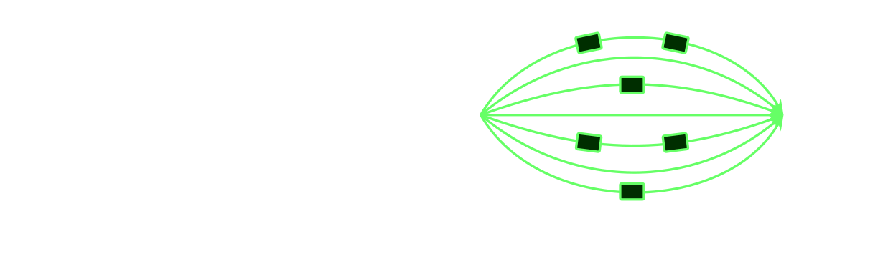
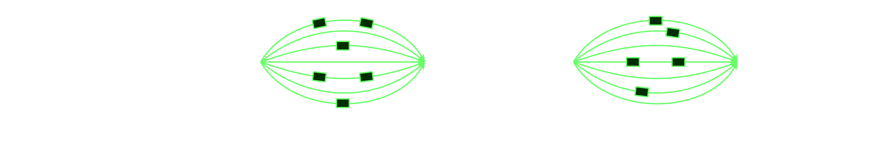

# distributed computing — the pattern menu

Distribution in metatron is not a subsystem you add: it is what a fold's *declared algebra* already licenses. A
reducer ships, splits, and recombines **because its carrier declares a law**, never because a feature was turned on.
The menu below (A–W) catalogues those laws: each entry is a pattern, its algebraic law the reason it is sound, its
*pre-write motif* the mtron you write, and its *rewrite motif* the sharded layout the rewriter emits. The premise is
`docs/design/distributed-patterns-through-algebra.md` ("distribution is a theorem, not a feature"); the first
realization is `law_shard`; the substrate and its gaps live in `docs/design/distributed-computing.md`. This doc is the
reference: what to build next, and why each item is sound.

## the substrate — the constructions a pattern rests on

A distribution pattern is a small amount of *declaration* on top of machinery that already exists. Before reading the
menu, fix the five pieces a row names:

| type                           | where                 | the role it plays                                                                                                                                                                                                                                                                                                                                                                                   |
|--------------------------------|-----------------------|-----------------------------------------------------------------------------------------------------------------------------------------------------------------------------------------------------------------------------------------------------------------------------------------------------------------------------------------------------------------------------------------------------|
| `machine::T`                   | `~/`                  | the topology. `push`/`pop` is a call stack; a child machine is a subproblem; a *mini-cluster* is a child machine + the peers its network declares + the URI space they share. The authority is the boundary — an address names work this machine owns or work a peer owns.                                                                                                                          |
| `network::T`                   | `~/network`           | the reach. `roster` is what the system **knows** (connectionless endpoints); `peer` is what **this** machine has **dialed**. Knowledge is inherited, reach is not. A `peer::T` carries a `host` (where to dial it back) — the marker that makes it a fan-out target; an inbound accept has none and never receives a shard.                                                                         |
| `rewriter::T`                  | `~/compiler/rewriter` | the stage. The compiler's first atomic pass lowers `code::T → code::T` to a fixpoint over the machine's **rewrite pool** (`instset().rewrites()`); `fixpoint_rewriter::[max=>N]` is one such stage. A distribution rule is one rule of that pool, applied in place — `law_shard` and `law_bsp` live in `/m` beside its local laws, every instset's rules run in the order they declare (`?pre`/`?post` families, then `?zindex`; `Rewriter.Helper.sort`), and every emitted layout is itself re-planned where it lands. |
| `instset::T`                   | `/m/math/cat`         | the declaration surface. `object::T` holds a type's structural theories; `morphism::T` holds an inst's process laws, `form`, `class`, and `analysis`; `path::T` lifts *code* to a vertex whose out-edges are the live rewrite rules, each a `plan::T`. `lower(plan::T)` and `bind(plan::T)` are the two applications.                                                                               |
| `law::T`, `plan::T`, `path::T` | —                     | the engine. A `plan::T` assembles `[name, cut, where]` (a value, validated against its axes' law obligations) and lowers to a layout; the combiner a fold's partials recombine through is read off the `law::T` declarations — never named, always computed.                                                                                                                                        |

`Law.Helper.combiner(keyed, laws)` decides a fold's recombination, and `Law.Helper.lifted(keyed)` the one case it
leaves out, a fold that recombines through itself after a lift:

- a fold that declares `monoidic` + `commutative` is **its own** combiner (`sum`, `prod`);
- a fold defined by its `derivation` recombines through the fold that defines it (`count ↦ sum`,
  `order(s) ↦ kmerge(s)`, and a bare `order()` ↦ `kmerge()`: an omitted argument is noobj, which the derivation's
  `s{?}` admits), when every hole it re-applies is blind to mass (`Law.Helper.massBlind`): `order(cc())` has none;
- a keyed fold `group([k ⇒ h])` recombines **pointwise** — `sum()==[_=>combiner(h)]` — which no single edge names,
  when its keys are blind to mass (`group([cc()=>…])` stays home);
- a fold whose derivation ends in itself, `r ↦ ℓ·r`, recombines through **itself after the lift**: every lane runs
  `ℓ` in its place, and home runs `r` over the summaries (`mean`, entry J; `combiner` stays null for it). A keyed
  fold of such folds lifts per key (`Law.Helper.pointwiseLift`): lanes run `group([k ⇒ ℓ])`, and home runs
  `sum()==[_=>r]`. `Law.Helper.lifted` answers both as a `Lift(lane, home)`.

A point on the cut is a multiplicity of its answer, `(a+b)·r{d} = {d}((a·r + b·r)·C)`: no lane carries it, and
home's combiner does, so `count{2}()` recombines through `sum{2}()` and `mean{2}()` through `mean{2}()`. A span on
the cut (`{2}count()`, the cut run again over its own answer) and a point or span on a group's value stay home.

`Shard` extends a cut over a select that keeps a prefix (`==[{k}_]`) when the combiner declares `causal`, so the
combiner of `order(s)==[{k}_]` is `kmerge(s)==[{k}_]` (entry K).

## the theorem bindings

"Which law the anchor obeys" is the whole decision. The stream-ring theorems are the implementation sites:

| theorem | statement                                                                         | meaning for distribution                                                                                              |
|---------|-----------------------------------------------------------------------------------|-----------------------------------------------------------------------------------------------------------------------|
| Thm 5   | streams are atemporal                                                             | no required order of apply/merge — remote placement is always safe, and the fan-out may be parallel                   |
| Thm 6   | $ca \cdot 1b = 1a \cdot 1b \cdot c1$                                              | the coefficient floats through non-reduce chains — elementwise work is independent, replicate it                      |
| Thm 16  | reducers are temporal                                                             | the fold is the one synchronization point (the barrier)                                                               |
| Thm 17  | $c1 \cdot 1a \neq 1a \cdot c1$ for $a \in \mathcal{F}_r$                          | floating stops at a reducer — the fold is the cut                                                                     |
| Thm 18  | $\langle\mathcal{F}_r, +, \cdot\rangle$ is a near-ring (left distributive)        | a reducer distributes over a fan-out, $c(a+b) = ca + cb$ — the combiner's algebraic home                              |
| Thm 19  | monoidic reducers are idempotent and semi-right distributive, $(a+b)c = (ac+bc)c$ | a commutative-monoid fold splits, merges, and re-applies — the shard is sound, not merely partitioned                 |
| Thm 21  | $\langle\mathcal{F}_r, \cdot\rangle$ is functionally closed                       | serial folds compose — a fold after a fold is a fold, so the master's `combiner.tail` and J's finalizer stay reducers |

These seven are the bindings that matter for distribution; the rest of the paper's theorems describe the function
rings the shapes live in. The full paper is [Stream Ring Theory](../../../articles/stream-ring-theory.html).

## the route vocabulary — the distribution shape

The plan's `where` states **three axes** — where (`?place`), how far and how wide (`?hop`), and what counts as one
share (`?split`) — and the shape is their consequence, not a fourth key. `law_shard` states them:

```mtron
[place=><[local]>, hop=>0, split=><stream>]                     [-- the origin's tail: the home place, no depth, strided --]
[place=><[peer]>, hop=>1, split=><stream>, span=>[seed, …]]     [-- the fan-out: the dialed set, one level, strided --]
```

| shape     | derived from                             | obligations on a cut shipped to it |
|-----------|------------------------------------------|------------------------------------|
| `local`   | the home place alone, no depth           | —                                  |
| `peers`   | the dialed set at no depth               | `monoidic`, `commutative`          |
| `tree`    | the dialed set at a depth of one or more | `monoidic`, `commutative`          |
| `shuffle` | a keyed `?split`                         | `monoidic`                         |
| `space`   | a landing (`to(<space>)`)                | —                                  |
| `none`    | nowhere (the unit law's transform)       | —                                  |

`PlanBuilder.create()` validates $\texttt{obligations} (\texttt{place}, \texttt{hop}, \texttt{split}) \subseteq
\texttt{cut.laws}$; a cut shipped to a decision and re-applied at home must declare every law the axes demand, or the
plan refuses to build. The legacy `shape`/`target` encoding is still *read* for one cycle; the plans no longer write it.

### `?hop=height{arity}` — how far, and how wide

`?hop` is a **tree shape**: the height (how many times the rule may re-plan the code it produced) and, as a leading
coefficient, the **arity** (how many children one node may fan out to). A bare `?hop=n` states the height and leaves the
arity at the receiver's own out-degree — today's behaviour — and the two arities no coefficient can render ride the pair
form: `[h,1]` is a **chain** (one child per node, `monoidic` alone, order preserved).

| written              | height | arity            | realized shape                           |
|----------------------|--------|------------------|------------------------------------------|
| `0`, `{0}n`, `[n,0]` | 0 / n  | 0                | **the identity** — `D(c) = c`, unchanged |
| `1`                  | 1      | the out-degree   | star (the default's one level)           |
| `n`                  | n      | the out-degree   | free/irregular tree                      |
| `[n,1]`              | n      | 1                | **chain / pipeline** — n lanes in a line |
| `{2}3`               | 3      | 2                | binary tree, at most 2 children/node     |
| `{2,4}3`             | 3      | 2..4 (the cap 4) | elastic: fill what is live up to 4       |

The arity **caps the fan-out**: each node takes the first `w` lanes of the emitter's lane order (home-first, then the
resolution order — deterministic, never rotated per node), still clamped by `min(shares, seed)`. A node with fewer live
targets takes what there is. The **form is restated, never the number**: the emitted lane's budget is the same arity
with the height decremented (`{2}3 ⇒ {2}2 ⇒ {2}1 ⇒ 0`, `[3,1] ⇒ [2,1] ⇒ [1,1]`). A shipped lane states it on its
**move's target**, `cut(<//peer?hop={2}2>, …)`, and the cut hands it to the program it ships, on that program's first
instruction; a home lane, which has no move, states it on its **first instruction** — the `start(part)` of a seeded
lane, the first run instruction otherwise. So a re-planning peer reads the budget in one place, the head of what it
runs. A leaf states the bare `?hop=0`; no copied instruction is stripped of a budget it carries (the earliest statement
wins, so the head is authoritative); and the master states none (its head is the layout's `branch`).

### `?place` — where

The place set, as a value: a **list** is a set of designators, a **rec** carries weights, and a trailing/leading
coefficient is that designator's **demand** (how many lanes it takes — a share is a lane, so demand is both data weight
and concurrency). Repetition is multiplicity: `[//ginger,//ginger,//booger]` is ginger twice.

| designator           | resolves through                                                                 |
|----------------------|----------------------------------------------------------------------------------|
| `local`              | this frame's own place (the addressless `eval()`)                                |
| `peer`               | the **dialed** set (host-bearing, online, `serves`-positive), never this machine |
| `#`                  | every reachable place the other entries did not name                             |
| `//host[:port]`      | the roster's place (a redirect); the port is not a selector                      |
| `//alias`            | a `~/network/prefix` name; a row's port names one transport                      |
| `scheme://host:port` | one authority, as written                                                        |

`?place=[local,peer]` is S (the master takes a share); `[{4}local]` is four home lanes on a peerless machine, still a
fan-out (it demands the off-machine merge's laws); `local=>0` is the explicit exclusion. Exclusion is omission.
A **roster** machine is *knowledge*, not reach: it is a fan-out target only when the author names it (`//host`) —
`peer` is the **dialed** set. A declared-but-undialed machine alone leaves `law_shard` the identity. **A machine is
never its own peer**: a dial back to one of its own listen authorities (its wildcard bind, or a loopback alias of it) is
no place, through `peer`, `#` or `//host`, and neither is its own address in the roster.

### `?split` — what counts as one share

| `?split`                         | lowered?                                                                                                                                                         |
|----------------------------------|------------------------------------------------------------------------------------------------------------------------------------------------------------------|
| `stream` (the default)           | **yes** — today's stride division, the layout `law_shard` has always emitted                                                                                     |
| `copy`                           | **only behind idempotence** — one part, the whole seed on every lane; legal only when the cut's combiner declares `idempotent`, else the unchanged chain         |
| `owner`                          | **over an addressed seed alone** (B, C): one part per owner, each lane reading its own; the default reads as `owner` there, and a `copy` of one declines |
| `block`, `key`, `index`          | **decline** — their premises (order, a key, a generator) are not held yet, so the decision is the identity, never a plausible-looking reorder |

An unreadable `?split` is refused loudly (the key and the text), never defaulted to `stream`.

### the run partition — a span range is an index set (menu entry V)

`?split` partitions the **seed**; a span range partitions the **run** — menu entry **V**, the *generative run*. (Computed
seeds (P) is its sibling over a generated *data* index space; the generative run's index is the exponent.) A coefficient `{m,n}`
on an instruction is the sum of its unrolls, `a^[m,n] = a^m + … + a^n`, and the unrolls are independent terms — so when
the seed is a singleton and the run carries a closed range, `law_shard` factors the **unroll index**: one lane per
distinct place, each carrying the **whole** seed and the run with its span narrowed to that place's share (`{p_i,q_i}`,
a contiguous subrange chosen by WORK — a lane walks its runs from the seed, each step once, so a share `{a,b}` costs the
`b` steps it walks and the `b - a + 1` runs it emits, and the lane nearer the top takes fewer runs: `{0,4}` over two
places is `{0,2}` and `{3,4}`). When the run ends at a cut, each lane folds its own unrolls through the cut, so one
partial per lane travels home, and the master recombines the partials through the cut's combiner.

```mtron
start(0).{0,10}plus(1).sum()
⇒ branch?<={0}(<p_1> => start?hop=0(0).{0,6}plus(1).sum(), <p_2> => start?hop=0(0).{7,10}plus(1).sum()).sum()
```

**No typed cut is needed** for the cutless form: a run with no cut after it ships its unrolls whole, and the chain's tail
(the first non-floatable instruction after the run) runs at home over the branch's bag, so a span the typing probe
cannot thread still plans (`branch(...)` alone when the tail is empty). A point span (`{3}`) is a lone compose chain and
an open range (`{*}`, `{+}`) has no last unroll: neither is an index set, so both decline to the identity. v1 factors
one axis per run — the seed first, the run when the seed is one obj; the product (seed × unroll) is the tree's next
level, never a new grid. The run partition is **not a `?split` kind**: `{w}part` weights the seed, while a run share is
a range — one per place, since a branch has one lane per key.

**After a cut, the seed is one obj.** A fold answers one obj (a gather whose rng is one, or a declared reducer whose rng admits none, as `sup` and `inf` do), so the run after a cut has
nothing to deal; its multiplicity is a span range in the run. The branch takes that obj whole and copies it to every
lane (`?split=copy`), and each lane walks its own share of the range and folds it through the cut. The copy needs no
idempotence: the shares are disjoint, so no term is counted twice. The obj stays one across the instructions that stay
home between the fold and the run, as long as each hands on at most one obj for the one it takes (a one-obj dom and
range, no copies, no unrolls): `sum().side(plus(1)).{0,3}plus(1).sum()` keeps `side` home and still splits the span.
An instruction whose range may be many (`print` and `to` declare `A{*}<=A{?}`) leaves a bag of unknown size, which the
branch deals. **A point is an index set too:** `step{p}` is `p` copies of one term, and points add across a branch
(`a{p} = a{p_1} + a{p_2}`), so the lanes take even shares of the copies — `id{5}()` over two places is `id{3}()` and
`id{2}()`, each lane folding its copies through the cut. A run after a cut with neither a span range nor a point stays
home: dealing one obj would hand the whole run to one lane — unless the run turns the one obj into many with a
**flatmapper**. The flatmapper stays home, with whatever hands on one obj for one before it, and the rest of the run
deals its bag, so `order(neg()).merge().plus(1).sum()` merges the sorted lst at home and ships `plus(1).sum()`
(`branch().kmerge().merge().branch().sum()`), and K's chained top-k maps and unrolls the lst at home
(`==[{4}mult(-1)]>-`) before its second sort ships.

```mtron
{1,2,3,4,5}.plus(1).sum().{0,3}plus(1).sum()
⇒ branch?<={0}(<p_1> => start?hop=0({1,4}).plus(1).sum(), <p_2> => …).sum()
     .branch?<=int{*}&split=copy(<p_1> => {0,1}plus?hop=0(1).sum(), <p_2> => {2,2}plus?hop=0(1).sum(),
                                 <p_3> => {3,3}plus?hop=0(1).sum()).sum()                          [-- 41+22+23 = 86 --]
```

### the branch's gather grain — the dom coefficient

The dom is a **tid**, not a number: `inst.dom()` answers the domain's type-id and `inst.dom().c()` its **coefficient**
(the multiplicity). The arrow spelling is sugar — `A<=B` is `dom=B&rng=A` (the left is the rng, the
right the dom) — so `?<=T{n}` states the **dom** coefficient `{n}` with the rng at its default, and the canonical
render order is `rng<=dom`.

The instruction's own default is `{?}`: a bare `branch()` feeds one obj at a time (local, per-object semantics). The
**shipment grain** is the dom coefficient a rewrite (or an author) states on a branch: `{n}` **pages** (a buffer of
at most n per call), `{*}` gathers the whole lhs once — a **barrier** — and a band `{2,5}` keeps its band. The
distributed rewrite states `{*}` on the branch it emits where it wants a barrier (the computed-bag broadcast); that
is an optimization of the plan, never a property of the instruction. The branch never combines pages — the chain's
outer fold does, so the recombination law is still the cut's gate. An ORDERED branch's members run over what a call
holds as a keyed lane does, `start(bag).member`: under a page or the barrier a map still meets one obj at a time and a
fold meets the whole bag, so `{1,2,3}.branch?<=int{*}(sum(),count())` is `{6,3}` where the per-object default answers
`{{4}1,2,3}`, and a map's terms are the same under every grain (`0.{4}branch?<=int{*}(plus(1),id())` is still the
binomial row `{4,{4}3,{6}2,{4}1,0}`).

A split partitions the branch's **shipment**, not the call: under a rewrite's `{*}` branch, `branch?split=part` deals
the whole lhs across its keys (each lane's program runs once over its part); under the instruction's per-object
default each call holds one member, so a single-member deal lands in the first slot. The run partition's lanes are
*seeded*, so their branch takes no lhs and neither the stream nor the barrier applies — the cheapest broadcast. A page
size belongs with the other shipping knobs on the head, next to `?hop`, never in the partition: it changes the number
of round trips a lane's share costs, not how the index set was split.

---

## the menu

The centerpiece: every pattern, the law that makes it sound, and what it does; then the mtron each one rewrites.
A ▶ play button plays the pattern's recorded cast. What is implemented is a ✅ in the taxonomy tree below, which the
legend dates; a pattern can be done before it has a cast. The key letters index the menu: in prose for a reader, name
the pattern and keep its letter in parentheses, as in *the generative run (V)*.

| key   | play                                                                                                 | pattern                     | law                                                                                                                                | description                                                                                       |
|-------|------------------------------------------------------------------------------------------------------|-----------------------------|------------------------------------------------------------------------------------------------------------------------------------|---------------------------------------------------------------------------------------------------|
| **A** | <!-- cast: mini-distributed title="A" speed_rates="0.5,1,1.5,2" speed_default="1" place="inline" --> | homomorphism shard          | $h(a \uplus b) = h(a) \oplus h(b)$                                                                                                 | each place folds its part; the master recombines the partials through the computed combiner       |
| **B** | <!-- cast: dist-data-local title="B" speed_rates="0.5,1,1.5,2" speed_default="1" place="inline" -->  | data-local shard            | $\mathrm{from}(p) = \sum_a \mathrm{from}_a(p)$                                                                                     | the code moves to the data: each authority folds what it holds                                    |
| **C** |                                                                                                      | authority push-down         | $\mathrm{from} \cdot \mathrm{count} \mapsto \mathrm{native\_count}$                                                                | B with one owner: the fold runs where the data lives, natively (Thm 5 and a pure chain)           |
| **D** |                                                                                                      | parallel fan-out            | $\langle x\rangle(a+b) = \langle x\rangle a + \langle x\rangle b$                                                                  | the transport, not a new fold: every lane a `virtual::T`, so the master pays max RTT, not Σ RTT   |
| **E** | <!-- cast: dist-tree title="E" speed_rates="0.5,1,1.5,2" speed_default="1" place="inline" -->        | tree reduction              | $(a+b+c+d)\cdot r = ((a\cdot r + b\cdot r)\cdot C + (c\cdot r + d\cdot r)\cdot C)\cdot C$                                          | `?hop=height{arity}`: each interior node re-plans its part and recombines a level                 |
| **F** |                                                                                                      | ordered fold                | $a \cdot (b \cdot c) = (a \cdot b) \cdot c$                                                                                        | associativity alone: a `lst`-partitioned fold carries the running total (streams never shard)     |
| **G** | <!-- cast: dist-keyed title="G" speed_rates="0.5,1,1.5,2" speed_default="1" place="inline" -->       | keyed reduce                | $\mathrm{combiner}(\mathrm{group}([k \Rightarrow h])) = \mathrm{sum} \cdot \mathrm{select}([\_ \Rightarrow \mathrm{combiner}(h)])$ | partials merge by key; the combiner is pointwise, computed from `h`'s                             |
| **H** |                                                                                                      | redundant / hedged shards   | $x \oplus x = x$                                                                                                                   | an idempotent fold lets a part ship to r peers and every reply fold; otherwise hedge, first wins  |
| **I** |                                                                                                      | span/route interpreter      | $\mathrm{plan} \mapsto \mathrm{layout}$                                                                                            | the infrastructure: `PlanInterpreter` (via `Shard`) lowers a plan's axes to a layout              |
| **J** |                                                                                                      | algebraic aggregates        | $\mathrm{mean} = \ell\,\mathrm{mean},\ a\,\ell = \{\lvert a\rvert\}\,\mathrm{mean}(a)$                                             | each place ships its mean weighted by its count, `{n}m`; home takes the weighted mean             |
| **K** |                                                                                                      | limit / top-k push-down     | $\mathrm{take}(k) \cdot \oplus = \mathrm{take}(k) \cdot \oplus \cdot \mathrm{take}(k)$                                             | each lane keeps its own top k, and the master merges and keeps k                                  |
| **L** |                                                                                                      | mergeable sketches          | $\hat h(a \uplus b) = \hat h(a) \oplus \hat h(b)$                                                                                  | a sketch fold that declares its monoid theory plugs into A, E and H                               |
| **M** |                                                                                                      | matrix multiplication       | $A \cdot (B + C) = A \cdot B + A \cdot C$                                                                                          | O plus an addressed union (rows), A with the matrix sum (inner k), G over block keys (2-D)        |
| **N** |                                                                                                      | iterative / BSP             | $x^{*} = x \vee f(x) \vee f^{2}(x) \vee \cdots$                                                                                    | a superstep, repeated: `law_bsp` deals each pass; the merge is the boundary                              |
| **O** | <!-- cast: dist-const title="O" speed_rates="0.5,1,1.5,2" speed_default="1" place="inline" -->       | broadcast constants         | $ca \cdot 1b = 1a \cdot 1b \cdot c1$                                                                                               | a constant rides as an argument of the floatable run: no fan-out change (Thm 6)                   |
| **P** |                                                                                                      | computed seeds              | $[0, n) = \uplus_i \mathrm{index}_i$                                                                                               | the index space is split, not the data: one O(1) message per peer, nothing shipped                |
| **Q** |                                                                                                      | monad migration             | $\mathrm{authority}(m)$                                                                                                            | ship the monad, not the value: the continuation travels, `law_shard` per step                     |
| **R** |                                                                                                      | durable results             | $\mathrm{id} : \mathrm{partial} \mapsto \mathrm{address}$                                                                          | each partial is written to an address: a space and its `shard_result::T`                          |
| **S** | <!-- cast: dist-master title="S" speed_rates="0.5,1,1.5,2" speed_default="1" place="inline" -->      | master-participates         | $\bigoplus_{i=0}^{k} a_i \cdot r$ over $\{\mathrm{master}\} \cup \mathrm{peers}$                                                   | the master folds its own slice, a lane at distance zero, and ships the rest                       |
| **T** | <!-- cast: dist-move title="T" speed_rates="0.5,1,1.5,2" speed_default="1" place="inline" -->        | reference frame migration   | $\mathrm{move}(a) \ldots \mathrm{move}(b) \ldots$                                                                                  | the frame moves, not the data: the tail ships as a program and the value snakes back              |
| **U** |                                                                                                      | profile collation           | $\hat{p}(a \uplus b) = \hat{p}(a) \oplus \hat{p}(b)$                                                                               | each lane's profile ships home and nests under the master's, timed around the branch              |
| **V** | <!-- cast: dist-run title="V" speed_rates="0.5,1,1.5,2" speed_default="1" place="inline" -->         | generative run              | $a^{[m,n]} = \sum_{k=m}^{n} a^k$                                                                                                   | a span range or a point is an index set: the lanes split the unrolls by WORK, or the copies evenly |
| **W** | <!-- cast: dist-parallel title="W" speed_rates="0.5,1,1.5,2" speed_default="1" place="inline" -->    | embarrassingly parallel     | $(a + b) \cdot f = a \cdot f + b \cdot f$                                                                                          | no cut: each place runs the floatable run on its share, and the branch's merge brings it all home |
| **X** |                                                                                                      | partition by key            | $\mathrm{partition}(p, k_i \Rightarrow c_i) = \sum_i \mathrm{filter}(p = k_i)\,c_i$                                             | each obj to the lane its key names; a hosted key is a place, so each place is sent its share alone |

### the mtron motif rewrites

Each pattern's **pre-write** motif, the mtron before the rewrite fires, and its **rewrite**, the emitted layout: one
`branch` keyed by place (`s_i` a lane's program, `p_i` a peer, `part_i` the factor of the seed bulk the branch deals
lane `i`). The names are placeholders and the rows are schemas, not literal runs; a cell in plain prose describes a motif no
single expression shows. A lane is a move (`Law.nomadic`): the planner emits `<p_i> => s_i` as the cut its move compiles
to, `cut(<p_i?hop=n>, s_i)`, its budget on the target, and a home lane as its program alone, its budget on its head.
A lane's share is the bias on the branch, `?split=[local,{2}ws://p_1:8555,ws://p_2:8555]`, read per lane: a point on a cut would be
copies of its answer. The rows write the keyed spelling, which reads the same.

| key   | pre-write                                                          | rewrite                                                                                            |
|-------|--------------------------------------------------------------------|----------------------------------------------------------------------------------------------------|
| **A** | `{1,2,3,4}.plus(1).count()`                                        | `branch?<={0}(<p_i> => start?hop=0(part_i).plus(1).count(), …).sum()`                              |
| **B** | `*//{a,b}/p.count()`, `*//+/p.count()`                             | `branch(<a> => from?hop=0(</p>).count(), <b> => from?hop=0(</p>).count()).sum()`                   |
| **C** | `*//a/p.count()`                                                   | `branch(<a> => from?hop=0(</p>).count()).sum()`                                                    |
| **D** | any shard                                                          | `branch(<p_i> => s_i, …).combiner`, every lane a `virtual::T`                                      |
| **E** | `{1,…,8}.plus(1).sum?hop=2()`                                      | a nested `start?hop=n-1(p_i)…` at each interior node: the dial graph is the tree                   |
| **F** | a `lst`-partitioned fold                                           | a pipeline: the running total travels neighbor to neighbor                                         |
| **G** | `{1,2,3,4,5,6}.group([mod(3)=>sum()])`                             | `branch?<={0}(<p_i> => start?hop=0(part_i).group([mod(3)=>sum()]), …).sum()==[_=>sum()]`           |
| **H** | `{...}.sup?split=copy()`                                           | `branch?<={0}&split=copy(<p_i> => start?hop=0(seed).sup(), …).sup()`; hedging (first reply wins) unwritten |
| **I** | `[{1,2,3}.plus(1).sum()]==[as(cat:path::T)]==[lower(>>law_shard)]` | the plan's axes lowered over a real span `[(lo, hi, role)]`                                        |
| **J** | `{1,1,1,5}.mean()`                                                 | `branch?<={0}(<p_i> => start?hop=0(part_i).split?<=int{*}([mean(),count()]).cc(_>>1)>>0, …).mean()` |
| **K** | `{...}.order(s)==[{k}_]`                                           | lanes `order(s)==[{k}_]`; the master `kmerge(s)==[{k}_]`, as `kmerge` is `causal`                  |
| **L** | `{...}.hll()`                                                      | A, E or H once the sketch declares its monoid theory                                               |
| **M** | `mtrx::[...].mult(mtrx::[...])`                                    | O + an addressed union (rows); A with the matrix sum (inner k); G over block keys (2-D)            |
| **N** | `x.repeat?<=A{*}(code=>f,until=>p)`                               | `law_bsp`: `repeat?<=A{*}(code=>branch?<=A{*}&split=part(<p_i> => f?hop=0, …),until=>p)` |
| **O** | `{...}.plus(B).sum()`                                              | the constant `B` rides as an argument of the floatable run                                         |
| **P** | Monte Carlo: a count and an RNG seed per peer                      | one O(1) message per peer                                                                          |
| **Q** | a remote read mid-chain                                            | `law_shard` per step: the continuation ships                                                       |
| **R** | `to(</usr/job/round/shard>)`                                       | a space, and `shard_result::[authority, round, status, value]`                                     |
| **S** | `{1,…,8}.plus(1).sum?place=[local,peer]()`                         | the master's slice is a lane at distance zero; k−1 ship                                            |
| **T** | `{1,2,3}.plus(5).move(//host/a).plus(2).sum()`                     | cut at the move, `move(<host>)`: the tail ships as a program                                       |
| **U** | `{1,2,3,4,5}.plus(10).sum().profile()>>format`                     | `profile_collate(branch?<={0}(<p_i> => start?hop=0(part_i).plus(10).sum().profile(), …))>>format`  |
| **V** | `start(0).{0,1000}plus(1).sum()`                                   | `branch?<={0}(<p_1> => start?hop=0(0).{0,p}plus(1).sum(), <p_2> => …).sum()`, narrowed by WORK     |
| **W** | `{1,…,8}.complex_computation()`                                    | `branch?<={0}(<p_i> => start?hop=0(part_i).complex_computation(), …)`, and no combiner             |
| **X** | `{…}.partition(<//${mod(2).plus(1)}>, //1 => f, //2 => f)`        | as written, a layout already: each lane is `cut(<p_k>, f)` over its key's share, and the fold after it stays home |

**Legend.** The dates behind the tree's ✅ (`A` done; `D` done 2026-10-26; `E`, `G` v1 done 2026-10-28; `S` done 2026-10-28 —
the axes' `local` designator, `?place=[local,peer]`; `O` free today — it needs no plumbing; `V` v1 done 2026-11-12 — a
**singleton** seed and a **closed** span range — and 2026-11-18 every cut plans its run; see *the run partition*). `P`
is the data-index-space sibling of `V`: same "nothing ships" spirit, but its index is a generated *data* space, while
`V`'s index is the exponent. `W` done 2026-11-19 — the free law with no cut at all, right distributivity alone: a
dealt seed ships its floatable run and only the branch's merge recombines (an index set was already the cutless run
partition). Floating is `Inst.isPure`, so an instruction handed an effect keeps the run home.
`K` done 2026-11-20 — top-k is `order(s)==[{k}_]`, the select of `id()` slots that keeps the first k positions, and the
cut absorbs it because `kmerge` declares `causal`; see *K* below. Since 2026-11-22 a key that reads mass (`cc()`)
sorts at home, where every mass is whole.
`J` done 2026-11-22 — `mean ↦ ℓ·mean`: each lane runs the lift `ℓ`, its mean weighted by its count (`{n}m`, the
count riding the coefficient), and home runs the weighted mean; see *J* below.
`H` done 2026-11-22 for idempotent folds — `sup` and `inf`, a join and a meet (each takes `order`'s projection, "what
are you taking the sup on?": `sup(_>>age)`, `sup(as(str::T))` over a mixed stream), are self-combining and idempotent, so
`?split=copy` ships the whole seed to every lane and folds every reply; hedging a fold that is not idempotent (the
first reply wins) is not written yet.
`N` done 2026-11-22 — `law_bsp`, its own rule beside `law_shard` (Marko): a whole-frontier `repeat?<=A{*}` whose code
is pure and floatable has its code dealt over the dialed peers on every pass, the loop and its predicates home; see *N*
below.
`B` and `C` done 2026-11-26 — an ADDRESSED SEED (`Shard.owners`): a `from` whose literal address names machines is
read where each part lives. The address is a sum of names (`//{a,b}/p`, the host brace always names, numeric ones
included), every name in the prefix table (`//+/p`), a root branch of terms (`<{/p,//a/p}>`, a term with no host
being a home lane), or one origin (C). Each term's owner is the dialed peer that answers its origin and serves the
route. One lane per owner reads its own part, `from(</p>)` localized there, and the floatable run and the fold ship
with it; home recombines through the computed combiner. An owner's part lives at no other place, so no lane is
dropped by an arity or dealt elsewhere, and a term no dialed peer serves leaves the read as written, where
`Network.Helper.atPeer` refuses it. The read must head its run: an effect between it and the fold keeps it home, and
the fold ships over the bag it hands on. A read is untyped (`#`) on the planning side, so a mean (its lift is declared
at int and real) or a sum (a str sum is not commutative) over one stays home; `count` and `order` recombine through
derivations that hold at any carrier. At the owner, the lane is compiled there, so a database space holding `/p` can
take the fold natively (C's `native_count`). Pinned by the B and C rows of `AbstractDistributedComputingTest`.
`X` done 2026-11-27 — `partition(p, k => c, …)`, the branch whose lanes are guarded by the fibers of `p`, which runs
once per obj: each obj goes to the lane its key names. A key naming two lanes sends it to both, an unmatched key goes
to `<#>`, an obj keyed noobj goes to each zeroable lane (`{?}//a`), and an obj no lane takes fails the call. A hosted
key is a place, and its lane is the cut its program runs in there, so each place is sent its share alone (data
distribution); a key that names where its data lives co-locates the two, so B and C hold by key as by address. It is
a barrier instruction: its dom gathers the whole lhs by default, and a smaller maximum makes it a lazy barrier. A
partition with a hosted key is a layout, so `law_shard` leaves its
chain; the planner emits no partition yet (`?split=key` still declines). See *X* below; pinned by `PartitionTest` and
the B, C and X rows of `AbstractDistributedComputingTest`.
An empty box is *not* "unsound": the law holds, the lowering is unwritten. `F` is struck for streams (order lives in
`lst`, never a bag); `M` is a note; `I` is infrastructure. `C` needs only Thm 5 and a pure chain. `T` is the machine
semiring's groupoid, the stream ring's process dual. `V`'s unrolls are independent terms (Definition 3), which is why
they split. `U` done 2026-11-19 — the instrumentation row: its $\oplus$ nests reports by place, a keyed union whose
figures add or fold, so the report is a commutative monoid. Each lane ends in `profile()` and answers its own report,
and the master's run is timed around its branch (`profile_collate(branch(…))`), so the master's report holds the one
number no lane can supply, the gather wait; each lane's report nests under it at `place`, keyed by the machine that
made it. Every axis a run factors collates: a seed's members, a computed bag, a span's unrolls (`V`). A tree nests
like the tree: an interior node collates its own places, and the tree's figures (`depth`, `leaf`, `level` and the
critical `path`) fold bottom-up as each node collates. `>>format` nests like the tree too: `master`, then each place
under a header of its own (its apply, and a leaf's objs or a node's count of places), the place's report one level in.
A node's body leads with the summary over its places (objs and apply per place, the straggler, imbalance as max ÷ mean
apply, the gather wait, and a provisional efficiency, Σ lane apply ÷ (k × gather wait)), then its own run.

## the taxonomy — the menu as a tree

The twenty-four entries are not a flat list: they fall out of **two axes** — the *data-side* law the anchor obeys (which
fixes the route shape), and the *location-side* question of where the work lives — plus **orthogonal** rules that
multiply any fan-out and **composites** that build on the rest. The table keeps the A–X lettering stable.

```
distribution — the menu (A–X)
├─ by the anchor's law            (the data-side theorem → the route shape)
│  ├─ free · floatable (Thm 6)        → O:✅  W:✅
│  ├─ star · comm. monoid (Thm 19)    → A:✅  E:✅  G:✅  J:✅  K:✅  H:✅  L
│  ├─ pipeline · associative          → F
│  └─ shuffle · keyed                 → X:✅  (G's hash-route; M(3))
├─ by the location                (native · delegation — where the work lives)
│  └─ B:✅  C:✅  Q  P  T:✅
├─ orthogonal                     (multiply any fan-out)
│  └─ D:✅  S:✅  U:✅  V:✅ (the run's own multiplicity)
└─ composite & substrate          (built from the above)
   └─ N:✅  R  M  I
```

<!-- figure source: assets/tikz/distributed-patterns.tex (same recipe); the rendered image is the original A–S menu — the table and the tree above are authoritative for U/V/W/X -->


The four top branches read the two axes of `docs/design/distributed-patterns-through-algebra.md`:

- **the anchor's law** is the *data-side* theorem, and it *is* the route shape: `free` (floatable, Thm 6) replicates
  the run with no coordination (`O` carries a constant along, and `W` is a run with no cut at all); `star`
  (commutative monoid, Thm 19) scatters, partial-reduces, and gathers — `A` is the one engine, and `E` / `G` / `J` /
  `K` / `L` / `H` are its refinements; `pipeline` (associative) carries the running total; `shuffle` (keyed)
  routes each obj by its key, `X`, and so co-locates a key with its data (G's future hash-route, and M (3)).
- **the location** is the *machine-side* question — native / delegation: `B` moves the code to the data, `C` is `B`
  with one owner, `Q` is `C` per step, `P` partitions the index space instead of data.
- **orthogonal** multiplies any fan-out: `D` ships every round trip in parallel (max RTT), `S` keeps a slice home, and
  `V` factors the run's own multiplicity — a closed span range — across the same fan-out, each lane carrying the whole
  seed and a narrowed span (`?hop` recurses the remaining range).
- **composite & substrate** builds on the rest: `N` iterates a dealt superstep (`law_bsp`), `R` writes results to a spatial
  address, `M` decomposes into O / A / G over three index splits, `I` lowers the plan's axes to a layout.

Implemented is a ✅ (green) in this tree, dated in the legend above; white = the law holds, the lowering is unwritten.
A ▶ in the menu plays a recorded cast, which a done pattern may not have yet.

## the implemented layouts, spelled out

The done patterns, with the lane/master forms written in full. `law_shard` (A) is the one engine they all lower
to; the rest specialize it. Every run that ships is one `branch` keyed by place, and the master recombines the lanes'
partials through the combiner: the chain **expands** into one lane per place and **contracts** at the fold.

<!-- figure source: assets/tikz/distributed-run.tex (same recipe) -->


- **Every cut plans the run before it.** A chain that folds more than once ships each run through its own branch;
  each combiner brings the computation home, where the next run starts:
  `branch(<p_i> => <run_1>.<fold_1>, …).<combiner_1>.branch(<p_i> => <run_2>.<fold_2>, …).<combiner_2>`. A run never
  reaches back past the cut before it, a run that declines stays as written, and the tail after the last cut stays
  home. The chain expands and contracts once per cut:

  <!-- figure source: assets/tikz/distributed-runs.tex (same recipe) -->
  

- **A literal seed is dealt by the plan.** Each lane carries its own part, `<p_i> => start(part_i).<program>`, so the
  listing shows what each place runs. With no `start` left at home the branch takes nothing: it is the initial form,
  `branch?<={0}(…)`.
- **A computed bag stays home and is dealt when the branch runs.** Whatever cannot float before the run (a gathering
  `repeat?<=A{*}`, whose own code `law_bsp` deals instead; an effect) is the prefix, which runs where the code stands:
  `<prefix>.branch?<=T{*}&split=part(<p_i> => <program>, …)` (`repeat() [[ plus(10).order ]]`, Marko 2026-11-05).
  Its **dom coefficient** is `{*}` by default (the barrier); a stated one pages it — see *the branch's gather grain*.
- **A run partition replicates the seed and narrows the exponent.** A seeded lane carries the whole seed and its own
  subrange of the unroll index; there is no branch lhs, so neither the stream nor the barrier applies. After a cut the
  seed is computed, so the branch copies it to every lane (`branch?<=T{*}&split=copy(…)`). See *the run partition*.
- Under the seed axis, a peer with n shares is one lane whose demand in the branch's bias is n
  (`branch?split=[local,{n}ws://p_i:8555](…)`, the peer named by its authority, the keyed spelling's `?split={n}part`), and home's n shares are n home lanes,
  `local` one share apiece; shares of one apiece are a plain `?split=part`. Under the run axis and `?split=copy`, each
  place is one lane, and a copy hands every lane the whole seed.
- A lane ships raw. The master's compiler never binds a lane; each is compiled where it runs (server side for a host,
  by that machine's compiler for a machine path).

### A — homomorphism shard (`sum`, `prod`, `count`, `order(s)`, rec `sum`)

```mtron
master:   branch?<={0}&split=part(<p_1> => start?hop=0(<part_1>).plus(1).count(), …,
                                  <p_k> => start?hop=0(<part_k>).plus(1).count()).sum()
```

The combiner is computed, never declared — see `Law.Helper.combiner` above:

| fold          | combiner    | why                                                                                                                                      |
|---------------|-------------|------------------------------------------------------------------------------------------------------------------------------------------|
| `sum`, `prod` | itself      | declares `monoidic` + `commutative`                                                                                                      |
| `count`       | `sum`       | `count ≡ map(1)·sum`                                                                                                                     |
| `order(s)`    | `kmerge(s)` | `order(s{?}) ≡ split([_])·kmerge(s{?})`, so a bare `order()` recombines through `kmerge()`; `kmerge` declares `monoidic` + `commutative` |
| rec `sum`     | itself      | the deep merge's fold declares `monoidic` + `commutative` — a `lst` is its atom, so colliding values bag in any order                    |

The cat graph answers lazily: `|count?int<=A{*}().as(morphism::T)>>analysis>>combiner` is
`/m/inst/sum?rng=/m/int&dom=/m/int{*}`. `str` `sum` (not commutative) correctly does not shard, and `mean`, which has
no combiner, recombines through itself after its lift (entry J), so its morphism names none.

**`order` is the distributed sort.** The lane sorts its shard and the master k-way-merges the runs — the same shard,
with `kmerge` as the combiner instead of `sum`:

```mtron
lane_i:   start?hop=0(<part_i>).order(>>)                       [-- each shard sorts by its key --]
master:   branch?<={0}&split=part(<p_1> => start?hop=0(<part_1>).order(>>), …).kmerge(>>)
```

`order(>>)` on a stream of single-key recs sorts by value, and `kmerge(>>)` merges the sorted partial runs — a k-way
merge that re-reads the multiplicity, so two `1`s in different shards merge into `{2}1`, never `[1,1]`. The same
`kmerge` recombines a keyed sort: under `group([k⇒order(>>)])` each key's sorted partials bag whole and merge per key
(entry G).

### D — parallel fan-out (virtual-threaded lanes, max RTT)

Every keyed lane of the branch is a `virtual::T`, submitted before any is awaited — each returns immediately and waits
on its own thread, and the branch then awaits each lane through its `rhs`. The master pays **max RTT, not Σ RTT**. A
keyed lane is a move (`Law.nomadic`): `<p> => program` runs as the cut `move(<p>).program` compiles to, so the cut
routes it, a remote lane shipping its program through its place's `eval` (the client's mini-instset override), bound
when the lane runs rather than when the plan is made, and the result hangs off `rhs` as a lazy `auto` over the future.
A lane that is one `from(</x>)` or one `to(</x>)` of one obj, at the peer itself, goes through the place's door
instead, so a client that runs no program is a place too.

### E — tree reduction (`?hop=height{arity}`)

```mtron
root:      {1,…,8}.plus(1).sum?hop={2}2()                               [-- height 2, at most 2 children per node --]
        ⇒  branch?<={0}&split=part(<p_1> => start?hop={2}1({1,…,8}).plus(1).sum()).sum()
on p_1:    branch?<={0}&split=part(<p_2> => start?hop={2}0({1,3,5,7}).plus(1).sum(),
                                  <p_3> => start?hop={2}0({2,4,6,8}).plus(1).sum()).sum()
```

The axis resolves per run, in chain order — the first statement among the run's own instructions wins, else the axis
the run before it resolved, else the plan's tree route (default height 1, the star). A statement governs from where it
stands onward: `start?hop=0(…)` keeps a whole chain home, while `?hop=0` on the last fold keeps only that run home. The
`?place` and `?split` axes resolve the same way. A peer re-plans its part because applying a code compiles it:
`Machine.evaluate(lhs, code)` runs a code of more than one instruction through the machine's compiler, and a shipped
lane arrives as such a code, `start?hop=…(part)` followed by its run. The lane restates the form, never the number
(see *?hop*): `{2}2 ⇒ {2}1 ⇒ 0`. A chain (`[h,1]`)
hands the whole part to one child, so the tree is a line.
`?hops` is the deprecated pre-singular spelling of the same key: it is read for one cycle, `?hop` wins at the same
position (both keys on one instruction), and the earliest statement wins across positions.

### G — keyed reduce (`group([k ⇒ h])`)

```mtron
lane_i:   start?hop=0(<part_i>).group([mod(3)=>sum()])               [-- [1=>1,0=>3,2=>5] --]
master:   branch?<={0}&split=part(<p_1> => start?hop=0(<part_1>)…, <p_2> => …).sum()==[_=>sum()]   [-- [1=>{1,4},…] → [1=>5,…] --]
```

The combiner is pointwise, computed from `h`'s (`Law.Helper.pointwise`). The rec `sum` is the deep merge: colliding
partials append into a bag, and a bulked partial reads as its copies (the lanes' bag bulks equal ones). `==[_=>C]` is
`select`, the per-key fold. A `lst` is an atom of the merge, so an `order`'s sorted partials bag whole per key and
`kmerge` merges the runs.

**A keyed mean lifts per key (G × J).** `mean` has no combiner, so `group([k ⇒ mean()])` cannot recombine
pointwise; it recombines per key through mean's lift instead:

```mtron
lane_i:   start?hop=0(<part_i>).group([mod(2)=>split?<=int{*}([mean(),count()]).cc(_>>1)>>0])   [-- [1=>{3}3.0] --]
master:   branch?<={0}&split=part(<p_1> => …, <p_2> => …).sum()==[_=>mean()]                     [-- [1=>3.0,0=>4.0] --]
```

Each lane answers a rec of `{n}m` books, the deep merge bags each key's books with their weights intact, and the
per-key `mean` reads the weighted mean. It recurses: `group([mod(2)=>group([mod(3)=>mean()])])` lifts at both levels.

**A key that reads mass keeps the group home.** group bulks before it keys (since 2026-11-22, as `order` bulks before
it sorts), so `group([cc()=>count()])` keys each value by its whole mass, the same for `{1,1,2}` and for a computed
`{1,2,3,4}.mod(2)`. Sharded, a lane would key a value by part of its mass, so the pointwise combiner requires keys
blind to mass: the run ships and group runs at home. A sharded rec keeps its keys in lane order, which can differ from
home's first-seen order, so G's own row stays disabled until the key order is pinned.

### J — algebraic aggregates (`mean`)

```mtron
lane_i:   start?hop=0(<part_i>).split?<=int{*}([mean(),count()]).cc(_>>1)>>0     [-- {n}m: the part's mean, weighed by its count --]
master:   branch?<={0}&split=part(<p_1> => start?hop=0(<part_1>)…, <p_2> => …).mean()
```

`mean` is no monoid (the mean of two means is not the mean of their union), so it has no combiner, and it recombines
through **itself after a lift**. The lift `ℓ` summarizes a part as its mean weighted by its count: the split gathers
the part (`?<=int{*}`, which `Shard` keeps on the lane, where every other instruction is shipped raw), `cc(_>>1)` makes
the count the coefficient, and `>>0` keeps the mean, the weight floating through the projection. A weighted mean
averages to itself, so `mean` declares `mean ↦ ℓ·mean` beside itself (both overloads, int and real), and the lift is
a self-combining fold, `(a+b)ℓ = (aℓ+bℓ)ℓ`, because the branch's merge adds the weights of equal summaries. Then
`(a+b)·mean = (aℓ+bℓ)·mean` (`Law.Helper#lifted`): each lane runs `ℓ` in the mean's place and home runs the weighted
mean, `Σnᵢmᵢ / Σnᵢ`. `{1,1,1,5}.mean()` deals the bulked `{3}1` to one lane whole, the lanes answer `{3}1.0` and
`5.0`, and home answers 2.0 (a plain mean of the two answers would be 3.0).

The form of the equation carries the soundness: an rhs that ends in the lhs's own fold claims the lift is a sufficient
statistic, which the equation alone does not (the median satisfies `median ↦ split([median()])>>0·median` and does not
distribute). Home runs the equation's own last fold, never the cut as written, since the summaries' type need not be
the carrier's: an int's mean lifts to reals, which `mean?<=int{*}()` would refuse. A keyed mean,
`group([k=>mean()])`, stays home for now: its lanes would need the lift per key, and `Law.Helper#combiner` (which the
pointwise merge reads) stays null for `mean`. A tree (`mean?hop=2()`) answers as at home, but a peer re-plans only
the floatable run before the lift: the lift is a split and a projection, no cut, so each peer gathers its children's
members and lifts them itself rather than recombining their summaries.

### K — top-k push-down (`order(s)==[{k}_]`)

```mtron
lane_i:   start?hop=0(<part_i>).order(s)==[{k}_]                       [-- each lane keeps its own first k --]
master:   branch?<={0}&split=part(<p_1> => start?hop=0(<part_1>)…, <p_2> => …).kmerge(s)==[{k}_]
```

Top-k needs no instruction of its own. A positional select keeps only the positions its pattern covers, and a span
on an entry lays that many slots along the select's bracket, so `==[{k}_]` is the lst's take: `[3,1,2]==[{2}_]` is
`[3,1]`, and `{5,3,9,1,7}.order()==[{2}_]` is `[1,3]`. The cut **absorbs** that select when the cut's combiner
declares `causal`: the first n of its output depend only on the first n of each input, so the longer cut recombines
through the combiner followed by the select, `combiner(r·t) = combiner(r)·t`, computed rather than declared. `kmerge`
is causal, since the first k of a sorted merge draw only on the first k of each run, so each lane sorts its part,
keeps k and ships at most k members, and the master merges the runs and keeps k. It is not a `poset` law: `kmerge`
is not monotone in the prefix order (`{[1],[3]}.kmerge()` is `[1,3]`, no prefix of `{[1,2],[3]}.kmerge()`,
`[1,2,3]`).

The select must keep a prefix and change nothing, every slot a bare `id()` (`_` is its sugar). A select that maps
(`==[{2}+1]`) would map once in each lane and again at home, so it stays home, as do a point that copies
(`id{2}()`) and a keyed pattern (`==[?<2=>_]`, which keeps every position, as a hole where its key fails). `order`
and `kmerge` bulk as a stream does (there is no nested stream: `{1,2,{5,3},5,{0,1,1}}` is `{{3}1,2,{2}5,3,0}`), and
`order` bulks before it sorts, so equals that arrive apart sort once (`{1,2,3}.mult(0).order()` sorts one entry, not
three). Each distinct value takes one index with its whole
mass, whether its equals came bulked or apart (`{1,2}.mult(0).order()` is `[{2}0]`, as `{0,0}.order()` is), so a
top-k sharded across places and the same chain held home answer the same lst. A zero span in a bracket lays no slot,
so `==[{0}_]` keeps nothing; its empty pattern stays home.

Top-ks chain in one job, since every cut plans its own run. The master of the first answers one lst, and a lone lst
is one obj to a stream instruction, so a second sort over its integers starts with `>-`, which unrolls the lst into a
bag the second cut deals. `{1,2,3,4,5}.order(neg())==[{4}_]==[{4}mult(-1)]>-.order(neg())==[{2}_]` ships both sorts
and is `[-2,-3]`: the map over the lst and the `>-` stay home, since one obj has nothing to deal, and a map written
after the `>-` (`>-.mult(-1)`) ships with the second sort. Without the `>-`, the second sort meets the lst alone and
stays home (`[[-5,-4,-3,-2]]`).

**A key that reads mass sorts at home.** A sort compares each member by its key, and a floatable key reads the
member's value, never its mass (Thm 6: `{n}v·f = {n}(v·f)`). `cc()` reads the mass, and a shard parts a value's mass
across its lanes, `{n₁}v` in one and `{n₂}v` in another, so each lane would sort by a mass the branch's merge then
changes (`{[{2}2,{3}1],[{2}2,{3}3]}.kmerge(cc())` is `[{4}2,{3}3,{3}1]`, out of order). So `order(s)`'s derivation
recombines only a key blind to mass (`Law.Helper.massBlind`: each contract of the key's ops at its arity takes one copy,
by its own shape, or is a typer, or is an identity that hands every copy back; a gather that reads copies, `cc()`,
`count()`, `skip(2)`, is refused, and every code a key is handed must be blind too). A self-combining fold re-applies its own key at home, so
`kmerge(cc())` is no cut either. For `order(cc())` the cut is gone: the run before it ships (W), the
merge adds equal members' masses, and home sorts by whole masses.
`{11,21,31,41,12,22,13}.mod(10).order(cc())==[{1}_]` ships `mod(10)` and answers `[3]`, as at home. The books for
top-k by mass are the bulked part, bounded by the distinct members. Shipping fewer is a threshold algorithm's job
(TPUT, Cao and Wang), a multi-round exchange the branch does not have yet.

### N — iterative / BSP (`repeat?<=A{*}`, `law_bsp`)

`repeat` has two readings, and its **dom coefficient** picks one (Marko, 2026-11-22). With the default dom of one,
`repeat` loops one monad at a time, the way a traverser walks: each monad runs its passes alone and the processor
interleaves them. With an unbounded dom, `repeat?<=A{*}`, the swarm's barrier hands it the whole frontier once, and
each pass applies the code to all of it before the next pass begins: a superstep. `loop()` counts passes and is shared
by every member; `until`, `emit` and `esc` are judged per member against it; a member that leaves (or becomes a fail)
is emitted, and the rest, bulked, are the next frontier. For a floatable code the two readings answer the same, by
right distributivity; they part when a pass holds a fold, which meets one member per monad but the whole frontier per
superstep: `{1,2,3}.repeat(code=>sum(),until=>loop()?>0)` is `{1,2,3}`, the `?<=int{*}` form is `6`.

`law_bsp` (`Bsp`, registered in `mInstSet` before `law_shard`) deals a superstep's code over the dialed peers:

```mtron
x.repeat?<=A{*}(code=>f, until=>p)
  ⇝  x.repeat?<=A{*}(code=>branch?<=A{*}&split=part(<p_1> => f?hop=h-1, …, <p_k> => f?hop=h-1), until=>p)
```

where `h` is the superstep's height, one when unstated, so a lane is `f?hop=0` unless a tree is asked for.

- **`repeat` and `branch` split the work.** The `repeat` owns the loop: it stays home, holds the frontier, counts the
  passes and judges the predicates. The `branch` owns the place: inside the code, it gathers each pass's frontier
  (`?<=A{*}`), deals it by its own rule (`BranchInst#deal`: member j to lane j mod k, a bulked member whole), and its
  merge, the ring's `+`, is the superstep boundary, since no pass starts before every lane of the last has answered.
- **What is dealt.** `f` must be pure and floatable instruction by instruction, each retyped at the carrier flowing
  into it (law_shard's own `floatable` pattern): such an `f` distributes over the stream sum. A fold, a gather or an
  effect in `f` leaves the repeat as written. So do a per-monad repeat, a superstep whose budget is the point
  (`?hop=0`, or an arity of zero, on the repeat or its code), a code a keyed branch already deals, and a machine with
  no dialed peer.
- **Where.** The **dialed** peers that serve `eval`, never the roster: the roster counts every interface of a machine
  as a place.
- **How deep: a tree of supersteps (E ∘ N, Marko 2026-11-22: "tree bsp would unite two different distributed
  computing patterns").** The superstep's budget is read as `law_shard` reads a fold's: the earliest `?hop` on the
  repeat or its code (`Shard.hopAxis`), else one level. The arity caps the lanes (`?hop={2}2` takes two peers,
  `?hop=[2,1]` one), and each lane states the height one level down on its head. A peer handed
  `start(part).f?hop=1` plans its part over its own dialed peers through `law_shard`'s cutless run (W), so every pass
  deals the frontier down the tree and merges it back up; the root's merge is still the one barrier. The tree and the
  loop are two orthogonal recursions in one term: with `π_j` the deal's shares (`π_1 + … + π_k = 1`),
  $x\,f^{n} = x\,\big(\sum_{j_1}\pi_{j_1}(\cdots(\sum_{j_h}\pi_{j_h}\,f)\cdots)\big)^{n}$. A peer re-deals
  only where it has dialed peers of its own; `boot/space/grph/peer.boot.mtron` gives every peer a `harvest`, so
  `branch(<//0> => {2,3}.harvest(<boot/space/grph/peer.boot.mtron>), …)` grows the tree. The topology draws only the
  root's level, since a peer plans a frontier's part only when it arrives. Pinned by `BspRuleTest` (heights, arity,
  the code's own budget) and `TreeShardTransportTest#testATreeOfSuperstepsOverTransport` (root, peer 1, peers 2 and
  3; the answer is the flat deal's).
- **Graph walks.** A space read is untyped (`#`), and the traversal steps declare `pure` (out, in, both, outE, inE,
  bothE, inV, outV, bothV), so `*g:V/+.repeat?<=A{*}(code=>both(),until=>loop()?>4)` deals `both()` over the peers.
  On peers that boot the same graph at the same route (`boot/space/grph/peer.boot.mtron`), a dealt vertex binds to the
  peer's copy by its id. The walk counts the walks of length five ending at each vertex, $(A^{5}\mathbf{1})_v$: `{99}`
  for marko, lop and josh, `{41}` for vadas, ripple and peter, six bulked members carrying 420 walks.
- **The topology draws the loop.** `explain()>>format` draws it under the plan (the extension alone is
  `explain()>>ext/topology/format`): a repeat is its body once, with a back edge
  from the exit to the entry. Here `{1,2,3}.repeat?<=int{*}(code=>plus(1),…)` is dealt over two peers: each member
  reaches a lane at most once (`{0,3}`), the lanes add where they merge (`{0,6}`), and the repeat answers any number
  (`{*}`):

```
       ┌─►//0─{0,3}─{0,3}─┐
{3}─┬──┤                  ├─►//local─{0,6}─┬─{*}
    ▲  └─►//1─{0,3}─{0,3}─┘                │
    └──────────────────────────────────────┘
```

- **The dom coefficient is the schedule.** `{1}` walks each monad on its own (asynchronous), `{*}` waits for the whole
  frontier (lock step). Not yet written: a bounded `{n}` will page it, the processor running and dumping pages of n as
  a lazy barrier (Marko: the coroutine belongs to the processor, not to the instruction), once repeat's gate widens
  from `isGather()` to `isBatching()`.

Open: the frontier kept on the peers between passes (fusing one pass's branch with the next); a deal weighted by
coefficient instead of by member; and a pass that holds a cut, whose combiner would run at every superstep boundary. A
bulked member keeps its count across a remote lane (`test_N_a_bulked_member_keeps_its_count_on_a_remote_lane`, fixed
2026-11-22: the client's reply router was declared `#{?}`, so a single bulked answer lost its coefficient on arrival).

### T — migrating a frame of reference

`move()` relocates the *frame of reference* — the machine the code runs in — rather than moving data. It is the
machine ring's serial `·` (`move` points the machine pointer at an existing machine, and the value flows through
unchanged), so it is the one distributed pattern that is **not a fold**: no reducer, no combiner, no `Law.Helper`, no
`plan::T`. A hand-crafted `rewriter` rule (`extractNomadic`) cuts the code at its first move, push or pop and ships a remote tail to
that authority via `eval`, and stops. The receiving machine re-compiles the shipped tail, finds the next move, and
tails-and-ships again — the one dumb step propagates *fractally*, machine to machine, without the origin ever
re-entering the loop; it does not propagate by local recursion — each machine re-compiles the shipped tail, so the
chain of machines is itself the recursion.

The value snakes forward; only the terminal result back-propagates as each nested continuation resolves — `~>` ships
forward, `<-` returns the resolved future:

$$\begin{matrix}& \curvearrowleft_4 & & \curvearrowleft_3 & \\ \mathrm{move} (a) & \rightsquigarrow_1 & \mathrm{move} (b) & \rightsquigarrow_2 & \mathrm{move} (c)\end{matrix}$$

Each hop is a re-compilation in a new environment, so the tail ships as *source*, never as compiled code; the
receiver's compiler re-runs the same rule, which keeps the snake sound across a chain of machines with different
co-located resources and instruction sets.

### W — embarrassingly parallel (no cut)

A chain with no fold has nothing to recombine, so the shard identity loses its combiner and keeps only right
distributivity, $(a + b) \cdot f = a \cdot f + b \cdot f$: the map, filter and flatmap rings distribute over `+`. Past
the last cut, `Shard.apply` plans run by run. Each floatable run ships on a branch of its own and deals the bag the
home stretch before it hands on: a literal seed is dealt by the plan, any other bag by the branch when it runs. An
instruction that does not float ends the run and brings the members home, where it runs once over the merged bag,
and the next floatable run goes out again; the branch's own merge, its `+`, is the only recombination:

```mtron
{1,2,3,4,5,6,7,8}.plus(1).print(_).mult(2)
  ⇝  branch?<={0}(<p_1> => start?hop=0({1,3,5,7}).plus(1),
                  <p_2> => start?hop=0({2,4,6,8}).plus(1))
       .print(_)
       .branch?<=T{*}&split=part(<p_1> => mult?hop=0(2), <p_2> => mult?hop=0(2))
```

An effect at the head is the same walk with an empty first run: `{…}.print(_).plus(1)` prints at home and deals
`plus(1)` over what `print` hands on.

Every member comes home, eight in and eight out, where a fold would send one partial per place, so `W` pays the
return trip on every member. One obj with a span range or a point is the same pattern over an index set (`V` with no
cut), and one obj with neither has nothing to deal. Floating is `Inst.isPure`: an instruction floats when its
contract declares `pure` (or, declaring nothing, its mtron body is a composition of pure instructions) and everything
it is handed is pure too, so `is(gt(4))` ships and `is(print(_).gt(4))` keeps the run home. A user-defined
instruction is still bare when `law_shard` runs, before resolution, so it stays home until its peers can run it.

### X — partition by key (the shuffle)

`partition(p, k_1 => c_1, …)` sends each obj to the lane its key names, where a branch sends it to every lane. It is
the branch whose lanes are guarded by the fibers of `p`, $\mathrm{partition}(p, k_i \Rightarrow c_i) = \sum_i
\mathrm{filter}(p = k_i)\,c_i$, so the branch's laws hold of it, and `p` runs once per obj where the guarded branch
runs every guard. What `p` answers is applied to the obj in turn, so a stored function (`*/pf`: an instruction, a code
or a key template) keys it as `mod(2)` does; a key is a uri, or an int read as its decimal spelling.

```mtron
mtron> {1,2,3,4}.partition(mod(2), <0> => plus(10), <1> => plus(20))
==>12
==>14
==>21
==>23
mtron> {1,2,3,4}.partition(<${mod(2)}>, <0> => plus(10), <1> => plus(20))
==>12
==>14
==>21
==>23
mtron> {1,2,3}.partition(mod(3), <0> => id(), <#> => plus(100))
==>3
==>101
==>102
mtron> {1,2,3,4}.partition(is(mod(2).eq(0)).map?<=A(<even>), <even> => plus(10), {?}<odd> => plus(20))
==>12
==>14
==>21
==>23
```
A key naming two lanes sends the obj to both, `<#>` takes every key no other lane names, and an obj keyed noobj goes to
each lane whose key is zeroable (`{?}<odd>`, any coefficient that holds zero). An obj no lane takes fails the call.
A partition is a barrier instruction (Marko, 2026-11-27): its dom, `{*}` by default, gathers the whole lhs, so a
lane's fold folds its whole share once, where a branch's default is one obj at a time. A smaller maximum makes it a
lazy barrier, `{n}` a page of n and `{?}` one obj at a time:

```mtron
mtron> {1,2,3,4}.partition(mod(2), <0> => sum(), <1> => sum())
==>6
==>4
mtron> {1,2,3,4}.partition?<=int{2}(mod(2), <0> => sum(), <1> => sum())
==>2
==>1
==>4
==>3
mtron> {1,2,3,4}.partition?<=int{?}(mod(2), <0> => sum(), <1> => sum())
==>1
==>2
==>3
==>4
```
A hosted key is a place: its lane is the cut its program runs in there, so each place is sent its share alone, where a
branch sends every lane the whole bag. That is DATA DISTRIBUTION. A key that names where its data lives is
CO-LOCATION: each lane reads its keys where they are held, which is B and C by key:

```mtron
*/data.partition(*/pf, //a => sum(), //b => sum()).sum()
{1,2}.partition(<//${_}>, //1 => *</kv/${_}>.sum(), //2 => *</kv/${_}>.sum())
```

A partition with a hosted key is a layout (`BranchInst.isLayout`), so `law_shard` leaves its chain as written and the
fold after it stays home. The topology draws each place dealt its key's share, `{0,n}` of n. The planner emits no
partition yet: its own deal (`?split=stream`) assigns by position, not by a function of the obj, and `?split=key`
still declines.

## how the entries compose

This section composes the menu's keys, so it writes them as letters. Outside an index like this one, name the
pattern and keep its letter in parentheses.

- **E applies to every A-fold**, and to G, J, K and L: any combiner recombines at any interior node, and a K lane
  re-planned below the root absorbs its select again.
- **D multiplies everything** — its absence made distribution slower, not wrong.
- **S applies to every fan-out** — the master (and every interior node) folds its own slice instead of only recombining.
- **V multiplies A/E/G** — the seed and the run are independent multiplicities: a lane's narrowed span is itself an
  A-fold, so the tree recurses over the remaining range. `V` never changes the seed's split; a multi-member seed still
  factors by the seed axis first.
- **N is W under `repeat`**: each pass of a whole-frontier repeat is a cutless run dealt over the peers (`law_bsp`),
  and the branch's merge is the superstep boundary. A pass that holds a cut stays home today; R would make rounds
  durable.
- **M (1)** is O plus an addressed union; **M (2)** is A with matrix `sum`; **M (3)** is G over block keys.
- **L plugs into A, E and H** by declaring theories, with no new lowering.
- **C is B with one owner**, and **Q is C per step**.

## how to add a pattern

A pattern is a declaration, not a new subsystem. The recipe, in the order the machinery consumes it:

1. **Declare the law.** A fold declares `monoidic` + `commutative` (or a `derivation`) beside itself, in its
   `?decq`: `InstBuilder…law(Law.monoidic, Law.commutative)`, or `.derivation(…)` for a derived fold.
2. **Let the combiner compute.** `Law.Helper.combiner` reads it back — self-combining, derivation-defined, or pointwise
   (`group`) — so no combiner is ever named. A cut followed by a select that keeps a prefix (`==[{k}_]`) extends over it
   when the combiner declares `causal`, and the longer cut recombines through the combiner followed by that select (K).
3. **Author the plan in the axes.** `PlanBuilder.plan(name).cut(Cut.reducer(Law.monoidic, Law.commutative))`, then
   state each decision's three axes before the `where` they describe: the origin's tail is
   `.place(PlaceSet.local()).hop(0, cInt.ANY()).split(Partition.stream())` over `local(at, post)` (the home
   `<combiner>.<tail>`, no SEED span — a tail, never a lane), and the fan-out is `.place(PlaceSet.peer())
   .hop(1, cInt.ANY()).split(Partition.stream())` over `tree(1, seed.partition(), pre.withoutSeed(), at)`.
   `create()` validates the axes' obligations and writes no derived `shape`/`target`.
4. **Register it.** A rewrite in `mInstSet`'s `REWRITE` list,
   `/m/inst/rewrite/law_shard?zindex=500&pre=[/m/db/+/inst/rewrite]`, lowers the plan
   (`code -> PlanInterpreter.lower(plan, code)`), so the compiler's rewriter applies it after every database pushdown
   and, in `/m`'s own rank, after the local laws and before the capture rules, and `path::T` draws it as an out-edge
   wherever it moves the code. Every machine has it, the category imported or not.
5. **The emitter lowers it.** `Shard.apply` — the body `PlanInterpreter` delegates to — walks the chain cut by cut,
   `[initial, {+}[{*}home, {*}floatable, blocked(reducer ∧ laws)], {*}tail]`. Each cut is a fold that recombines, the
   floatable run before it (never reaching back past the cut before) ships, and what lies between stays home. Each run
   emits one branch keyed by place: seeded lanes under `branch?<={0}` for a literal seed;
   `<prefix>.branch?<=T{*}&split=part(<p_i> => <run>.<fold>, …).<combiner>` for a computed bag, which the branch deals
   when it runs (a stated dom coefficient pages the shipment); and the **run partition** when the seed is one obj and
   the run carries a closed span range or a point (see *the run partition*). The lane's first instruction states the
   restated budget (`?hop=0` at a leaf).
   A machine change is never compiled past (`Law.nomadic`, Marko 2026-11-24): `move`, `push`, `pop` and `cut` change
   `Machine.current()`, and the nomadic extractor (machInstSet's `nomadic_extract`, ranked ahead of every other
   instruction set's rules) cuts the chain at the first of them. A move becomes `cut(<target>, tail)` and a push or a
   pop is followed by `cut(<~>, tail)`, so `law_shard` and `law_bsp` plan only what runs here, and the tail is
   compiled by the machine it lands in, over that machine's own peers (reach is not inherited). A cut into this
   server's machine tree switches the current machine and compiles the tail there; a cut to a host ships the lhs and
   the cut to the tail's place in that peer, `cut(</path>, tail)` (the peer's root when the target names no machine
   past the surface it was dialed at), which the receiver runs as any cut. `explain()` and `profile()` are the
   return home: the tail ends before them, so `1.move(<a>).plus(1).explain()` compiles to
   `1.cut?<=int(<a>, plus(1)).explain()`, explained here with nothing run, and a profile times the cut here, every run
   starting from home. The cut's dom is the stream that flows into the move (the rng of the instruction before it is
   the dom of the next), `int` for `1` and `int{4}` for `{1,2,3,4}`, wherever a chain that starts from its own seed
   hands the move its whole stream at once, an exact count (from the seed, or a gather run once); anywhere else the
   count is not known here (after an instruction that answers per obj or per page, after a fold run a range of times,
   where a count is only a range, in a branch member compiled without its lhs, or where the stream may hold nothing),
   and the cut keeps `#{*}`, so it still gathers the stream whole. A cut written with no tail has the absent tail,
   noobj, the zero, and answers nothing; the cut a move that ends a chain compiles to has the empty tail, the unit,
   and answers its lhs.
6. **Liveness gates it.** The rule is a live out-edge only where it moves the code: over dialed peers (or a stated
   place set), and only to targets that `serve` the route (`PlaceResolver.serves`: online, and the client overrides the
   placement's
   insts). A dial back to this machine is no target (`Network.Helper.reachesSelf`): a machine is never its own peer.
   A **declared** (roster) machine is knowledge, not reach — name it (`//host`) to ship there. An outage *shrinks* the
   fan-out; it never poisons the reduction. Every machine has the rule, so a lane sent with hop budget left re-plans
   where it lands, over that machine's own dialed peers (until 2026-11-24 the rule was the category's, and a peer that
   never imported `/m/math/cat` ran every lane it was sent flat).

## see also

* [the category graph](cat-instset-mtron.md) — `object::T` / `morphism::T` / `path::T` / `plan::T` / `place::T`, the
  lifts a pattern is authored and matched against.
* [rewrite system](../metatron/references/rewrite-system-java.md) — the `rewriter::T` stage the plans run in.
* [mtron language reference](m-instset-mtron.md) — `start` / `select` / `merge`, coefficients, the `==`
  per-key fold.
* [Stream Ring Theory](../../../articles/stream-ring-theory.html) — the coefficient algebra: `floatable` / `blocked`,
  Thm 19 which `law_shard` realizes.
* `docs/design/distributed-patterns-through-algebra.md` — the premise, in one page: the patterns are the laws, not the
  ops.
* `docs/design/distributed-patterns-menu.md` — the working list this reference distills, with the open decisions and
  the instructions the patterns still want.